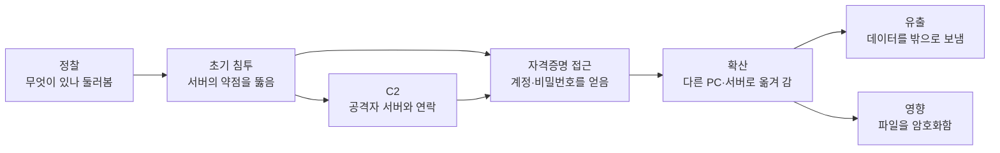

# 탐지 룰 쉬운 설명

작성: 2026-11-18 · 갱신: 2026-11-23(PR #129까지) · 탐지 룰 34개·탐지 유형 48종 · 대상: 관제·운영 담당자, 처음 보는 사람

이 문서는 NSM 센서가 무엇을 보고 어떤 공격을 알려 주는지 쉬운 말로 설명합니다. 탐지마다 어떤 공격인지, 정상과 무엇이 달라서 알아채는지, 알림이 뜨면 무엇을 확인할지, 정상인데 걸리는 경우를 적었습니다. 숫자는 현재 운영 기본값입니다. 정확한 조건·Zeek 이벤트·파라미터는 [SRS.md](SRS.md) 4.3절(룰별 탐지 상세)과 7장(설정)에 있습니다.

---

## 1. 먼저 알아 둘 것

### 1.1 센서가 보는 것

센서는 스위치가 복사해 준 네트워크 트래픽(미러)을 보는 Zeek 프로그램입니다. PC에 설치하는 에이전트가 아니라서, **누가 누구와 어떤 프로토콜로 얼마나 통신했는지**를 봅니다.

- 평문 프로토콜(HTTP, FTP, DNS, Kerberos·NTLM 인증 정보, SMB 파일 이름, Windows 원격 호출 이름)은 내용까지 봅니다.
- 암호화된 통신(HTTPS, SSH, RDP)은 내용을 못 보고, 접속 대상·시각·주기·크기·인증서 같은 겉모습만 봅니다.
- 그래서 탐지는 "이 내용이 악성이다"보다 **"정상 사용자는 이렇게 하지 않는다"** 는 행동 차이로 판단하는 것이 많습니다.

### 1.2 공격 단계

탐지는 공격 단계(킬체인) 7개로 나눕니다. 공격자는 보통 이 순서로 움직이고, 뒤 단계로 갈수록 피해가 커집니다.

| 단계 | 쉬운 뜻 | 탐지 수 |
| --- | --- | --- |
| 정찰 | 어떤 PC·서버·서비스가 있는지 훑어봄 | 3 |
| 초기 침투 | 외부에 열린 웹서버 등의 약점으로 안에 들어옴 | 5 |
| 자격증명 접근 | 계정과 비밀번호(또는 그 해시)를 손에 넣음 | 15 |
| 확산 | 얻은 계정으로 다른 PC·서버에 들어감 | 8 |
| C2 | 감염된 PC가 공격자 서버와 주기적으로 연락하며 명령을 받음 | 9 |
| 유출 | 모은 데이터를 외부로 내보냄 | 6 |
| 영향 | 파일 암호화(랜섬웨어) 같은 실제 피해 | 1 |

### 1.3 탐지 1건이 남기는 것

| 로그 | 쉬운 뜻 | 볼 때 |
| --- | --- | --- |
| `nsm_detection.log` | 탐지 요약. 무엇이(진단명), 누가(공격자), 누구에게(대상), 어느 단계인지 한 줄 | 알림을 받았을 때 처음 봄 |
| `evidence.log` | 근거. 어떤 연결·계정·파일·호출 때문에 탐지했는지 | "왜 걸렸지?"를 확인할 때 |
| `notice.log` | Zeek 원문 메시지(센서에만 남음) | 개발·점검용 |

- **진단명**(`diagnosis`)은 `NSM.<단계>.<탐지>` 모양입니다(예: `NSM.CredentialAccess.DcSync`). 아래 각 절 제목에 탐지 이름과 진단명을 함께 적었습니다.
- **사건 묶기:** 같은 공격자가 같은 대상에 같은 탐지를 15분 안에 다시 일으키면 같은 사건(`incident_id`)으로 묶고 횟수(`occurrence`)만 늘립니다. 알림은 사건당 한 번입니다.
- **상관 탐지:** 같은 공격자의 탐지가 단계 순서대로 이어지면(예: 스캔 → 비콘 → 계정 공격 → 확산) "킬체인 상관" 탐지가 따로 하나 더 나옵니다(`category=Correlated`). 한 공격 흐름을 한 줄로 보여 주므로 우선순위가 높습니다(8장).
- **심각도:** 지금은 단일 탐지가 모두 `Information`(숫자 1), 상관 탐지가 `Suspicious`(숫자 3)입니다. 탐지 종류마다 위험도가 다르므로 1.5절의 위험도와 아래 설명의 "알림이 뜨면"을 참고해 판단합니다.

### 1.4 예외(오탐 처리)

정상인데 반복해서 걸리는 통신은 예외 파일(TSV)에 등록합니다. 센서를 다시 시작하지 않아도 반영됩니다.

| 처리 방식 | 쉬운 뜻 | 언제 |
| --- | --- | --- |
| `drop`(기본) | 아예 탐지하지 않음 | 확실히 정상이고 양이 많은 통신(백업 서버, 취약점 스캐너, 업데이트 서버) |
| `suppress` | 탐지는 기록하되 알림만 끔 | 아직 확신이 없거나 기록을 남겨야 할 때. 문제가 없으면 나중에 `drop`으로 바꿈 |

예외는 출발지, 목적지, 포트, 서비스, 도메인, TLS 지문(JA4) 기준으로 걸 수 있습니다. 예시는 [examples/exceptions.example.tsv](examples/exceptions.example.tsv), 형식은 SRS 7.8절에 있습니다.

프록시를 거친 통신은 센서가 보는 목적지 주소가 프록시라서, 실제 목적지 이름(도메인)과 포트로 예외를 판정합니다. 프록시를 쓰는 회사에서는 목적지 주소로 건 예외를 도메인으로도 걸어야 합니다. 흔한 OS·SaaS 주기 통신을 미리 모아 둔 기본 예외 목록 [examples/exceptions.proxy-beacon.tsv](examples/exceptions.proxy-beacon.tsv)도 있습니다(7.1절의 프록시 경유 비콘 탐지를 켤 때 사용).

### 1.5 위험도 평가

각 탐지 설명 끝의 **위험도**는 알림을 얼마나 먼저, 얼마나 세게 대응할지 정하는 기준입니다. 두 가지를 함께 봅니다.

- **영향:** 그 공격이 성공했을 때의 피해와 공격 단계. 뒤 단계(도메인 장악·유출·암호화)일수록 큽니다.
- **확신도:** 정상 통신이 같은 모양으로 걸릴 가능성. 오탐이 드물수록 높습니다.

| 위험도 | 뜻 | 대응 | 탐지 |
| --- | --- | --- | --- |
| 매우 높음(Critical) | 이미 장악됐거나 도메인 전체·업무가 위험하고, 오탐이 드묾 | 즉시: 출발지 분리·계정 잠금·차단 | 웹쉘, DCSync, 원격 레지스트리 하이브 저장, Zerologon, 랜섬웨어성 SMB |
| 높음(High) | 계정 탈취·감염·유출이 일어났거나 직전. 오탐이 적거나 확인하면 구분됨 | 당일 확인 | 초기 침투 대부분, Kerberoasting 등 AD 계정 공격, 원격 실행, C2, 유출 |
| 중간(Medium) | 공격이면 위험하지만 정상 업무와 모양이 겹침 | 업무 관련성 확인 후 판단. 예외를 등록한 뒤에도 남는 것은 높게 봄 | 비밀번호 대입, 확산(관리 공유·RDP·SSH·WinRM·DCOM), 일부 C2·유출 |
| 낮음(Low) | 정찰. 그 자체로는 피해 없음 | 다른 탐지와 이어질 때 봄 | 포트·호스트 스캔 |

- **센서 등급과 다릅니다.** 센서 로그의 `severity`는 단독 `Information`, 상관 `Suspicious` 두 단계뿐입니다. 이 위험도는 Manager의 룰 정책 기본값(화면 목업 관리 › NSM 룰 정책의 위험도 칸과 같음)이고, 고객 환경에 맞게 바꿀 수 있습니다.
- **올려 볼 때:** 출발지가 내부 PC(외부에서 오는 시도보다 이미 들어온 공격일 가능성), 대상이 DC·서버, 상관 탐지에 들어 있음, 같은 PC에 다른 단계 탐지가 있음.
- **실제 사례:** 공개된 사고 분석·보안 업체·기관 보고에서 확인된 것만 적었습니다. 같은 사례는 MITRE ATT&CK 기법 페이지(각 절의 기법 번호)에도 정리돼 있습니다. 사례는 공격을 이해하기 위한 것이고, 탐지가 났을 때 공격 주체를 판단하는 근거가 아닙니다.
---

## 2. 한눈에 보기

| 단계 | 탐지 | 이럴 때 알림 | 위험도 |
| --- | --- | --- | --- |
| 정찰 | 포트 스캔 | 한 PC가 한 서버의 포트 25개 이상을 5분 안에 두드림 | 낮음 |
| 정찰 | 호스트 스캔 | 한 PC가 같은 포트로 25대 이상을 5분 안에 두드림 | 낮음 |
| 정찰 | AD 정보 수집 | 한 PC가 10대 이상에 "누가 로그온했나·관리자가 누구냐"를 5분 안에 물어봄 | 중간 |
| 초기 침투 | SQL Injection | 내부 웹서버로 SQL 공격 문장이 들어옴 | 높음 |
| 초기 침투 | 웹쉘 접근 | 웹서버에 심어 둔 명령 실행 파일을 부름 | 매우 높음 |
| 초기 침투 | XSS | 내부 웹서버로 스크립트 삽입 공격이 들어옴 | 중간 |
| 초기 침투 | Heartbleed | 오래된 OpenSSL의 메모리를 빼내는 요청 | 높음 |
| 초기 침투 | AI 인프라 관리 API 공격 | 사내 AI 서버의 관리·실행 기능을 원격으로 호출 | 높음 |
| 자격증명 | NTLM 스프레이 | 한 PC에서 10개 넘는 계정이 10분 안에 로그인 실패 | 중간 |
| 자격증명 | Kerberos 스프레이 | 한 PC에서 10개 넘는 계정이 10분 안에 도메인 로그인 실패 | 중간 |
| 자격증명 | Kerberos 무차별 대입 | 한 계정이 10분 안에 비밀번호를 20번 넘게 틀림 | 중간 |
| 자격증명 | SSH 무차별 대입 | 같은 서버로 5분 안에 로그인 못 한 SSH 접속 20번 이상 | 중간 |
| 자격증명 | FTP 무차별 대입 | 같은 서버로 5분 안에 FTP 로그인 실패 10번 이상 | 중간 |
| 자격증명 | 웹 로그인 무차별 대입 | 같은 로그인 페이지에 5분 안에 서로 다른 비밀번호 20가지 이상 | 중간 |
| 자격증명 | Kerberoasting | 한 PC가 10분 안에 약한 암호의 서비스 티켓을 5종류 이상 받음 | 높음 |
| 자격증명 | AS-REP Roasting | 사전 인증 없는 계정의 로그인 응답을 약한 암호로 받음 | 높음 |
| 자격증명 | 외부 NTLM 인증 | 내부 PC가 외부 서버에 Windows 로그인 정보를 보냄 | 중간 |
| 자격증명 | 이름 응답 위조 | 한 PC가 10분 안에 남의 이름 5개 이상에 "그게 나다"라고 대답 | 높음 |
| 자격증명 | 남의 머신 계정 사용 | 한 PC가 10분 안에 서로 다른 PC 계정 2개 이상으로 로그인 | 높음 |
| 자격증명 | DCSync | DC가 아닌 PC가 DC에 계정 비밀번호 복제를 요청 | 매우 높음 |
| 자격증명 | 강제 인증 | 서버가 공격자에게 로그인하도록 만드는 원격 호출 | 높음 |
| 자격증명 | 원격 레지스트리 하이브 저장 | 원격으로 레지스트리 계정 데이터베이스를 파일로 저장 | 매우 높음 |
| 자격증명 | Zerologon | DC에 1분 안에 보안 채널 인증을 20번 넘게 시도 | 매우 높음 |
| 확산 | SMB 관리 공유 | 한 PC가 1분 안에 2대 이상의 관리 공유(`ADMIN$`, `C$`)에 접근 | 중간 |
| 확산 | RDP 확산 | 한 PC가 1분 안에 3대 이상에 원격 데스크톱 접속 | 중간 |
| 확산 | SSH 확산 | 한 PC가 1분 안에 3대 이상에 SSH 로그인 | 중간 |
| 확산 | WinRM 확산 | 한 PC가 5분 안에 3대 이상에 PowerShell 원격 접속 | 중간 |
| 확산 | DCOM 확산 | 한 PC가 5분 안에 3대 이상에 원격 COM 객체 생성 | 중간 |
| 확산 | 원격 서비스 생성·예약 작업·WMI 실행 | 다른 PC에 원격으로 서비스·예약 작업을 만들거나 프로그램을 실행(1대여도) | 높음 |
| C2 | HTTP 비콘 | 같은 외부 서버에 일정한 간격으로 12번 연속 HTTP 접속 | 높음 |
| C2 | TLS 비콘 | 같은 외부 서버에 일정한 간격·같은 크기로 30분 넘게 HTTPS 접속 | 높음 |
| C2 | DNS 터널링 | 한 도메인 아래 무작위 이름을 5분 안에 50개 넘게 조회 | 높음 |
| C2 | 암호화 C2 | 자체 서명 인증서, 이름 없는 접속, 악성 지문 같은 수상한 HTTPS가 겹침 | 높음 |
| C2 | DGA 도메인 | 존재하지 않는 무작위 도메인을 10분 안에 50개 넘게 조회 | 높음 |
| C2 | 비표준 포트 | 웹·SSH 같은 통신을 외부의 엉뚱한 포트로 함 | 중간 |
| C2 | 장기 외부 연결 | 외부와 연결 하나가 6시간 넘게 이어짐 | 중간 |
| C2 | 식별 안 된 프로토콜 | 무슨 프로토콜인지 알 수 없는 통신으로 외부에 많이·오래 보냄 | 높음 |
| C2 | 서버의 AI API 접속 | 서버가 ChatGPT 같은 AI 서비스 API에 접속 | 중간 |
| C2 | IOC 일치 | 위협 정보에 있는 악성 IP·도메인·URL과 통신 | 높음 |
| 유출 | DNS 유출 | DNS 질의 이름에 실어 5분 안에 256KB 넘게 내보냄 | 높음 |
| 유출 | 단일 연결 대용량 | 외부로 연결 하나에 50MB 넘게 올림 | 높음 |
| 유출 | 클라우드 업로드 | 한 PC가 클라우드 저장소 서비스 하나에 1시간 안에 합계 50MB 넘게 올림 | 높음 |
| 유출 | 호스트 볼륨 | 한 PC가 1분 안에 외부로 합계 50MB 넘게 올림 | 높음 |
| 유출 | 외부향 SMB | 내부 PC가 외부의 Windows 파일 공유 포트에 연결됨 | 중간 |
| 유출 | AI 서비스 대량 업로드 | 한 PC가 AI 서비스 하나에 1시간 안에 10MB 넘게 올림 | 중간 |
| 영향 | 랜섬웨어성 SMB | 파일 서버에서 1분 안에 확장자를 30개 넘게 바꾸거나 협박 안내 파일을 5개 폴더 넘게 만듦 | 매우 높음 |

---

## 3. 정찰

공격자가 내부망에 무엇이 있는지 둘러보는 단계입니다. 정찰만으로 피해는 없지만, **내부 PC가 스캔을 한다면 그 PC가 이미 감염됐을 가능성**이 있어 뒤 단계 탐지와 함께 봅니다.

### 포트 스캔 · `Port_Scan` (`NSM.Recon.PortScan`)

- **어떤 공격:** 서버 한 대의 문(포트)을 하나씩 두드려 어떤 서비스가 열려 있는지 찾습니다. nmap 같은 도구가 대표적입니다.
- **실제 사례:** 랜섬웨어 조직은 침투한 PC에서 Advanced IP Scanner·nmap 같은 도구로 내부를 훑어 파일 서버·DC를 찾습니다. 공개된 랜섬웨어 사고 분석 보고서에 거의 빠지지 않는 단계입니다.
- **어떻게 알아채나:** 정상 사용자는 서버의 몇 개 포트만 씁니다. 한 내부 PC가 한 서버에 **5분 안에 응답 없거나 거절된 포트 25개 이상**을 두드리면 알립니다. 일반 SYN 스캔뿐 아니라 FIN·NULL·Xmas 같은 변형 스캔과 UDP 스캔도 셉니다.
- **알림이 뜨면:** 출발지 PC가 보안 점검 장비인지 확인합니다. 아니라면 그 PC의 다른 탐지(비콘, 계정 공격)를 함께 봅니다.
- **정상인데 걸리는 경우:** 취약점 스캐너, 자산 관리 도구, 네트워크 모니터링 서버. 출발지 예외로 등록합니다.
- **위험도:** **낮음(Low)** — 영향: 스캔 자체로는 피해가 없습니다. 확신도: 점검 장비·자산 관리 도구도 같은 모양이라 오탐이 있습니다. 내부 PC가 출발지이거나 뒤 단계 탐지와 이어지면 높여 봅니다.

### 호스트 스캔 · `Host_Scan` (`NSM.Recon.HostScan`)

- **어떤 공격:** 같은 포트(예: 445 파일 공유)를 여러 대에 두드려 살아 있는 서버를 찾습니다. 웜형 악성코드가 퍼질 대상을 찾을 때도 이렇게 합니다.
- **실제 사례:** WannaCry(2017)는 감염된 PC가 내부·외부 주소의 445 포트를 차례로 두드려 다음 감염 대상을 찾았습니다. 관리 포트(445·3389)를 여러 대에 두드리는 것은 확산 준비의 전형입니다.
- **어떻게 알아채나:** 한 PC가 **같은 포트로 5분 안에 25대 이상**에 접속을 시도하면 알립니다. 웹(80·443)·DNS(53)와 Windows 업데이트 공유(7680)는 정상적으로 여러 대에 가므로 뺍니다.
- **알림이 뜨면:** 어떤 포트인지 봅니다. 445·3389·22 같은 관리 포트면 확산 준비일 수 있습니다.
- **정상인데 걸리는 경우:** 모니터링 서버, 백신 관리 서버, 배포 도구. 출발지 예외로 등록합니다.
- **위험도:** **낮음(Low)** — 영향: 그 자체는 정찰입니다. 확신도: 모니터링 서버·스캐너가 같은 모양입니다. 445·3389처럼 관리 포트이거나 내부 PC가 출발지면 중간으로 봅니다.

### AD 정보 수집 · `AD_Enumeration` (`NSM.Recon.AdEnumeration`)

- **어떤 공격:** BloodHound 같은 도구가 도메인 PC를 하나씩 돌며 "누가 어디에 로그온했나", "로컬 관리자가 누구냐"를 수집해 관리자 계정을 훔칠 경로를 찾습니다.
- **실제 사례:** BloodHound(SharpHound)·AdFind로 "누가 어디에 로그온했는지, 관리자가 누구인지"를 모아 도메인 관리자까지 가는 경로를 찾습니다. Ryuk·Conti 등 랜섬웨어 사고 보고서에 반복해서 나오는 도구입니다.
- **어떻게 알아채나:** 한 PC가 **5분 안에 10대 이상**에 로그온 세션·로컬 관리자 그룹을 물어보면 알립니다. DC 한 대에 계정을 조회하는 일상적인 관리 명령은 보지 않습니다.
- **알림이 뜨면:** 출발지 PC의 사용자와 실행 중인 도구를 확인합니다. 곧 확산·관리자 계정 공격이 이어질 수 있습니다.
- **정상인데 걸리는 경우:** 자산 관리·보안 점검 도구. 첫 주에 출발지 예외로 등록합니다.
- **위험도:** **중간(Medium)** — 영향: 도메인 장악 경로를 찾는 단계라 뒤 단계가 빠르게 이어집니다. 확신도: 자산 관리·보안 점검 도구도 같은 호출을 해 첫 주에 예외가 필요합니다.

---

## 4. 초기 침투

외부(또는 내부)에서 **내부 웹서버 같은 서버의 약점**을 뚫는 단계입니다. 내부 서버로 들어오는 요청만 봅니다. HTTPS로 운영하는 웹서버는 내용이 암호화돼 있어 보이지 않습니다.

### SQL Injection · `SQL_Injection` (`NSM.WebAttack.SqlInjection`)

- **어떤 공격:** 웹 입력값에 데이터베이스 명령을 끼워 넣어 데이터를 빼내거나 바꿉니다.
- **실제 사례:** MOVEit Transfer 취약점(CVE-2023-34362, 2023)을 Cl0p 조직이 SQL Injection으로 악용해 수많은 기관의 파일을 빼냈습니다. 고객 정보 유출 사고의 오래된 단골 원인입니다.
- **어떻게 알아채나:** 검색어에도 `select` 같은 단어는 나오므로 단어 하나로는 판단하지 않습니다. `UNION SELECT`, `' or 1=1`, `sleep(5)`처럼 **SQL 문장 구조**가 보일 때만 알립니다. 인코딩으로 숨긴 것도 풀어서 봅니다.
- **알림이 뜨면:** 대상 웹서버의 응답 코드와 이후 같은 출발지의 요청을 봅니다. 웹 방화벽이 막았는지 확인합니다.
- **정상인데 걸리는 경우:** 모의해킹·취약점 스캐너. 출발지 예외로 등록합니다.
- **위험도:** **높음(High)** — 영향: 성공하면 DB 정보 유출·웹서버 장악으로 이어집니다. 확신도: 공격 문장 자체를 보고 판단해 오탐이 적지만, 시도만으로는 성공 여부를 모릅니다.

### 웹쉘 접근 · `Webshell_Access` (`NSM.WebAttack.Webshell`)

- **어떤 공격:** 공격자가 웹서버에 몰래 올린 스크립트(웹쉘)로 서버 명령을 실행합니다.
- **실제 사례:** Exchange 서버 취약점(ProxyLogon, 2021) 공격에서 Hafnium 등 여러 조직이 China Chopper 같은 웹쉘을 심고 원격 명령을 실행했습니다.
- **어떻게 알아채나:** `cmd=` 같은 이름만으로는 판단하지 않고, **웹쉘 파일 이름**, `cmd=whoami`처럼 **실제 명령이 담긴 값**, 웹쉘 도구 특유의 요청 본문이 보일 때 알립니다.
- **알림이 뜨면:** 이미 침투가 끝난 상태일 수 있어 우선순위가 높습니다. 서버에서 해당 파일을 찾고, 그 서버가 출발지인 다른 탐지를 봅니다.
- **정상인데 걸리는 경우:** 드뭅니다. 관리 페이지가 비슷한 이름을 쓰면 확인 후 예외로 둡니다.
- **위험도:** **매우 높음(Critical)** — 영향: 웹쉘이 호출된다는 것은 서버가 이미 장악됐다는 뜻입니다. 확신도: 정상 웹 요청과 모양이 달라 오탐이 드뭅니다.

### 크로스 사이트 스크립팅(XSS) · `Cross_Site_Scripting` (`NSM.WebAttack.Xss`)

- **어떤 공격:** 웹 입력값에 스크립트를 넣어 다른 사용자의 브라우저에서 실행되게 합니다(쿠키 탈취 등).
- **실제 사례:** Samy 웜(2005)은 MySpace의 저장형 XSS로 하루 만에 100만 명 넘는 프로필에 퍼졌습니다. 관리자 페이지에 스크립트를 심어 로그인 세션을 훔치는 데 씁니다.
- **어떻게 알아채나:** `<b>` 같은 태그나 `alert(` 같은 단어만으로는 판단하지 않고, `<script>`, `onerror=` 같은 **스크립트가 실제로 실행되는 구조**가 보일 때 알립니다.
- **알림이 뜨면:** 게시판처럼 저장되는 곳(POST)이면 다른 사용자가 피해를 볼 수 있어 해당 글을 확인합니다.
- **정상인데 걸리는 경우:** 웹 편집기가 HTML을 그대로 보내는 경우, 보안 점검. 확인 후 예외로 둡니다.
- **위험도:** **중간(Medium)** — 영향: 서버가 아니라 사용자 세션을 노립니다. 관리자 세션이 털리면 커집니다. 확신도: 공격 문장을 보고 판단하지만 시도와 성공을 구분하지 못합니다.

### Heartbleed · `TLS_Heartbleed` (`NSM.WebAttack.Heartbleed`)

- **어떤 공격:** 2014년에 알려진 OpenSSL 결함(CVE-2014-0160)으로, 서버 메모리(개인 키, 세션, 비밀번호)를 16KB씩 빼냅니다.
- **실제 사례:** Heartbleed(CVE-2014-0160) 공개 직후 미국 병원 그룹 Community Health Systems의 환자 정보 450만 건 유출이 이 취약점을 통한 침투로 보도됐습니다. 서버 메모리의 인증서 개인키·세션·비밀번호가 노출될 수 있습니다.
- **어떻게 알아채나:** 정상 하트비트는 보낸 만큼 돌려받습니다. **작은 요청에 큰 응답**이 오면 성공, 이상한 요청에 응답이 없으면 시도로 알립니다. 암호화된 하트비트도 크기로 판단하며, 첫 유출 순간에 바로 알립니다.
- **알림이 뜨면:** "성공"이면 대상 서버의 OpenSSL을 바로 패치하고 인증서·비밀번호를 바꿔야 합니다.
- **정상인데 걸리는 경우:** 거의 없습니다.
- **위험도:** **높음(High)** — 영향: 개인키·계정 노출. 확신도: 요청 모양이 뚜렷해 오탐이 드뭅니다. 응답이 오지 않은 시도(패치된 서버)는 영향이 없습니다.

### 사내 AI 인프라 관리 API 공격 · `AI_Service_Exploit` (`NSM.WebAttack.AiServiceExploit`)

- **어떤 공격:** Ray, Ollama, TorchServe, Jupyter, MLflow 같은 사내 AI 서버는 관리 기능에 인증이 없는 경우가 많습니다. 공격자는 이를 호출해 서버에서 코드를 실행합니다(예: ShadowRay).
- **실제 사례:** ShadowRay(2024): 인증 없이 열린 Ray(AI 학습 클러스터) 관리 API(CVE-2023-48022)로 작업을 실행해 서버를 장악하고 코인 채굴·자격증명 탈취를 한 공격이 보고됐습니다.
- **어떻게 알아채나:** Ray 작업 제출, Ollama 모델 받기·삭제, TorchServe 모델 등록, Jupyter 터미널 생성, MLflow 경로 조작 같은 **관리·실행 요청 1건**이면 알립니다. 추론·조회 요청은 보지 않습니다.
- **알림이 뜨면:** 요청한 사람이 ML 팀인지 확인합니다. 아니면 그 AI 서버가 출발지인 다른 탐지를 봅니다.
- **정상인데 걸리는 경우:** ML 팀의 작업·배포 도구. 출발지 예외로 등록합니다.
- **위험도:** **높음(High)** — 영향: GPU 서버 장악, 모델·데이터 탈취. 확신도: 관리·실행 API를 외부·비관리 PC가 부르는 것 자체가 이상이라 오탐이 적습니다.

---

## 5. 자격증명 접근

계정과 비밀번호(또는 비밀번호 해시)를 얻으려는 단계입니다. 탐지 수가 가장 많고, **DCSync·Zerologon처럼 성공하면 도메인 전체가 넘어가는 탐지**가 있어 우선순위를 높게 봅니다. 비밀번호 값은 어떤 로그에도 남기지 않습니다.

### NTLM 패스워드 스프레이 · `NTLM_Spray` (`NSM.CredentialAccess.NtlmSpray`)

- **어떤 공격:** 계정 잠금을 피하려고 흔한 비밀번호 몇 개를 많은 계정에 하나씩 대 봅니다.
- **실제 사례:** 패스워드 스프레이는 국가 배후 조직도 즐겨 씁니다. Microsoft는 2024년 Midnight Blizzard(APT29)가 패스워드 스프레이로 테스트 계정을 뚫고 사내 메일에 접근했다고 공개했습니다. 내부에서는 흔한 비밀번호 몇 개를 전 계정에 대입합니다.
- **어떻게 알아채나:** 한 PC에서 **10분 안에 로그인에 실패한 서로 다른 계정이 10개 이상**이면 알립니다. 성공은 세지 않으므로 많은 사람이 로그인하는 터미널 서버는 걸리지 않습니다.
- **알림이 뜨면:** 근거에서 실패한 계정 목록을 보고, 그중 이후에 성공한 계정이 있는지 확인합니다.
- **정상인데 걸리는 경우:** 잘못 설정된 서비스가 여러 계정으로 반복 로그인하는 경우.
- **위험도:** **중간(Medium)** — 영향: 약한 비밀번호 계정 하나만 맞아도 다음 단계로 갑니다. 확신도: 계정 동기화 장애·잘못된 서비스 설정도 비슷한 실패를 만들어 확인이 필요합니다.

### Kerberos 패스워드 스프레이 · `Kerberos_Spray` (`NSM.CredentialAccess.KerberosSpray`)

- **어떤 공격:** NTLM 스프레이와 같지만 도메인 로그인(Kerberos)으로 합니다.
- **실제 사례:** kerbrute 같은 도구로 NTLM 대신 도메인(Kerberos) 로그인에 같은 스프레이를 합니다. 실패 로그가 덜 남는다고 알려져 침투 후 계정 확보에 쓰입니다.
- **어떻게 알아채나:** 한 PC에서 **10분 안에 도메인 로그인에 실패한 계정이 10개 이상**이면 알립니다. 정상 로그온의 첫 단계 응답은 실패로 세지 않습니다.
- **알림이 뜨면:** NTLM 스프레이와 같습니다.
- **정상인데 걸리는 경우:** 드뭅니다.
- **위험도:** **중간(Medium)** — 영향·확신도: NTLM 스프레이와 같습니다.

### Kerberos 무차별 대입 · `Kerberos_Bruteforce` (`NSM.CredentialAccess.KerberosBruteforce`)

- **어떤 공격:** 계정 하나에 비밀번호를 계속 바꿔 넣습니다.
- **실제 사례:** 관리자처럼 알려진 계정 하나에 비밀번호 사전을 대입합니다(kerbrute, Rubeus).
- **어떻게 알아채나:** 한 PC가 **같은 계정으로 10분 안에 비밀번호를 20번 넘게 틀리면** 알립니다.
- **알림이 뜨면:** 해당 계정이 잠겼는지, 그 뒤 성공했는지 확인합니다.
- **정상인데 걸리는 경우:** 비밀번호를 바꾼 뒤 옛 비밀번호로 계속 접속하는 PC·스마트폰.
- **위험도:** **중간(Medium)** — 영향: 그 계정이 관리자면 큽니다. 확신도: 비밀번호를 바꾼 뒤 옛 비밀번호를 쓰는 프로그램도 반복 실패를 만듭니다.

### SSH 무차별 대입 · `SSH_Bruteforce` (`NSM.CredentialAccess.SshBruteforce`)

- **어떤 공격:** Hydra 같은 도구로 SSH 비밀번호를 계속 바꿔 접속을 시도합니다.
- **실제 사례:** AhnLab ASEC은 관리가 부실한 리눅스 SSH 서버에 계정을 대입해 ShellBot·코인 채굴기를 설치하는 공격을 꾸준히 보고하고 있습니다(2023 등). 인터넷에 노출된 SSH는 봇넷의 상시 표적입니다.
- **어떻게 알아채나:** SSH는 암호화라 비밀번호는 안 보이지만, 정상 사용자는 한 번 로그인하면 세션을 이어 갑니다. **같은 서버로 5분 안에 로그인에 성공하지 못한 짧은 접속이 20번 이상**이면 알립니다.
- **알림이 뜨면:** 대상 서버의 인증 로그에서 성공한 로그인이 있는지 확인합니다.
- **정상인데 걸리는 경우:** 짧은 접속을 반복하는 모니터링 스크립트. 출발지·대상 예외로 둡니다.
- **위험도:** **중간(Medium)** — 영향: 성공하면 서버 장악. 확신도: 외부에서 오는 대입은 매우 흔해(배경 소음) 성공한 로그인과 함께 봐야 합니다. 내부 PC가 출발지면 더 심각합니다.

### FTP 무차별 대입 · `FTP_Bruteforce` (`NSM.CredentialAccess.FtpBruteforce`)

- **어떤 공격:** FTP 로그인에 비밀번호를 계속 바꿔 넣습니다.
- **실제 사례:** 노출된 FTP 서버에 계정을 대입해 웹 페이지를 변조하거나 악성 파일을 올리는 공격이 오래전부터 이어지고 있습니다.
- **어떻게 알아채나:** FTP는 평문이라 실패 응답이 보입니다. **같은 서버로 5분 안에 로그인 실패가 10번 이상**이면 알립니다. 근거에 시도한 계정 이름이 남습니다.
- **알림이 뜨면:** 시도한 계정과 성공 여부를 봅니다.
- **정상인데 걸리는 경우:** 비밀번호가 바뀐 자동 업로드 작업.
- **위험도:** **중간(Medium)** — 영향: 파일 변조·유출. 확신도: SSH 대입과 같습니다.

### 웹 로그인 무차별 대입 · `HTTP_Bruteforce` (`NSM.CredentialAccess.HttpBruteforce`)

- **어떤 공격:** 내부 웹서버의 로그인 페이지에 비밀번호를 바꿔 가며 계속 보냅니다.
- **실제 사례:** 다른 곳에서 유출된 계정 목록을 로그인 페이지에 대입하는 크리덴셜 스터핑, VPN·웹메일 로그인 대입이 대표적입니다.
- **어떻게 알아채나:** 요청 횟수가 아니라 **같은 로그인 경로에 5분 안에 서로 다른 비밀번호가 20가지 이상**이면 알립니다. 같은 비밀번호를 반복하는 자동 점검은 걸리지 않습니다. Basic 인증은 401 실패 20번으로 봅니다.
- **알림이 뜨면:** 근거의 계정 이름과 로그인 경로를 보고, 같은 계정이 이후 성공했는지 웹 로그를 확인합니다.
- **정상인데 걸리는 경우:** 드뭅니다. HTTPS 로그인 페이지는 보이지 않습니다.
- **위험도:** **중간(Medium)** — 영향: 맞은 계정으로 내부 시스템 접근. 확신도: 비밀번호를 여러 번 틀리는 정상 사용자와 구분하려고 서로 다른 비밀번호 수로 셉니다.

### Kerberoasting · `Kerberoasting` (`NSM.CredentialAccess.Kerberoasting`)

- **어떤 공격:** 서비스 계정의 티켓을 약한 암호(RC4)로 받아 가져간 뒤, 그 서비스 계정 비밀번호를 오프라인으로 풉니다. 서비스 계정은 권한이 큰 경우가 많습니다.
- **실제 사례:** Ryuk 랜섬웨어 조직(Wizard Spider) 등 여러 사고 보고서에서 Rubeus·Impacket으로 서비스 계정 티켓을 받아 비밀번호를 푼 뒤 관리자 권한을 얻었습니다.
- **어떻게 알아채나:** 요즘 정상 티켓은 대부분 강한 암호(AES)입니다. 한 PC가 **10분 안에 약한 암호 티켓을 서비스 5종류 이상** 받으면 알립니다.
- **알림이 뜨면:** 대상 서비스 계정의 비밀번호를 길고 복잡하게 바꾸고, 그 계정의 이후 사용을 확인합니다.
- **정상인데 걸리는 경우:** RC4만 지원하는 오래된 시스템. 확인 후 예외로 둡니다.
- **위험도:** **높음(High)** — 영향: 서비스 계정은 권한이 커서 도메인 장악으로 이어지기 쉽습니다. 확신도: RC4만 쓰는 오래된 시스템 외에는 오탐이 적습니다.

### AS-REP Roasting · `ASREP_Roasting` (`NSM.CredentialAccess.AsrepRoasting`)

- **어떤 공격:** "사전 인증 필요 없음"으로 잘못 설정된 계정은 비밀번호 없이도 로그인 응답을 받을 수 있고, 그 응답으로 비밀번호를 오프라인으로 풉니다.
- **실제 사례:** Rubeus·Impacket(GetNPUsers)으로 "사전 인증 필요 없음" 계정을 찾아 비밀번호를 오프라인으로 풉니다. 모의해킹에서 자주 쓰는 AD 공격입니다.
- **어떻게 알아채나:** 정상 Windows 로그온에서는 이런 응답이 나오지 않습니다. **사전 인증 없이 약한 암호의 로그인 응답**이 오면 계정마다 1건 알립니다.
- **알림이 뜨면:** 해당 계정의 "사전 인증 필요 없음" 설정을 끄고 비밀번호를 바꿉니다.
- **정상인데 걸리는 경우:** 드뭅니다.
- **위험도:** **높음(High)** — 영향: 비밀번호 없이 계정 탈취. 확신도: 정상 로그온에서 나오지 않는 응답이라 오탐이 드뭅니다.

### 외부 NTLM 인증 · `NTLM_Credential_Leak` (`NSM.CredentialAccess.NtlmCredentialLeak`)

- **어떤 공격:** 피싱 메일이나 문서 속 링크로 PC가 공격자 서버에 Windows 로그인 정보(NTLM 해시)를 보내게 만듭니다. 이 해시로 비밀번호를 풀거나 다른 서버에 대신 로그인합니다.
- **실제 사례:** Outlook 취약점(CVE-2023-23397)은 메일을 받기만 해도 PC가 외부 SMB 서버에 NTLM 해시를 보내게 했고, APT28이 실제 공격에 썼습니다. 문서 속 원격 이미지 링크로도 같은 일이 생깁니다.
- **어떻게 알아채나:** 업무상 외부 서버에 Windows 로그인을 보낼 일은 드뭅니다. **내부 PC가 외부 서버에 NTLM 인증을 보내면** 1건 알립니다.
- **알림이 뜨면:** 그 PC 사용자가 직전에 연 메일·문서를 확인하고, 해당 계정 비밀번호 변경을 검토합니다.
- **정상인데 걸리는 경우:** 외부 협력사 파일 서버를 정상적으로 쓰는 경우. 목적지 예외로 둡니다.
- **위험도:** **중간(Medium)** — 영향: 해시로 비밀번호를 풀거나 다른 서버에 대신 로그인. 확신도: 협력사 파일 서버처럼 정상 사용이 있어 목적지를 확인해야 합니다.

### 이름 응답 위조 · `Name_Poisoning` (`NSM.CredentialAccess.NamePoisoning`)

- **어떤 공격:** Windows는 DNS로 못 찾은 이름을 같은 네트워크에 "이 이름 누구야?"라고 묻습니다(LLMNR·NetBIOS). Responder 같은 도구는 **어떤 이름이든 자기라고 대답**해 로그인 정보를 가로챕니다.
- **실제 사례:** Responder·Inveigh로 LLMNR·NBT-NS 질의에 대신 응답해 계정 해시를 모읍니다. 내부망 모의해킹에서 가장 먼저 쓰는 기법 중 하나이고 실제 침투에서도 같습니다.
- **어떻게 알아채나:** 정상 PC는 자기 이름에만 답합니다. 한 PC가 **10분 안에 서로 다른 이름 5개 이상**에 대답하면 알립니다.
- **알림이 뜨면:** 그 PC를 바로 확인합니다. 같은 네트워크 사용자의 로그인 정보가 새어 나갔을 수 있습니다.
- **정상인데 걸리는 경우:** WINS 서버, 일부 네트워크 장비. 예외로 둡니다.
- **위험도:** **높음(High)** — 영향: 여러 사용자의 해시를 한꺼번에 모읍니다. 확신도: 정상 장비가 남의 이름 여러 개에 응답할 일은 거의 없습니다.

### 남의 머신 계정 사용 · `Machine_Account_Misuse` (`NSM.CredentialAccess.MachineAccountMisuse`)

- **어떤 공격:** 각 PC에는 그 PC 자신만 쓰는 계정(`PC01$` 같은 머신 계정)이 있습니다. NTLM 릴레이 공격은 다른 PC의 로그인을 가로채 대신 쓰므로, 공격 PC 한 대가 여러 PC 계정으로 로그인하는 모습이 됩니다.
- **실제 사례:** PetitPotam(2021)으로 DC가 공격자에게 인증하게 만든 뒤 그 인증을 인증서 서버(AD CS)로 중계해 DC 머신 계정 권한을 얻는 공격이 공개됐습니다. 한 PC에서 남의 PC 계정이 보이는 것이 NTLM 중계의 흔적입니다.
- **어떻게 알아채나:** 한 PC가 **10분 안에 서로 다른 머신 계정 2개 이상**으로 로그인하면 알립니다.
- **알림이 뜨면:** 출발지 PC와 근거에 나온 머신 계정들을 확인합니다. 강제 인증·이름 응답 위조 탐지가 앞에 있었는지 봅니다.
- **정상인데 걸리는 경우:** NAT 뒤에 여러 PC가 있는 구간, 장애 조치 클러스터. 출발지 예외로 둡니다.
- **위험도:** **높음(High)** — 영향: 중계 대상에 따라 도메인 장악까지 갑니다. 확신도: 터미널 서버·프록시처럼 여러 PC 인증을 대신 전달하는 장비는 예외가 필요합니다.

### DCSync · `DCSync` (`NSM.CredentialAccess.DcSync`)

- **어떤 공격:** 공격자가 DC(도메인 컨트롤러)인 척하며 DC에 "계정 정보를 복제해 달라"고 요청해 모든 계정의 비밀번호 해시를 가져갑니다(mimikatz). 성공하면 도메인 전체가 넘어갑니다.
- **실제 사례:** Mimikatz(`lsadump::dcsync`)·Impacket(secretsdump)으로 DC처럼 복제를 요청해 krbtgt를 포함한 모든 계정 해시를 가져갑니다. 도메인 장악 사고에서 반복해서 확인되는 단계입니다.
- **어떻게 알아채나:** 이 요청은 원래 DC끼리만 합니다. **DC가 아닌 PC가 복제를 요청하면** 1건으로 알립니다. 신뢰도가 높은 탐지입니다.
- **알림이 뜨면:** **최우선으로 대응합니다.** 출발지 PC를 격리하고, 사용된 계정과 관리자 계정·krbtgt 비밀번호 재설정을 검토합니다.
- **정상인데 걸리는 경우:** DC 목록에 없는 새 DC, Azure AD Connect 서버. DC 목록 설정과 예외로 둡니다.
- **위험도:** **매우 높음(Critical)** — 영향: 모든 계정 비밀번호 해시 유출 = 도메인 전체 장악. 확신도: DC가 아닌 장비의 복제 요청은 정상에서 거의 없습니다.

### 강제 인증 · `Coerced_Authentication` (`NSM.CredentialAccess.CoercedAuth`)

- **어떤 공격:** PetitPotam 같은 도구가 서버(주로 DC)에 원격 호출을 보내, 서버가 공격자에게 로그인하도록 만듭니다. 공격자는 이 로그인을 다른 서버에 넘겨(릴레이) 권한을 얻습니다.
- **실제 사례:** PetitPotam(CVE-2021-36942, 2021), PrinterBug(SpoolSample) 등으로 DC·서버가 공격자에게 로그인하게 만들어 NTLM 중계 공격의 재료로 씁니다.
- **어떻게 알아채나:** 이런 호출을 PC가 서버로 보내는 일은 드뭅니다. **내부 서버로 가는 강제 인증 호출 1건**이면 알립니다. 다만 프린터 알림 등록 호출은 프린트 서버에서는 정상이라, 이 호출만은 대상이 DC일 때만 봅니다.
- **알림이 뜨면:** 뒤이어 남의 머신 계정 사용이나 인증서 서버 접속이 있는지 봅니다.
- **정상인데 걸리는 경우:** 드뭅니다.
- **위험도:** **높음(High)** — 영향: 중계와 이어지면 서버·도메인 권한 탈취. 확신도: 해당 원격 호출을 정상 업무로 쓰는 경우가 드뭅니다.

### 원격 레지스트리 하이브 저장 · `Remote_Registry_Dump` (`NSM.CredentialAccess.RemoteRegistryDump`)

- **어떤 공격:** 원격으로 레지스트리의 계정 데이터베이스(SAM·SECURITY)를 파일로 저장한 뒤 가져가, 로컬 계정 해시와 저장된 도메인 로그인 정보를 꺼냅니다(secretsdump).
- **실제 사례:** Impacket secretsdump가 원격 레지스트리로 SAM·SECURITY·SYSTEM 하이브를 저장해 로컬 계정 해시와 캐시된 도메인 계정을 가져가는 방식입니다. 침투 후 계정 수집에 널리 쓰입니다.
- **어떻게 알아채나:** 원격 관리에서 레지스트리를 파일로 통째로 저장하는 일은 드뭅니다. **원격 하이브 저장 호출 1건**이면 알립니다. 조회·설정 변경은 보지 않습니다.
- **알림이 뜨면:** 대상 PC의 로컬 관리자 비밀번호를 바꾸고, 출발지를 확인합니다.
- **정상인데 걸리는 경우:** 원격 백업 에이전트. 출발지 예외로 둡니다.
- **위험도:** **매우 높음(Critical)** — 영향: 로컬 관리자·서비스 계정 해시 유출. 확신도: 원격으로 계정 데이터베이스를 파일로 저장하는 정상 업무는 드뭅니다.

### Zerologon · `Zerologon_Attempt` (`NSM.CredentialAccess.Zerologon`)

- **어떤 공격:** DC의 보안 채널 인증 결함(CVE-2020-1472)으로, 같은 인증을 수백 번 반복해 DC 계정을 장악합니다.
- **실제 사례:** Zerologon(CVE-2020-1472)은 공개 직후 랜섬웨어 조직(Ryuk 등)과 국가 배후 조직이 썼고, 미국 CISA가 긴급 경보를 냈습니다(2020). 성공하면 DC 비밀번호를 비워 바로 도메인을 장악합니다.
- **어떻게 알아채나:** 정상 PC는 한 번에 1\~2회면 끝납니다. **같은 DC에 1분 안에 20번 넘게** 시도하면 알립니다.
- **알림이 뜨면:** **최우선으로 대응합니다.** DC 패치 여부를 확인하고, 뒤이어 DCSync가 나오는지 봅니다.
- **정상인데 걸리는 경우:** 거의 없습니다.
- **위험도:** **매우 높음(Critical)** — 영향: 즉시 도메인 장악. 확신도: 짧은 시간에 보안 채널 인증을 수십 번 시도하는 정상 동작은 없습니다.

---

## 6. 확산

얻은 계정으로 다른 PC·서버에 들어가는 단계입니다. 관리자도 같은 방법으로 일하므로, **짧은 시간에 여러 대로 퍼지는지**나 **정상 업무에서 드문 원격 실행인지**로 판단합니다. 관리 서버·점프 서버는 반드시 예외로 등록해야 오탐이 줄어듭니다.

### SMB 관리 공유 · `SMB_Admin_Share` (`NSM.LateralMovement.SmbAccess`)

- **어떤 공격:** PsExec 같은 도구는 관리 공유(`ADMIN$`, `C$`)에 실행 파일을 올려 원격 실행합니다.
- **실제 사례:** NotPetya(2017)는 탈취한 계정으로 PsExec·WMIC를 써서 관리 공유를 통해 사내 PC로 퍼졌습니다. 랜섬웨어 배포 단계에서도 관리 공유로 실행 파일을 복사합니다.
- **어떻게 알아채나:** 한 PC가 **1분 안에 2대 이상의 관리 공유**에 접근하면 알립니다.
- **알림이 뜨면:** 근거의 계정을 보고 그 계정 주인이 실제로 한 작업인지 확인합니다.
- **정상인데 걸리는 경우:** 배포·패치 서버, 관리자 PC. 출발지 예외로 둡니다.
- **위험도:** **중간(Medium)** — 영향: 확산이 시작된 것입니다. 확신도: 배포·관리 서버, 백업 서버가 같은 동작을 해 예외 등록이 필요합니다. 예외 뒤에도 남으면 높게 봅니다.

### RDP 확산 · `RDP_Lateral` (`NSM.LateralMovement.RdpAccess`)

- **어떤 공격:** 원격 데스크톱으로 여러 대에 차례로 들어갑니다.
- **실제 사례:** 랜섬웨어 조직은 탈취한 계정으로 RDP를 써서 서버를 옮겨 다니며 손으로 작업합니다. 사고 보고서에서 가장 흔한 내부 이동 수단 중 하나입니다.
- **어떻게 알아채나:** 한 PC가 **1분 안에 내부 3대 이상**에 원격 데스크톱으로 접속하면 알립니다.
- **알림이 뜨면:** 접속한 사람과 목적을 확인합니다.
- **정상인데 걸리는 경우:** 점프 서버, 원격 지원 담당자 PC.
- **위험도:** **중간(Medium)** — 영향: 사람이 직접 들어온 공격일 수 있습니다. 확신도: 운영자·헬프데스크의 정상 사용이 많아 계정·시간대를 함께 봅니다.

### SSH 확산 · `SSH_Lateral` (`NSM.LateralMovement.SshAccess`)

- **어떤 공격:** 리눅스 서버들에 SSH로 차례로 들어갑니다.
- **실제 사례:** TeamTNT 같은 조직은 리눅스·클라우드 서버에서 SSH 키를 모아 다른 서버로 퍼지며 채굴기를 심었습니다.
- **어떻게 알아채나:** 실제로 로그인한 세션만 셉니다. 한 PC가 **1분 안에 내부 3대 이상**에 SSH 로그인하면 알립니다.
- **알림이 뜨면:** 접속 계정과 자동화 작업 여부를 확인합니다.
- **정상인데 걸리는 경우:** 자동화 서버(Ansible 등), 모니터링 서버.
- **위험도:** **중간(Medium)** — 영향·확신도: RDP 확산과 같습니다. 배포 자동화(Ansible 등) 서버는 예외로 둡니다.

### WinRM 확산 · `WinRM_Lateral` (`NSM.LateralMovement.WinrmAccess`)

- **어떤 공격:** PowerShell 원격 실행(WinRM)으로 여러 대에 명령을 실행합니다.
- **실제 사례:** Evil-WinRM·PowerShell Remoting으로 여러 서버에 명령을 내립니다. 정상 관리 도구라 공격자도 흔적을 덜 남기려고 씁니다.
- **어떻게 알아채나:** 한 PC가 **5분 안에 내부 3대 이상**에 WinRM으로 연결하면 알립니다.
- **알림이 뜨면:** 근거의 계정과 출발지가 관리 서버인지 확인합니다.
- **정상인데 걸리는 경우:** 관리 서버(필수 예외 등록).
- **위험도:** **중간(Medium)** — 영향: 원격 명령 실행. 확신도: 관리자 업무와 같은 모양이라 출발지·계정 확인이 필요합니다.

### DCOM 확산 · `DCOM_Lateral` (`NSM.LateralMovement.DcomExec`)

- **어떤 공격:** Windows 원격 객체(DCOM)를 만들어 다른 PC에서 프로그램을 실행합니다(dcomexec, wmiexec).
- **실제 사례:** Cobalt Strike·Impacket(dcomexec)이 지원하는 원격 실행 방식입니다. PsExec보다 덜 알려져 탐지를 피하려고 씁니다.
- **어떻게 알아채나:** 한 PC가 **5분 안에 내부 3대 이상**에 원격 객체를 만들면 알립니다.
- **알림이 뜨면:** WinRM 확산과 같습니다.
- **정상인데 걸리는 경우:** 관리 도구.
- **위험도:** **중간(Medium)** — 영향: 원격 명령 실행. 확신도: 정상 업무에서 여러 PC에 원격 COM 객체를 만드는 일은 드물지만 일부 관리 도구가 씁니다.

### 원격 서비스 생성 · 원격 예약 작업 · 원격 WMI 실행 · `Remote_Service_Creation` · `Remote_Task_Creation` · `Remote_WMI_Execution` (`NSM.LateralMovement.RemoteService` · `RemoteTask` · `RemoteWmi`)

- **어떤 공격:** 다른 PC에 원격으로 서비스를 만들거나(PsExec, `sc \\host create`), 예약 작업을 등록하거나(`schtasks /s`), 프로그램을 실행합니다(`wmic /node`). 여러 대가 아니라 **한 대만 노려도** 위험합니다.
- **실제 사례:** PsExec·Impacket(psexec·smbexec·atexec·wmiexec)·Cobalt Strike의 원격 실행이 모두 이 세 방식입니다. NotPetya(2017)는 WMIC 원격 실행으로 퍼졌고, 랜섬웨어 조직은 마지막 단계에서 이 방식으로 모든 PC에 암호화 프로그램을 동시에 실행합니다.
- **어떻게 알아채나:** 정상 업무에서 PC가 다른 PC에 이런 원격 작업을 하는 일은 드물어, **대상 1대여도 1건**으로 알립니다. 조회 호출은 보지 않습니다.
- **알림이 뜨면:** 대상 PC에서 새로 만들어진 서비스·예약 작업을 확인하고, 근거의 계정을 봅니다.
- **정상인데 걸리는 경우:** 배포·관리 서버(필수 예외 등록).
- **위험도:** **높음(High)** — 영향: 대상 PC에서 공격자 프로그램이 실행됩니다. 확신도: 배포·관리 서버를 예외로 두면 정상 사용이 드물어 1대여도 알립니다.

---

## 7. C2·유출·영향

### 7.1 C2(공격자 서버와 연락)

감염된 PC의 악성코드는 공격자 서버(C2)에 **주기적으로 접속해 명령을 받습니다.** 내용은 대부분 암호화돼 있어, 주기·크기·접속 대상의 이상한 점으로 판단합니다. 광고·뉴스 사이트의 자동 새로고침도 주기가 있어 비콘 탐지 오탐의 대부분을 차지합니다.

PC에 프록시가 설정된 회사에서는 C2 통신도 프록시를 거칩니다. 암호화 C2·비표준 포트·AI 관련 탐지는 연결 첫 줄(`CONNECT 목적지:포트`)로 **실제 목적지**를 알아내 똑같이 판정합니다. 이때 알림의 대상 주소는 프록시이고, 근거의 `host=`가 실제 목적지, `via_proxy=`가 프록시입니다. 비콘 탐지(HTTP·TLS)는 프록시를 거치면 업데이트·원격 측정 같은 정상 주기 통신이 많이 잡혀 기본으로 꺼 두었습니다. 켜려면 `NSM::proxy_aware_beacon`을 켜고 기본 예외 목록을 함께 씁니다. 실제 목적지를 모르는 프록시 연결(센서 시작 전부터 열려 있던 연결)은 C2 탐지에서 뺍니다.

#### HTTP 비콘 · `HTTP_Beaconing` (`NSM.C2.HttpBeaconing`)

- **어떤 공격:** 악성코드가 정해진 간격(예: 30초마다)으로 공격자 서버에 HTTP로 접속합니다.
- **실제 사례:** Cobalt Strike 비콘은 기본 60초마다 C2에 접속하고, Emotet 같은 악성코드도 일정한 간격으로 명령을 받으러 옵니다.
- **어떻게 알아채나:** 사람이 웹을 쓰는 간격은 불규칙합니다. **같은 외부 서버에 3초\~1시간 사이의 일정한 간격으로 12번 연속** 접속하면 알립니다(조금 어긋나거나 몇 번 빠져도 셈).
- **알림이 뜨면:** 목적지 도메인의 평판을 확인합니다. 처음 보는 도메인이고 사용자가 모르는 프로그램이면 감염을 의심합니다. CIC-IDS2017 검증에서 봇넷에 감염된 PC 5대를 모두 이것으로 찾았습니다.
- **정상인데 걸리는 경우:** 광고·뉴스 사이트 자동 새로고침, 업데이트 확인, 상태 점검. 도메인 예외로 둡니다(확신이 없으면 `suppress`).
- **프록시 경유:** 기본 꺼짐. 켜면 프록시 연결 하나에서 오가는 사이트마다 따로 셉니다.
- **위험도:** **높음(High)** — 영향: 감염된 장비가 공격자 손에 있습니다. 확신도: 광고·뉴스 자동 새로고침, 업데이트 확인 오탐이 있어 도메인 확인이 필요합니다.

#### TLS 비콘 · `TLS_Beaconing` (`NSM.C2.TlsBeaconing`)

- **어떤 공격:** 요즘 C2(Cobalt Strike, Sliver 등)는 대부분 HTTPS로 주기 접속합니다.
- **실제 사례:** 요즘 C2(Cobalt Strike·Sliver·Brute Ratel)는 대부분 HTTPS 주기 접속이라 내용을 보지 못하고 주기·크기로만 알아챌 수 있습니다.
- **어떻게 알아채나:** 내용은 못 보지만, 명령이 없을 때 C2 접속은 매번 거의 같은 크기입니다. **같은 외부 서버에 일정한 간격·비슷한 크기의 HTTPS 접속이 12번 연속이고 그 패턴이 30분 넘게 이어지면** 알립니다.
- **알림이 뜨면:** HTTP 비콘과 같습니다.
- **정상인데 걸리는 경우:** 앱의 상태 확인·동기화, 광고 스크립트. SNI(접속 도메인) 예외로 둡니다. 30분 안에 끝나는 C2는 이 탐지로 보이지 않습니다.
- **프록시 경유:** 기본 꺼짐. 켜면 `CONNECT` 대상 이름별로 셉니다. 고객 환경 측정에서는 VS Code 업데이트(5분), Chrome·Android 동기화, 원격 측정 같은 정상 통신이 1.4시간에 45건 잡혀, 기본 예외 목록으로 뺍니다.
- **위험도:** **높음(High)** — 영향: HTTP 비콘과 같습니다. 확신도: 앱 상태 확인·동기화 오탐이 있습니다. 30분 넘게 같은 크기로 이어지는 조건이 오탐을 줄입니다.

#### DNS 터널링 · `DNS_Tunneling` (`NSM.C2.DnsTunneling`)

- **어떤 공격:** 방화벽이 막아도 DNS는 대부분 통과하므로, 데이터를 도메인 이름 앞부분에 숨겨 질의합니다(예: `a8f3k2...evil.com`).
- **실제 사례:** 이란 배후 OilRig(APT34)는 DNS 터널링 C2를 장기간 써 왔고, dnscat2·iodine·Cobalt Strike DNS 비콘이 같은 방식입니다.
- **어떻게 알아채나:** 한 PC가 **한 도메인 아래 서로 다른 이름을 5분 안에 50개 넘게** 조회하고, 그 이름 절반 이상이 무작위·인코딩 모양이면 알립니다.
- **알림이 뜨면:** 해당 도메인을 차단하고 출발지 PC의 프로그램을 확인합니다.
- **정상인데 걸리는 경우:** 내부 DNS 서버(다른 PC 대신 조회함), 백신 평판 조회, 클라우드 로드밸런서 이름. 내부 DNS 서버는 반드시 등록합니다.
- **위험도:** **높음(High)** — 영향: 방화벽을 우회한 C2·유출 통로. 확신도: 내부 DNS 서버·백신 평판 조회·클라우드 로드밸런서 이름 오탐은 기본 제외로 줄였습니다.

#### 암호화 C2 · `Encrypted_C2` (`NSM.C2.EncryptedChannel`)

- **어떤 공격:** 공격자 서버는 정식 인증서 없이 직접 만든 인증서를 쓰는 경우가 많습니다.
- **실제 사례:** Cobalt Strike 기본 설정의 자체 서명 인증서, Trickbot 등이 쓴 자체 서명 인증서가 알려진 지표입니다. 정식 인증서 없이 IP로 접속하는 HTTPS는 C2에서 흔합니다.
- **어떻게 알아채나:** 한 가지 신호로는 오탐이 많아 점수를 더합니다. 자체 서명 인증서(2점), 접속 도메인 이름 없음(1점), 인증서와 접속 이름 불일치(1점), 악성으로 알려진 TLS 지문(2\~3점) 등을 더해 **3점 이상**이면 알립니다.
- **알림이 뜨면:** 목적지 IP·인증서 정보를 보고 사내 장비인지, 처음 보는 외부 서버인지 확인합니다.
- **정상인데 걸리는 경우:** 사내 장비의 자체 서명 관리 페이지, 호스팅 업체 기본 인증서. 도메인·목적지 예외로 둡니다.
- **프록시 경유:** 프록시 터널 안의 인증서·접속 이름도 그대로 보여 같은 점수로 판정합니다.
- **위험도:** **높음(High)** — 영향: C2 통신. 확신도: 사내 장비 관리 페이지 같은 자체 서명 정상 통신이 있어 점수를 합쳐 판단합니다.

#### DGA 도메인 · `DGA_Domain` (`NSM.C2.DgaDomain`)

- **어떤 공격:** 일부 악성코드는 알고리즘으로 무작위 도메인을 매일 수백 개 만들어 조회하고, 공격자가 등록해 둔 몇 개에만 연결합니다.
- **실제 사례:** Conficker(2008~)는 하루 수만 개의 무작위 도메인을 만들었고, Necurs 등 여러 악성코드가 같은 방식으로 C2 차단을 피했습니다.
- **어떻게 알아채나:** 대부분 존재하지 않는 도메인이라 "없음" 응답이 쏟아집니다. **10분 안에 없는 도메인 50개 이상, 그 비율 80% 이상, 이름 절반 이상이 무작위 모양**이면 알립니다.
- **알림이 뜨면:** 출발지 PC는 감염 가능성이 높습니다. 응답이 온 몇 개 도메인이 실제 C2입니다.
- **정상인데 걸리는 경우:** 드뭅니다.
- **위험도:** **높음(High)** — 영향: 감염 가능성이 높습니다. 확신도: 정상 프로그램이 존재하지 않는 무작위 도메인을 대량으로 조회하는 일은 드뭅니다.

#### 비표준 포트 · `Nonstandard_Port` (`NSM.C2.NonstandardPort`)

- **어떤 공격:** 방화벽 정책을 피하려고 웹·SSH 같은 통신을 4444, 8081, 2222 같은 임의 포트로 합니다.
- **실제 사례:** Metasploit 기본 포트 4444, 임의 포트로 여는 웹·SSH 터널처럼 방화벽 규칙을 피하려는 통신입니다.
- **어떻게 알아채나:** 포트 번호가 아니라 **실제 내용으로 프로토콜을 확인**한 뒤, 외부로 나가는 연결이 그 프로토콜의 표준 포트가 아니면 알립니다.
- **알림이 뜨면:** 목적지가 업무용 외부 서비스인지 확인합니다.
- **정상인데 걸리는 경우:** 8081 포트 웹 서비스 같은 업무용 외부 서비스. 푸시 알림·시간 동기화·QUIC 같은 알려진 서비스는 이미 뺐습니다. 목적지+포트 예외로 둡니다.
- **프록시 경유:** 프록시 포트(3128 등)가 아니라 `CONNECT 목적지:4444`처럼 요청한 목적지 포트로 판정합니다. 예외는 도메인+포트로 둡니다.
- **위험도:** **중간(Medium)** — 영향: C2·터널 가능성. 확신도: 8081 같은 포트를 쓰는 업무용 서비스가 있어 목적지 확인이 필요합니다.

#### 장기 외부 연결 · `Long_Connection` (`NSM.C2.LongConnection`)

- **어떤 공격:** 리버스 셸·터널은 외부와 연결 하나를 몇 시간씩 유지합니다.
- **실제 사례:** 리버스 셸, ngrok·Chisel·SSH 원격 포워딩 터널은 외부와 연결 하나를 몇 시간씩 유지합니다.
- **어떻게 알아채나:** 외부로 나가는 TCP 연결 하나가 **6시간 넘게** 이어지면 연결이 끝나기 전에 알립니다.
- **알림이 뜨면:** 목적지와 출발지 프로그램을 확인합니다.
- **정상인데 걸리는 경우:** VPN, 메신저, 원격 지원 도구. 목적지 예외로 둡니다. 프록시를 거친 연결은 보지 않습니다(메신저·메일 상시 연결이 대부분이라).
- **위험도:** **중간(Medium)** — 영향: 내부망으로 들어오는 상시 통로. 확신도: VPN·메신저·원격 지원 도구 오탐이 많아 목적지 예외가 필요합니다.

#### 식별 안 된 프로토콜 · `Unknown_Protocol` (`NSM.C2.UnknownProtocol`)

- **어떤 공격:** Metasploit 역방향 셸이나 자체 통신 방식을 쓰는 악성코드는 웹·HTTPS·SSH가 아닌 알 수 없는 통신으로 공격자 서버에 붙습니다.
- **실제 사례:** Metasploit 역방향 셸, 자체 통신 방식을 쓰는 RAT. CIC-IDS2017 검증에서도 침투당한 PC의 역방향 연결을 이 탐지가 잡았습니다.
- **어떻게 알아채나:** 외부로 나가는 연결 중 **무슨 프로토콜인지 알 수 없고 표준 포트도 아닌데, 한쪽으로 1MB 넘게 보냈거나 30분 넘게 이어지며 데이터를 주고받으면** 알립니다.
- **알림이 뜨면:** 목적지가 업무 시스템인지 확인합니다. CIC-IDS2017 검증에서 침투당한 PC의 역방향 연결을 이것으로 찾았습니다.
- **정상인데 걸리는 경우:** 전용 프로토콜을 쓰는 업무 프로그램(증권·게임·보안 제품). 목적지·포트 예외로 둡니다.
- **위험도:** **높음(High)** — 영향: 원격 조종. 확신도: 전용 프로토콜 업무 프로그램(증권·게임·보안 제품) 오탐이 있습니다.

#### 서버의 AI API 접속 · `AI_API_From_Server` (`NSM.C2.AiApiFromServer`)

- **어떤 공격:** 서버에는 사람이 앉아 AI를 쓰지 않습니다. 서버가 ChatGPT 같은 AI API에 접속하면 AI로 명령을 만드는 악성코드(예: LameHug)나 승인되지 않은 AI 연동을 의심합니다.
- **실제 사례:** AI 서비스 API를 악성코드가 쓰는 사례가 2025년 보고됐습니다. CERT-UA가 공개한 LameHug는 LLM API로 실행할 명령을 만들었고, Microsoft가 공개한 SesameOp는 OpenAI API를 C2 통로로 썼습니다.
- **어떻게 알아채나:** 서버로 판단된 내부 host(DB·DNS·메일 등 서버 포트에서 응답한 host)나 지정한 서버 대역이 **AI 서비스에 접속**하면 알립니다.
- **알림이 뜨면:** 그 서버의 AI 연동이 승인된 것인지 확인합니다.
- **정상인데 걸리는 경우:** 사내 챗봇·AI 연동 서버. 출발지 예외로 둡니다. 서버가 프록시로 나가도 실제 목적지로 판정합니다.
- **위험도:** **중간(Medium)** — 영향: 정상 서비스로 위장한 C2. 확신도: 사내 챗봇·AI 연동 서버가 있으면 오탐입니다. 승인된 서버를 예외로 둔 뒤 남는 것을 봅니다.

#### IOC 일치 · `IOC_Match` (`NSM.C2.IocMatch`)

- **어떤 공격:** 이미 알려진 공격자 서버·악성코드 배포지·피싱 사이트(위협 정보, IOC)와 통신했다는 직접 근거입니다.
- **실제 사례:** 위협 정보(공개 피드·보안 업체·기관 공유)에 오른 공격자 서버·배포지·피싱 사이트와의 통신입니다. 이미 알려진 공격의 직접 증거입니다.
- **어떻게 알아채나:** 위협 정보의 **IP(대역 포함)로 연결**하거나, **도메인(하위 도메인 포함)을 조회·접속**하거나, 평문 HTTP로 **URL을 요청**하면 알립니다. HTTPS는 경로가 암호화돼 URL은 사이트(도메인)까지만 맞습니다. 근거의 `status`로 연결이 실제로 됐는지(연결 성립·시도·DNS 조회만) 구분합니다.
- **알림이 뜨면:** 연결이 성립했으면 그 PC를 먼저 점검합니다. DNS 조회만 있었으면 어떤 프로그램이 조회했는지 확인합니다. 같은 IOC를 다른 PC도 접속했는지 과거 기록 검색으로 찾습니다.
- **정상인데 걸리는 경우:** IOC의 IP가 CDN·공유 호스팅이면 정상 사이트도 걸립니다. 해당 IOC를 피드에서 빼거나 목적지·도메인 예외로 둡니다.
- **위험도:** **높음(High)** — 영향: 알려진 공격 인프라와 연결. 확신도: IOC 품질에 좌우됩니다. CDN·공유 호스팅 IP는 정상 사이트도 걸립니다.

### 7.2 유출(데이터를 밖으로)

HTTPS라 무엇을 보냈는지는 못 보고, **어디로 얼마나 보냈는지**로 판단합니다. 백업·동기화 서버는 예외로 등록해야 합니다.

PC에 프록시가 설정된 회사에서는 PC가 인터넷 대신 프록시(예: 3128 포트)에 연결합니다. 이때 연결 첫 줄(`CONNECT 목적지:443`)과 이어지는 HTTPS 접속 도메인으로 **프록시 너머의 실제 목적지**를 알아내, 단일 연결·클라우드·호스트 볼륨 유출 탐지에 똑같이 적용합니다. 프록시가 인터넷으로 다시 보내는 연결은 같은 업로드라서 세지 않습니다.

#### DNS 유출 · `Exfil_DNS` (`NSM.Exfiltration.DnsTunnel`)

- **어떤 공격:** DNS 터널링과 같은 방법으로 데이터를 내보냅니다.
- **실제 사례:** DNS 터널링과 같은 도구(OilRig, dnscat2)로 데이터를 질의 이름에 실어 내보냅니다.
- **어떻게 알아채나:** 한 도메인 아래 질의 이름에 실은 양이 **5분 안에 256KB 이상**이면 알립니다.
- **알림이 뜨면:** DNS 터널링과 같습니다.
- **정상인데 걸리는 경우:** DNS 터널링과 같습니다.
- **위험도:** **높음(High)** — 영향: 방화벽을 우회한 유출. 확신도: DNS 터널링과 같습니다.

#### 단일 연결 대용량 유출 · `Exfil_Large_Transfer` (`NSM.Exfiltration.LargeTransfer`)

- **어떤 공격:** 모은 데이터를 압축해 한 번에 외부로 보냅니다.
- **실제 사례:** Conti·LockBit 같은 이중 갈취 랜섬웨어 조직은 암호화 전에 Rclone·MEGA·자체 도구(LockBit의 StealBit)로 데이터를 대량으로 빼냅니다.
- **어떻게 알아채나:** 외부로 가는 **연결 하나가 50MB 넘게 올리면** 알립니다. 프록시를 거쳤으면 근거의 `host=`가 실제 목적지, `via_proxy=`가 프록시입니다.
- **알림이 뜨면:** 목적지와 업무 관련성을 확인합니다.
- **정상인데 걸리는 경우:** 백업, 대용량 메일 첨부, 영상 업로드. 출발지·목적지 예외로 둡니다.
- **위험도:** **높음(High)** — 영향: 데이터 유출(협박·신고 대상). 확신도: 백업·대용량 업로드 같은 정상 전송이 있어 목적지 확인이 필요합니다.

#### 클라우드 업로드 유출 · `Exfil_Web_Upload` (`NSM.Exfiltration.WebUpload`)

- **어떤 공격:** Google Drive, Dropbox, OneDrive 같은 개인 클라우드 저장소로 데이터를 올립니다.
- **실제 사례:** 랜섬웨어 조직이 Rclone으로 MEGA·클라우드 저장소에 올리는 것이 대표적이고, 퇴사 예정자가 개인 클라우드로 회사 자료를 올리는 내부자 유출도 같은 모양입니다.
- **어떻게 알아채나:** 클라우드 앱은 파일을 여러 조각·여러 연결로 나눠 올리고, 천천히 올리기도 합니다. 그래서 연결 하나가 아니라 **한 PC가 한 클라우드 서비스(예: Dropbox, S3)에 1시간 안에 올린 합계가 50MB를 넘으면** 알립니다. 프록시를 거친 업로드도 봅니다.
- **알림이 뜨면:** 회사가 허용한 저장소인지, 개인 계정인지 확인합니다. 근거에 연결마다 올린 양과 실제 목적지 이름이 있습니다.
- **정상인데 걸리는 경우:** 회사가 쓰는 클라우드 저장소, 클라우드 동기화 프로그램. 도메인·출발지 예외로 둡니다(프록시를 거친 경우 목적지 주소는 프록시라 도메인으로 겁니다).
- **위험도:** **높음(High)** — 영향: 데이터 유출. 확신도: 회사가 쓰는 클라우드·동기화 프로그램 오탐이 있습니다.

#### 호스트 볼륨 유출 · `Exfil_Volume_Aggregate` (`NSM.Exfiltration.VolumeAggregate`)

- **어떤 공격:** 탐지를 피하려고 데이터를 여러 연결로 쪼개 보냅니다.
- **실제 사례:** LockBit의 StealBit처럼 여러 연결로 나눠 빠르게 올리는 유출 도구가 이 모양입니다.
- **어떻게 알아채나:** 연결이 아니라 PC 단위로 더해, **한 PC가 1분 안에 외부로 합계 50MB 넘게 올리면** 알립니다.
- **알림이 뜨면:** 단일 연결 유출과 같습니다.
- **정상인데 걸리는 경우:** 클라우드 동기화, 백업.
- **위험도:** **높음(High)** — 영향·확신도: 단일 연결 유출과 같습니다.

#### 외부향 SMB · `Outbound_SMB` (`NSM.Exfiltration.OutboundSmb`)

- **어떤 공격:** Windows 파일 공유(445·139 포트)는 원래 회사 밖으로 나가면 안 되는 통신입니다. 열려 있으면 데이터·로그인 해시가 새어 나갑니다.
- **실제 사례:** WannaCry(2017)는 감염 PC에서 인터넷의 445 포트로 퍼졌고, CVE-2023-23397처럼 외부 SMB로 해시를 보내게 하는 공격도 있습니다. 경계 방화벽이 445를 막지 않았다는 뜻이기도 합니다.
- **어떻게 알아채나:** 내부 PC가 **외부 주소의 445·139 포트와 연결에 성공하면** 알립니다. 방화벽에 막힌 시도는 빼므로, 알림이 뜨면 실제로 열려 있다는 뜻입니다.
- **알림이 뜨면:** 방화벽 정책을 점검합니다.
- **정상인데 걸리는 경우:** 외부 협력사 파일 서버. 목적지 예외로 둡니다.
- **위험도:** **중간(Medium)** — 영향: 해시 유출·웜 전파 통로. 확신도: 외부 협력사 파일 서버 같은 정상 사용이 있습니다.

#### AI 서비스 대량 업로드 · `AI_Service_Upload` (`NSM.Exfiltration.AiServiceUpload`)

- **어떤 공격:** 직원이 사내 문서·데이터를 ChatGPT 같은 AI 서비스에 올리는 정보 유출입니다(섀도 AI).
- **실제 사례:** 2023년 국내 대기업 직원들이 사내 소스 코드·회의 내용을 ChatGPT에 입력해 유출된 일이 보도된 뒤 여러 기업이 사내 AI 사용을 제한했습니다.
- **어떻게 알아채나:** 대화 입력은 수 KB입니다. 한 PC가 **한 AI 서비스에 1시간 안에 10MB 넘게** 올리면 파일을 첨부한 것으로 보고 알립니다.
- **알림이 뜨면:** 회사 AI 사용 정책에 따라 사용자에게 확인합니다.
- **정상인데 걸리는 경우:** 회사가 승인한 AI 서비스·부서. 정책에 따라 예외로 두거나, 사용 현황 파악용으로 남깁니다.
- **프록시 경유:** 포함합니다. 프록시를 쓰는 회사에서는 AI 사용이 거의 모두 프록시를 거칩니다(고객 환경 측정에서 PC·서비스 37쌍 전부).
- **위험도:** **중간(Medium)** — 영향: 사내 문서·코드 외부 반출(대부분 고의가 아님). 확신도: 승인된 AI 사용과 구분하려면 회사 정책이 필요합니다.

### 7.3 영향

#### 랜섬웨어성 SMB 파일 변경 · `SMB_Ransomware` (`NSM.Impact.SmbRansomware`)

- **어떤 공격:** 랜섬웨어는 파일 서버의 파일을 암호화하며 이름 뒤에 확장자를 붙이고(`report.docx` → `report.docx.lockd`), 여러 폴더에 협박 안내 파일(`README_DECRYPT.txt` 등)을 만듭니다.
- **실제 사례:** WannaCry(2017), Conti·LockBit 등 대부분의 랜섬웨어가 네트워크 공유의 파일을 암호화합니다. 국내에서도 파일 서버·NAS 암호화 피해가 반복해서 보고됩니다.
- **어떻게 알아채나:** 한 PC가 **1분 안에 확장자가 바뀐 이름 변경을 30개 넘게** 하거나, **5개 넘는 폴더에 안내 파일을 만들면** 알립니다. Office 임시 파일은 뺍니다.
- **알림이 뜨면:** **최우선으로 대응합니다.** 출발지 PC를 즉시 네트워크에서 분리하고 파일 서버 백업을 확인합니다.
- **정상인데 걸리는 경우:** 파일 이름을 일괄 변경하는 백업·문서 관리 서버. 출발지 예외로 둡니다.
- **위험도:** **매우 높음(Critical)** — 영향: 업무 중단과 데이터 손실이 진행 중입니다. 확신도: 일괄 이름 변경 서버 외에는 오탐이 드뭅니다.

---

## 8. 킬체인 상관 탐지

개별 탐지가 **같은 공격 흐름으로 이어지면** 상관 탐지가 따로 하나 나옵니다(`category=Correlated`, `severity=Suspicious`, 진단명 `NSM.Correlation.…`). 이어 붙이는 방법은 두 가지입니다.

- **같은 출발지:** 한 PC가 스캔 → 비콘 → 계정 공격 → 확산 순서로 탐지됨.
- **대상이 다음 출발지:** 공격자가 웹서버를 침투했는데(초기 침투 대상 = 웹서버), 그 웹서버가 이후 C2·확산을 함. 또는 확산 대상 PC가 이후 유출·랜섬웨어를 함.

예를 들어 "공격자가 웹서버를 SQL 인젝션으로 뚫음 → 웹서버가 C2에 비콘 → 웹서버가 Kerberoasting → 웹서버가 다른 PC로 확산 → 그 PC가 파일 서버의 파일을 암호화(랜섬웨어)"는 탐지 다섯 개가 아니라 **하나의 상관 탐지로도 보입니다.** 상관 탐지는 공격이 실제로 진행 중이라는 강한 신호이므로 먼저 봅니다. 통합 리포트(`tests/run_pcap.sh`)의 공격 스토리 화면이 이 흐름을 그림으로 보여 줍니다.

- **실제 사례:** Ryuk 랜섬웨어 사고(2020, The DFIR Report "Ryuk in 5 Hours")에서는 피싱 메일로 들어온 뒤 정찰 → Zerologon으로 도메인 장악 → 원격 실행으로 전 PC 암호화까지 약 5시간이 걸렸습니다. 단계마다 따로 보면 놓치기 쉬운 흐름을 상관 탐지가 한 줄로 보여 줍니다.
- **위험도:** 단독 탐지보다 한 단계 높게 봅니다. 체인이 **확산·유출·영향까지 이어지면 매우 높음**, C2·자격증명 단계까지면 높음입니다. 상관 탐지는 갱신될 때마다 단계가 늘어나므로, 마지막 행의 단계로 판단합니다.

체인은 다음 단계가 이어질 때마다 자랍니다. 그때마다 **같은 상관 탐지가 갱신**되어 다시 나오고(갱신 번호 `revision`이 1, 2, 3 … 으로 올라감), 가장 최근 행이 지금까지의 전체 흐름입니다. 확산 대상마다 갈래가 나뉘어도(한 PC는 유출, 다른 PC는 랜섬웨어) 한 상관 탐지에 모두 들어갑니다. 화면에서는 처음 나올 때 알림을 올리고, 이후 갱신은 같은 공격 스토리에 단계가 늘어나는 것으로 보면 됩니다.

---

## 9. 센서가 못 보는 것

| 못 보는 것 | 이유 | 보완 |
| --- | --- | --- |
| HTTPS·SSH·RDP 안의 내용 | 암호화 | 주기·크기·인증서·접속 대상으로 판단 |
| HTTPS로 운영하는 웹서버에 대한 웹 공격 | 요청이 암호화 | 웹 방화벽·웹서버 로그 |
| 암호화된 SMB3 세션, 암호화된 원격 호출 | 암호화 | 엔드포인트 보안 제품 |
| 받은 파일이 악성인지 | 파일 내용 판정은 범위 밖 | 백신·샌드박스(MDS 등) |
| DoS·DDoS | 가용성 공격은 탐지 범위 밖 | DDoS 방어 장비·IPS |
| 기준보다 느린 공격 | 5분 25포트 미만 스캔, 2대 미만 확산 등 | 상관 탐지, 메타데이터 조사 |
| 미러에 안 들어오는 구간 | 센서가 보는 트래픽만 판단 | 미러 위치에 DC·서버팜 앞 구간 포함 |
| HTTPS 프록시(PC와 프록시 사이도 암호화), 프록시 바깥 구간만 보는 미러 | 실제 목적지 또는 출발 PC를 알 수 없음 | 미러를 PC와 프록시 사이 구간으로 잡음 |

---

## 부록. 용어

| 용어 | 뜻 |
| --- | --- |
| 미러 | 스위치가 트래픽을 복사해 센서로 보내 주는 것(SPAN·TAP) |
| Zeek | 트래픽을 프로토콜별 기록으로 바꿔 주는 오픈소스 분석기. 센서의 엔진 |
| 출발지 / 대상 | 통신을 시작한 쪽 / 받은 쪽. 탐지에서는 대개 공격자 / 피해자 |
| DC(도메인 컨트롤러) | Windows 도메인의 로그인·계정을 관리하는 서버 |
| NTLM, Kerberos | Windows 로그인 방식. Kerberos는 DC에서 "티켓"을 받아 씀 |
| 해시 | 비밀번호를 변환한 값. 해시만 있어도 비밀번호를 풀거나 로그인에 쓸 수 있음 |
| 관리 공유 | Windows가 관리용으로 자동으로 여는 공유 폴더(`ADMIN$`, `C$`) |
| C2 | Command and Control. 공격자가 감염 PC에 명령을 내리는 서버 |
| 비콘 | 감염 PC가 C2 서버에 주기적으로 보내는 접속 |
| SNI | HTTPS 접속 때 처음에 평문으로 보내는 접속 도메인 이름 |
| JA3·JA4 | HTTPS 접속을 시작하는 방식으로 만든 프로그램 지문 |
| ATT&CK | MITRE가 정리한 공격 기법 목록. 탐지마다 기법 번호(예: T1003.006)를 붙임 |
| 예외 | 정상으로 확인된 통신을 탐지에서 빼는 등록(drop·suppress) |
