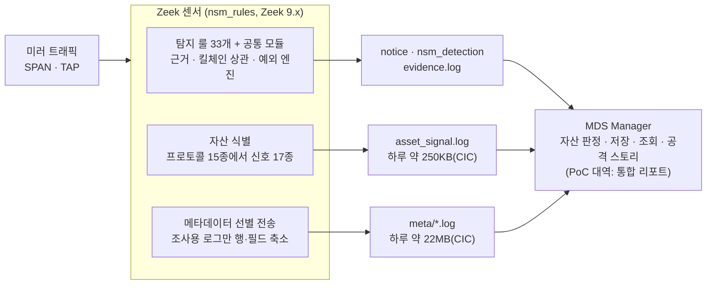

# NSM POC 결과 보고서

작성일: 2026-11-14 · 기준: main(탐지 PR #78까지) · 자산 식별·탐지·메타데이터 선별 전송을 함께 정리한 통합 보고입니다.
영역별 상세: 탐지 요구사항 [SRS.md](SRS.md) · 선별 전송 요구사항 [SRS_METADATA_EXPORT.md](SRS_METADATA_EXPORT.md) · 자산 식별 [asset-id/POC_RESULT.md](asset-id/POC_RESULT.md) · 단계별 기록 [탐지](DETECTION_POC_RESULT.md)·[선별 전송](METADATA_EXPORT_POC_RESULT.md)

## 요약

Zeek 센서 하나로 탐지·자산 식별·메타데이터 선별 전송을 함께 돌릴 수 있음을 확인했습니다. 공개 데이터셋 CIC-IDS2017 5일 검증에서 범위 안 공격 9종을 모두 탐지했고, 공격과 무관한 탐지는 5일 19건(하루 평균 약 4건)입니다.

| 영역 | 결과 |
| --- | --- |
| 탐지 | 룰 파일 33개, 탐지 유형(notice) 47개, 공격 단계 7개(정찰\~영향). 근거(evidence)·탐지 요약(사건 묶기)·킬체인 상관·예외 엔진 공통 적용 |
| 자산 식별 | 17종 신호로 자산 키(머신 계정·DHCP·MAC·호스트명)와 역할·OS 판정. 탐지 리포트의 공격자·대상 IP에 이름·역할·OS 표시 |
| 메타데이터 | 조사용 프로토콜 로그 9종(행 단위)과 요약 3종만 골라 전송. CIC 8시간 캡처당 Manager 전송량 21\~24MB(탐지·자산 신호 포함) |
| 검증 | btest 103개(Zeek 9.0.1·8.0.9 CI), 합성 pcap 46개, 통합 리포트(공격 스토리·킬체인·자산·전송량) |
| CIC-IDS2017 | 공격 14종 중 탐지 9종. 미탐 5종(DoS 4종·DDoS)은 탐지 범위 밖 |
| 오탐 | 5일 19건(예외 파일 16행 + 룰 기본값). 공격 탐지 30건(사건 기준) |

## POC 구성

미러 트래픽을 보는 Zeek 센서 한 대가 탐지·자산 신호·선별 메타데이터 세 가지 로그를 함께 냅니다. 센서 코드는 Zeek 패키지 `nsm_rules` 하나이고, 대상 버전은 Zeek 9.x(CI는 9.0.1과 8.0.9)입니다.

수집 에이전트가 세 경로를 읽어 Manager로 전송합니다.

탐지·자산 신호·메타데이터는 같은 Zeek 분석 결과에서 따로 기록되고, PoC에서는 Manager 대신 통합 리포트가 세 로그를 묶습니다.

| 구성 요소 | 위치 | 하는 일 |
| --- | --- | --- |
| 탐지 룰 | `nsm_rules/detections/01~34` | 공격 단계별 탐지. 룰마다 근거 → notice → 탐지 요약 순서로 기록 |
| 공통 모듈 | `nsm_rules/detections/`(main·evidence\_log·detection\_log·attack\_mapping·correlation\_killchain·exceptions) | ATT&CK 매핑, 억제, 킬체인 상관, 예외 엔진(파일 기반, 재시작 없이 반영) |
| 자산 식별 | `nsm_rules/asset-id/` | 프로토콜에서 자산 신호를 뽑아 `asset_signal.log`에 기록. 판정은 Manager(PoC에서는 리졸버) |
| 메타데이터 선별 전송 | `nsm_rules/metadata/` | 조사에 쓰는 로그만 행·필드를 줄여 `meta/`에 기록, conn·DNS는 요약 |
| 설정 | `nsm_config_fixed.zeek`(운영 기본값), `nsm_config_custom.zeek`(고객별), 예외 파일(TSV) | 고객별 값은 배포 때만 작성 |

검증은 네 가지로 했습니다.

| 방법 | 대상 | 확인한 것 |
| --- | --- | --- |
| btest + 합성 pcap | 룰마다 양성·음성 호스트를 한 pcap에 | 탐지 조건, 근거 연결, 예외·클러스터 동작. PR마다 CI가 두 Zeek 버전에서 실행, 경고 1건이라도 있으면 실패 |
| 통합 리포트(`tests/run_pcap.sh`) | pcap 하나 또는 디렉터리 일괄 | 운영과 같은 설정으로 실행해 공격 스토리·탐지·킬체인·자산·전송량·예외·센서 상태를 한 HTML로 |
| 고객 운영 pcap | 고객사 내부망 캡처 | 자산 식별률, 오탐 유형(보안 제품 통신, QUIC, 푸시 서비스 등)과 예외 파일 초안 |
| CIC-IDS2017 | 공개 데이터셋 5일(월\~금, 하루 약 8시간) | 알려진 공격 시나리오 대비 탐지·미탐·오탐 |

## 자산 식별 결과

센서의 신호 수집과 탐지 리포트 연동은 목표를 충족했습니다. PC 식별률과 판정 정확도는 고객 미러 구간에 DC·DHCP 트래픽이 없어 아직 판단하지 못했습니다.

센서는 프로토콜 15종과 연결 정보에서 17종 신호를 뽑아 `asset_signal.log`에 기록합니다. 판정은 Manager가 하며, 키 우선순위는 머신 계정 > DHCP client-id > MAC > 호스트명 > IP+시간입니다. 강한 키가 서로 다르면 합치지 않는 "오결합보다 중복" 정책을 씁니다.

| 지표 | 결과 | 근거 |
| --- | --- | --- |
| 신호 수집 | 프로토콜 15종, 신호 출처 22개 구현. 운영 데이터로 충분히 확인 8종, 소량 6종, 합성·공개 pcap으로만 4종(DHCP·ARP·LLMNR·DNS 동적 업데이트) | 고객 운영 pcap 9회 분석 |
| 로그량 | Zeek 전체 로그 대비 0.1\~0.3%. CIC 하루(8시간) 233\~256KB | 고객 pcap, CIC 5일 |
| 서버·장비 식별 | 서버 역할 추정 자산 33% → 49%(장비·인증서 신호 추가 후). AhnLab MDS·VMware·Cisco ASA 등 장비 종류 식별 | 고객 pcap |
| AhnLab 제품 설치 현황 | 활동 단말 중 41\~83%에서 제품 통신 확인 | 고객 pcap(구간별) |
| PC 식별(머신 계정·호스트명) | 고객 미러 구간에서 활동 단말 7\~9%. CIC에서는 내부 자산 29\~31개 중 18\~19개가 호스트명, 하루 머신 계정 신호 65\~74건 | 고객 구간은 DC·DHCP가 없는 라우팅 구간. CIC는 DC가 보이는 구성 |
| 판정 정확도 | 미검증 | AD·DHCP 정답 목록 비교 필요 |

탐지와의 연동은 이렇게 동작합니다.

- 통합 리포트는 탐지의 공격자·대상 IP에 그 시각의 자산 이름·역할·OS를 붙이고, 역할·OS로 탐지를 걸러 볼 수 있습니다. 리졸버 없이도 신호의 호스트명을 참고값으로 붙입니다.
- CIC는 리졸버 없이 돌렸고, 월·목·금요일은 탐지 대부분의 공격자 IP에 호스트명이 붙었습니다. 화요일은 공격자가 NAT 뒤 외부 주소(172.16.0.1)라 이름이 없습니다.
- 자산 식별은 탐지 결과에 영향을 주지 않습니다. 서버 역할(DC·DNS·파일 서버)을 탐지 조건·예외에 자동으로 반영하는 것은 다음 단계입니다.

## 탐지 결과

탐지 유형 47개가 공격 7단계를 덮고, 모두 같은 근거·탐지 요약·상관·예외 체계를 탑니다.

| 단계 | 탐지 유형 (ATT&CK) | 수 |
| --- | --- | --- |
| 정찰 | Port\_Scan (T1046: SYN 미응답·거부, SYN 없는 TCP 탐침, UDP 탐침), Host\_Scan (T1018), AD\_Enumeration (T1087.002) | 3 |
| 초기 침투 | SQL\_Injection, Cross\_Site\_Scripting, TLS\_Heartbleed, AI\_Service\_Exploit (T1190), Webshell\_Access (T1505.003) | 5 |
| 자격증명 접근 | NTLM\_Spray, Kerberos\_Spray (T1110.003), Kerberos\_Bruteforce, SSH\_Bruteforce, FTP\_Bruteforce, HTTP\_Bruteforce (T1110.001), Kerberoasting (T1558.003), ASREP\_Roasting (T1558.004), NTLM\_Credential\_Leak (T1187), Name\_Poisoning, Machine\_Account\_Misuse (T1557.001), DCSync (T1003.006), Coerced\_Authentication (T1187), Remote\_Registry\_Dump (T1003.002), Zerologon\_Attempt (T1210) | 15 |
| 확산 | SMB\_Admin\_Share (T1021.002), RDP\_Lateral (T1021.001), SSH\_Lateral (T1021.004), WinRM\_Lateral (T1021.006), DCOM\_Lateral (T1021.003), Remote\_Service\_Creation (T1569.002), Remote\_Task\_Creation (T1053.005), Remote\_WMI\_Execution (T1047) | 8 |
| C2 | HTTP\_Beaconing, TLS\_Beaconing (T1071.001), DNS\_Tunneling (T1071.004), Encrypted\_C2 (T1573.002), DGA\_Domain (T1568.002), Nonstandard\_Port (T1571), Long\_Connection (T1572), Unknown\_Protocol (T1095), AI\_API\_From\_Server (T1102) | 9 |
| 유출 | Exfil\_DNS (T1048.003), Exfil\_Large\_Transfer, Exfil\_Volume\_Aggregate (T1041), Exfil\_Web\_Upload (T1567.002), Outbound\_SMB (T1048), AI\_Service\_Upload (T1567) | 6 |
| 영향 | SMB\_Ransomware (T1486) | 1 |

모든 탐지에 공통으로 들어가는 기능입니다.

- 근거: 탐지마다 `evidence.log`에 누가·어디서·무엇을·어떻게와 연결 uid를 남깁니다. 확산·원격 실행 탐지는 같은 연결의 NTLM·Kerberos 인증 맥락에서 계정을 채웁니다. 비밀번호 값은 어떤 로그에도 남기지 않습니다.
- 탐지 요약: `nsm_detection.log`에 진단명·단계·공격자·피해 호스트를 한 행으로 남깁니다. 같은 (탐지 종류, 공격자, 피해 호스트)가 15분 안에 다시 나오면 같은 사건(`incident_id`, `occurrence`)으로 묶어, 알림은 사건당 1번입니다.
- 킬체인 상관: 같은 출발지, 또는 초기 침투·확산 대상이 다음 단계의 출발지가 되는 전이를 묶어 상관 탐지를 냅니다. 공격자가 웹서버를 침투하고 그 서버가 C2·확산·유출·암호화를 하면 체인 하나로 7단계가 이어집니다. 클러스터에서는 매니저가 판정합니다.
- 예외 엔진: 예외 파일(TSV)의 출발지·목적지·포트·서비스·도메인·JA4 축으로 drop 또는 suppress합니다. 재시작 없이 반영되고, 만료·적중 수를 기록합니다.
- 통합 리포트: 공격자별 공격 스토리를 킬체인 진행 보드·확산 경로 그래프·세로 내러티브 세 가지로 보여 줍니다. 같은 사건은 한 행(횟수·마지막 시각)으로 보입니다.

테스트는 btest 103개(룰·계약·예외·선별 전송 69개, 클러스터·자산 식별 34개)입니다. Zeek 9.0.1에서 모두 통과하고, 8.0.9에서는 9.x 분석기가 필요한 5개를 빼고 통과합니다. 룰마다 탐지돼야 하는 호스트와 비슷하지만 탐지되면 안 되는 호스트를 한 pcap에 넣어 확인합니다.

### AI 관련 위협 탐지

생성형 AI가 공격에 쓰이는 세 경로를 탐지 3종으로 봅니다. 외부 AI 서비스는 HTTPS라 프롬프트·응답 내용은 보지 않고, 누가·어느 서비스로·얼마나·어떤 호출을 했는지(SNI·바이트·평문 HTTP 요청)로 판정합니다.

| 탐지 (ATT&CK) | 보는 위협 | 탐지 조건 | 오탐 통제 |
| --- | --- | --- | --- |
| AI\_Service\_Upload (T1567) | 직원이 문서·데이터를 AI 서비스에 올림(섀도 AI 유출) | 한 출발지가 한 AI 서비스로 1시간에 10MB 이상 업로드. 대화 입력은 수 KB라 MB 단위면 파일 첨부 | 승인한 AI 서비스·부서를 도메인·출발지 예외로 둠 |
| AI\_API\_From\_Server (T1102) | 서버의 LLM API 호출: LLM으로 명령을 만드는 악성코드(예: LameHug), 승인 안 된 AI 연동 | 서버로 학습된 내부 호스트(DNS·Kerberos·LDAP·DB·메일 포트에서 응답) 또는 지정 대역이 AI 서비스에 TLS 접속 | 사내 챗봇·RAG 백엔드 등 승인된 연동 서버를 출발지 예외로 둠 |
| AI\_Service\_Exploit (T1190) | 사내 AI 인프라의 인증 없는 관리·실행 API 악용(ShadowRay CVE-2023-48022, ShellTorch) | Ray 작업 제출, Ollama 모델 pull·push·삭제, TorchServe URL 모델 등록, Jupyter 터미널 생성, MLflow 경로 조작 요청 1건 | ML 팀·배포 도구를 출발지 예외로 둠. 추론 호출·조회는 보지 않음 |

- AI 서비스 목록은 27개 도메인(OpenAI, Anthropic, Gemini, Copilot, DeepSeek, 뤼튼, 클로바X 등)이고, 고객이 쓰는 서비스를 더할 수 있습니다. HTTP·TLS 비콘 탐지는 목적지가 AI 서비스면 근거에 `ai_service=T`를 붙입니다.
- 킬체인 상관에서 업로드는 유출, 서버의 AI 접속은 C2, AI 인프라 공격은 초기 침투 단계로 묶입니다. 공격당한 AI 서버가 다음 탐지의 출발지가 되면 체인이 이어집니다.
- 합성 pcap에서 기대한 9건이 탐지되고, 걸리면 안 되는 6가지(작은 대화 요청, AI가 아닌 곳으로의 대량 업로드, PC의 AI API 접속, 서버의 일반 사이트 접속, Ray 작업 조회, Ollama 추론)는 탐지되지 않았습니다. CIC-IDS2017 5일 실행에서는 0건입니다(2017년 데이터라 생성형 AI 트래픽이 없음).

### AD 공격 탐지

액티브 디렉터리를 노리는 공격 4가지를 탐지 4종으로 봅니다. DCSync·원격 실행 탐지와 같이 DCE-RPC의 인터페이스·호출 이름만 쓰며, 이 정보는 패킷이 암호화돼도 평문으로 보입니다.

| 탐지 (ATT&CK) | 보는 공격 | 탐지 조건 | 오탐 통제 |
| --- | --- | --- | --- |
| AD\_Enumeration (T1087.002) | BloodHound/SharpHound의 로그온 세션·로컬 관리자 수집 | 한 출발지가 5분 안 서로 다른 호스트 10대 이상에 세션·로컬 그룹 조회 | DC 한 대에 대한 계정 조회·공유 목록 조회는 제외. 인벤토리 도구는 출발지 예외 |
| Coerced\_Authentication (T1187) | PetitPotam, PrinterBug, DFSCoerce, ShadowCoerce. 서버가 공격자에게 인증하게 만들어 NTLM 릴레이로 이어짐 | 내부 서버로 가는 강제 인증 호출 1건 | 프린트 서버로 가는 spoolss 알림은 정상이라 spoolss는 대상이 DC일 때만 |
| Remote\_Registry\_Dump (T1003.002) | secretsdump 등의 SAM·SECURITY 하이브 원격 저장 | winreg BaseRegSaveKey 호출 1건 | 레지스트리 조회·설정은 제외. 원격 백업 에이전트는 출발지 예외 |
| Zerologon\_Attempt (T1210) | Zerologon(CVE-2020-1472)의 netlogon 인증 반복 | 같은 출발지 → 대상 DC로 1분 안 netlogon 인증 호출 20회 이상 | 정상 보안 채널 수립은 1\~2회 |

- 킬체인 상관에서 AD 정보 수집은 정찰, 강제 인증·하이브 저장은 자격증명, Zerologon은 도메인 장악 단계로 묶입니다. AD 정보 수집 뒤 같은 출발지의 확산·도메인 장악, Zerologon 뒤 DCSync가 나오면 체인으로 이어집니다.
- 합성 pcap에서 기대한 8건과 상관 2건이 탐지되고, 걸리면 안 되는 6가지(프린트 서버 대상 spoolss, 조회 호출, 예외 등록한 백업 에이전트, netlogon 인증 2회, 5대 조회, 공유 목록 조회)는 탐지되지 않았습니다. CIC-IDS2017에는 AD 공격이 없습니다.
- 강제 인증 호출 일부(`\lsarpc` 파이프로 바인드한 PetitPotam, DFSCoerce, ShadowCoerce)가 메타데이터 선별 전송에서 빠져 있던 것도 함께 보완했습니다.

## 메타데이터 선별 전송 결과

CIC-IDS2017 8시간 캡처당 선별 메타데이터는 평균 21.7MB였습니다. 자산 신호·탐지 로그를 더한 Manager 전송 합계는 21\~24MB입니다. 목표(Zeek 전체 로그 대비 5% 이하)는 고객 운영 구간에서 아직 판정하지 못했습니다.

선별 전송은 탐지 후 조사와 헌팅에 쓰는 로그만 골라, 행과 필드를 줄여 남깁니다. Kerberos·NTLM·SMB 공유·SMB 파일·DCE-RPC·RDP·SSH·SSL·HTTP는 행 단위로, conn·DNS·HTTP User-Agent는 주기 요약으로 보냅니다. 범위 판정·중복 억제·분당 상한을 거친 뒤 기록하고, 탈락한 행은 직렬화·디스크 쓰기를 하지 않습니다.

| 로그 | 하루 평균(CIC 5일) | 내용 |
| --- | --- | --- |
| http | 7.40MB · 25,128행 | 메서드·Host·경로·상태 |
| flow\_summary | 6.63MB · 34,230행 | 경계 연결과 내부 관리 포트 연결의 30분 요약 |
| ssl | 3.85MB · 12,707행 | SNI·인증서·JA3 |
| dns\_summary | 2.83MB · 9,488행 | (출발지, 등록 도메인) 요약과 질의 표본 |
| ssh | 0.43MB · 1,650행 | 클라이언트·서버 버전, 인증 결과 |
| kerberos | 0.30MB · 1,127행 | 계정·서비스·암호 종류 |
| 그 밖(dce\_rpc·smb\_mapping·ntlm·UA 요약·센서 상태·통계) | 0.28MB |  |
| 합계 | 21.74MB |  |

전체 로그 대비 비율은 이렇게 재었습니다(측정 도구 `tests/measure_meta_export.sh`).

| 측정 | 비율 | 처리 시간 증가 |
| --- | --- | --- |
| CIC Monday 8시간 | 6.28% | +5.1% |
| 고객 운영 미러(수 분, AD 트래픽 없는 구간 포함) | 5.36\~8.08% | +4.0% |
| 고객 운영 미러 1시간 이상(DC 포함) | 측정 대기 | 측정 대기 |

위 두 측정은 DNS 요약 키 변경·User-Agent 요약·flow 필드 정리가 들어가기 전 설정 기준입니다. 현재 기본값의 비율은 고객 운영 구간 측정에서 함께 확인합니다.

메타데이터는 통합 리포트의 공격 스토리에도 씁니다. 각 탐지의 출발지·대상·시간창(앞뒤 10분)으로 메타데이터 행을 맞춰 계정·공유 경로·호출·SNI·바이트를 "추정 근거"로 붙입니다. 그래프의 노드와 선은 탐지로만 만들기 때문에, 탐지 없이 메타데이터에만 남은 이동은 그래프에 나오지 않습니다.

### 1,000명 규모 내부망의 하루 예상 크기

1,000명 규모면 선별 메타데이터는 하루 1\~3GB(압축 전)로 추정합니다. 피크 측정을 하루로 늘린 상한은 4\~5GB입니다. 그 규모로 잔 값은 아직 없고, 아래 두 측정값을 사람 수로 늘려 계산했습니다.

| 근거 | 측정값 | 1,000명 환산 |
| --- | --- | --- |
| CIC-IDS2017(내부 PC·서버 약 30대, 업무 8시간) | 하루 21.7MB, PC 1대당 8시간에 0.7\~1.7MB | 업무시간 0.7\~1.7GB에 야간·주말을 더해 약 1\~2GB/일 |
| 고객 운영 미러 A 구간(자산 약 3,200개, 피크 200초) | Zeek 전체 로그 하루 약 180GB 상당, 선별 비율 5.4\~8.1% | 전체 로그 약 57GB/일 × 5\~8% = 약 3\~4.5GB/일 |

CIC는 웹 브라우징 위주의 합성 트래픽이라 실제보다 적게 나옵니다. 고객 측정은 피크 200초를 24시간으로 늘렸고 현재 기본값(DNS 요약 축소 등)이 들어가기 전 값이라 크게 나옵니다. 실제는 그 사이인 1\~3GB가 현실적입니다.

| 로그 | 비중(CIC 기준) | 늘어나는 요인 |
| --- | --- | --- |
| http | 약 34% | 평문 HTTP 사용량. (출발지, Host, 경로, 상태) 10분 중복 억제 |
| flow\_summary | 약 30% | 외부·관리 포트로 가는 (출발지, 목적지, 포트) 조합 수. 30분마다 한 행 |
| ssl | 약 18% | 외부 TLS 목적지 수. (출발지, SNI, JA3) 24시간 중복 억제 |
| dns\_summary | 약 13% | 출발지당 도메인 수. 시간당 출발지 1대 100행이 상한 |
| kerberos·ssh·ntlm·smb·dce\_rpc 등 | 약 5% | AD 인증·관리 접속량 |

- 탐지·자산 로그: 자산 신호는 수십 MB/일, 탐지 로그(notice·탐지 요약·근거)는 수 MB/일 수준입니다.
- 압축: JSON 로그는 보통 1/8\~1/10로 줄어드는 것으로 봅니다(추정, 미측정). 전송량은 하루 약 100\~400MB입니다. `tests/measure_meta_export.sh`가 gzip·zstd 압축 후 크기를 함께 출력합니다.

크기를 크게 바꾸는 요인

1. 미러 위치: 인터넷 경계만 보면 위 범위입니다. 내부 서버팜(DC·파일 서버)까지 보면 kerberos·smb·flow가 늘어 30\~50% 더 나올 수 있습니다.
2. 예외 도메인 등록: OS·백신 업데이트, CDN, Office 365 같은 대량 정상 도메인을 `meta_domain_allowlist`에 넣으면 ssl·http·dns가 크게 줄어듭니다.
3. 내부 리졸버 등록: `dns_tunnel_resolvers`에 등록하지 않으면 리졸버가 대신 묻는 질의가 따로 쌓입니다.
4. 평문 HTTP 비중: 사내 업무 시스템이 HTTP면 http 비중이 커집니다.

정확한 값은 고객 미러 구간(DC 포함)에서 1시간 이상 캡처해 측정 스크립트로 잰 뒤 다시 계산합니다. 이 측정은 다음 단계 1번(고객 운영 측정)에 포함돼 있습니다.

## CIC-IDS2017 검증: 공격 시나리오와 NSM 탐지

CIC-IDS2017의 공격 14종 중 9종을 탐지했습니다. 범위 안 공격은 모두 탐지했고, 놓친 5종은 DoS 4종과 DDoS로 NSM 탐지 범위 밖입니다.

시각은 데이터셋 현지 시각(ADT, UTC−3)입니다. 공격자 172.16.0.1은 외부 공격 서버 205.174.165.73이 NAT를 거쳐 보이는 주소입니다. 내부망은 192.168.10.0/24, 웹 서버는 .50, 두 번째 서버는 .51입니다. 예외 파일과 현재 기본값으로 돌린 결과이며, 횟수는 같은 사건으로 묶인 탐지 수입니다.

| 요일 | 공격(데이터셋 일정) | 경로 | NSM 탐지 | 결과 |
| --- | --- | --- | --- | --- |
| 월 | 없음(정상 트래픽) |  | 공격 탐지 0건 | 해당 없음 |
| 화 | FTP-Patator 9:20–10:20 | 172.16.0.1 → .50:21 | FTP\_Bruteforce 사건 1건(09:23–10:23, 13회, 5분마다 실패 약 1,000회) | 탐지 |
| 화 | SSH-Patator 14:00–15:00 | 172.16.0.1 → .50:22 | SSH\_Bruteforce 사건 1건(14:13–15:13, 13회, 5분마다 150\~249회, 클라이언트 paramiko) | 탐지 |
| 수 | DoS slowloris 9:47–10:10 | 172.16.0.1 → .50:80 | 없음 | 미탐(범위 밖) |
| 수 | DoS Slowhttptest 10:14–10:35 | 172.16.0.1 → .50:80 | 없음 | 미탐(범위 밖) |
| 수 | DoS Hulk 10:43–11:00 | 172.16.0.1 → .50:80 | 없음 | 미탐(범위 밖) |
| 수 | DoS GoldenEye 11:10–11:23 | 172.16.0.1 → .50:80 | 없음 | 미탐(범위 밖) |
| 수 | Heartbleed 15:12–15:32 | 172.16.0.1 → .51:444 | TLS\_Heartbleed 성공 15:12(첫 유출 즉시, 암호화된 하트비트, 요청 61바이트 → 응답 16,408바이트) | 탐지 |
| 목 | 웹 무차별 대입 9:20–10:00 | 172.16.0.1 → .50:80 | HTTP\_Bruteforce 사건 1건(09:23–10:03, 9회, `/dv/login.php` 비밀번호 106가지) | 탐지 |
| 목 | XSS 10:15–10:35 | 172.16.0.1 → .50:80 | Cross\_Site\_Scripting 사건 1건(10:16–10:26, 2회, `xss_r`의 `<script>`) | 탐지 |
| 목 | SQL Injection 10:40–10:42 | 172.16.0.1 → .50:80 | SQL\_Injection 1건(`id=1' and 1=1#`) | 탐지 |
| 목 | Infiltration 14:19–15:45(감염 PC .8·.25의 역방향 연결, .8의 내부 스캔) | .8·.25 → 205.174.165.73:444, .8 → 내부 | Unknown\_Protocol 3건, Port\_Scan 사건 12건(.8 → 내부 11대, 대상마다 15:05–15:44에 4–5회 재스캔), 상관 1건(정찰 → C2) | 탐지 |
| 금 | Botnet ARES 10:02–11:02 | .5·.8·.9·.14·.15 → 205.174.165.73:8080 | HTTP\_Beaconing 5건(감염 PC 5대 모두, 10초 주기) | 탐지 |
| 금 | PortScan 13:55–15:29(방화벽 켬 13:55–14:35, 끔 14:51–15:29 nmap 방식별) | 172.16.0.1 → .50 | Port\_Scan 사건 2건(14:51, 15:08–15:22 2회. 거부된 SYN 탐침. FIN·Xmas·NULL 탐침은 캡처에 없음) | 탐지 |
| 금 | DDoS LOIT 15:56–16:16 | 172.16.0.1 → .50:80 | 없음 | 미탐(범위 밖) |

일정에 없는 탐지도 하나 있습니다. 목요일 14:00 172.16.0.1 → .51 포트 스캔(Port\_Scan 1건)으로, 침투 준비 단계의 정찰로 보입니다.

## 미탐 분류

놓친 공격은 모두 탐지 범위 밖입니다.

| 항목 | 판단 | 근거 | 대응 |
| --- | --- | --- | --- |
| DoS slowloris·Slowhttptest·Hulk·GoldenEye, DDoS LOIT | 탐지 대상 아님 | NSM은 침투 후 활동(자격증명·확산·C2·유출)을 보는 제품입니다. 가용성 공격은 경계의 DDoS 방어 장비·IPS·WAF가 막고, 센서 자신도 폭주 트래픽에 연결 상태를 쌓아야 해 부하가 큽니다 | 제외. 필요하면 향후 선택 기능(내부 웹 서버의 미완결 HTTP 연결 급증 등)으로 검토 |
| Infiltration 초기 단계(Dropbox로 악성 파일 다운로드) | 탐지 대상 아님(한계) | 파일을 HTTPS로 받아 내용이 보이지 않습니다. 파일 판정은 EDR·샌드박스 몫입니다. 이후 단계(역방향 연결·내부 스캔)는 탐지합니다 | 제외. MDS 등 파일 분석 제품과 연동 시 보완 |

## 오탐과 튜닝 결과

공격과 무관한 탐지는 튜닝 전 5일 271건에서 19건(하루 평균 약 4건)으로 줄었고, 공격 탐지 30건(사건 기준)은 하나도 빠지지 않았습니다.

튜닝은 두 갈래입니다. 환경마다 다른 것은 예외 파일(16행)로, 어느 고객에서나 같은 원인은 룰 기본값으로 처리합니다.

| 조치 | 방식 | 대상 |
| --- | --- | --- |
| DC 겸 내부 DNS 리졸버 제외 | 예외 파일(출발지 축) 1행 | 이름 응답 위조(NBNS), DNS 터널링 |
| AWS 로드밸런서 이름 | 예외 파일 1행 + 룰 기본값(`elb.amazonaws.com` 기본 예외) | DNS 터널링 |
| 여러 PC가 쓰는 외부 서비스 | 예외 파일(목적지+포트 축) 9행 | 비표준 포트 |
| 광고·트래킹 주기 요청 | 예외 파일(도메인 축, suppress: 기록은 남기고 알림만 끔) 1행 | HTTP 비콘 |
| Windows 위젯·인증서 상태 확인 | 예외 파일(도메인 축) 1행 | HTTP 비콘 |
| 광고 클라이언트 JA3, 호스팅 기본 인증서 사이트 | 예외 파일(도메인 축) 2행 | 암호화 C2 |
| Ubuntu 데스크톱 검색(60초 주기) | 예외 파일(SNI 축) 1행 | TLS 비콘 |
| 자체서명 + SNI 불일치 중복 점수 제거 | 룰 기본값(`enc_c2_w_mismatch_selfsigned=0`) | 암호화 C2 |
| 주기 패턴이 30분 이상 이어질 때만 | 룰 기본값(`tls_beacon_min_span=30min`) | TLS 비콘(웹 페이지 광고·분석 스크립트) |
| 캡처 손실로 남은 RST 응답 제외 | 룰 기본값 | 포트 스캔(피해 host를 스캐너로 오인) |

예외 파일은 월·화 이틀 치 오탐으로 대부분을 만들 수 있었고, 수\~금에 적용하면 그 주의 오탐 62%가 빠졌습니다. 고객사에서도 첫 1\~2주 오탐으로 예외를 만드는 절차가 현실적입니다.

남은 19건은 이렇습니다.

- 광고·뉴스 주기 통신 15건(HTTP 9, TLS 6): 5\~10분 주기로 1\~2시간 이어지는 광고 서버이며, 하루만 나오는 도메인이 대부분입니다. 예외로 하나씩 쫓아가기 어렵고, 비콘 위험도 등급으로 다루는 것이 맞습니다(흔한 도메인을 숨기면 Ares 같은 비콘도 숨겨지므로 등급만 낮춤).
- 비표준 포트 3건: 8081 TLS 2건, 443 포트 평문 HTTP 1건. 고객 환경이면 확인 후 예외로 등록합니다.
- 암호화 C2 1건: 수요일 .16 → 159.203.79.231, SNI 없는 자체서명(무작위 16진수 CN). C2 기본 설정과 같은 형태라 남겨 둔 신호이며 확인이 필요합니다.

| 탐지 종류 | 튜닝 전(5일) | 튜닝 후(5일) |
| --- | --- | --- |
| TLS 비콘 | 101 | 6 |
| HTTP 비콘 | 57 | 9 |
| 암호화 C2 | 56 | 1 |
| 비표준 포트 | 43 | 3 |
| DNS 터널링 | 9 | 0 |
| 이름 응답 위조 | 5 | 0 |
| 합계 | 271 | 19 |

TLS 비콘과 암호화 C2 오탐은 룰 기본값만으로 대부분 사라졌고, 남은 오탐의 대부분은 광고 서버의 주기 통신입니다.

## 한계와 다음 단계

센서 기능은 POC 목표를 충족했고, 남은 것은 고객 운영 구간에서의 측정과 Manager 연동입니다.

한계

- PC 식별률과 자산 판정 정확도는 미검증입니다. DC·DHCP가 보이는 고객 구간에서 2시간 이상 측정하고 AD·DHCP 정답 목록과 비교해야 합니다.
- 메타데이터 전송량 목표(전체 로그 대비 5% 이하)와 처리 부하 목표(+5% 이하)는 고객 운영 구간에서 아직 판정하지 않았습니다.
- CIC-IDS2017은 2017년 테스트베드라 현재 트래픽(TLS 1.3, QUIC, 클라우드 서비스)과 다릅니다. 특히 TLS 비콘·원격 실행·머신 계정 사용 탐지는 실제 업무 트래픽에서의 오탐을 아직 재지 않았습니다.
- AI 관련 탐지 3종은 합성 pcap으로만 확인했습니다. 업무에 AI를 쓰는 회사에서는 문서 첨부가 바로 걸리므로, 승인 서비스·부서를 예외로 둘지 사용 현황 파악용으로 남길지 정책 결정이 필요합니다. HTTPS로 감싼 사내 AI 서버는 요청이 보이지 않아 인프라 공격 탐지 대상이 아닙니다.
- AD 공격 탐지 4종도 합성 pcap으로만 확인했습니다. 자산 관리·보안 점검 도구의 세션 수집은 AD 정보 수집에 걸리므로 첫 주에 출발지 예외를 등록해야 합니다. 클러스터에서는 DC 자동 학습이 워커별이라 DC 목록을 설정에 적어야 spoolss 강제 인증을 놓치지 않습니다.
- TLS 비콘은 주기 패턴이 30분 이상 이어져야 탐지합니다. 짧게 끝나는 C2는 이 탐지로 보이지 않습니다.
- 클러스터 동작은 테스트(매니저 + 워커 2)로만 확인했습니다. 사건 묶기는 탐지를 낸 노드별이라, 연결 단위 탐지가 여러 워커에 나뉘면 사건도 나뉩니다.
- 공격 그래프는 탐지로만 그립니다. 탐지 임계 아래의 이동은 메타데이터에만 남습니다.
- 암호화 구간(DNS over HTTPS, SMB3 암호화 세션)과 ICMP 터널은 보지 못합니다.

다음 단계(우선순위 순)

1. 고객 운영 측정: DC 구간 2시간 이상 캡처로 자산 식별률·정확도, 메타데이터 전송량·CPU, 탐지 오탐을 한 번에 잽니다.
2. 비콘 위험도 등급: 남은 광고 비콘 15건을 숨기지 않고 낮은 등급으로 내립니다.
3. MDS Manager 연동: 로그에 센서 ID·스키마 버전·상관 갱신 번호 추가, 목록 필드 배열화, 사건(`incident_id`·`occurrence`) 처리 규칙 반영.
4. 운영 편의: 자산 식별 역할(DC·DNS·WINS)을 예외에 자동 반영, 예외 파일의 중복 id 거부, 공격 그래프에 메타데이터 "관측된 연결" 점선(선택).
