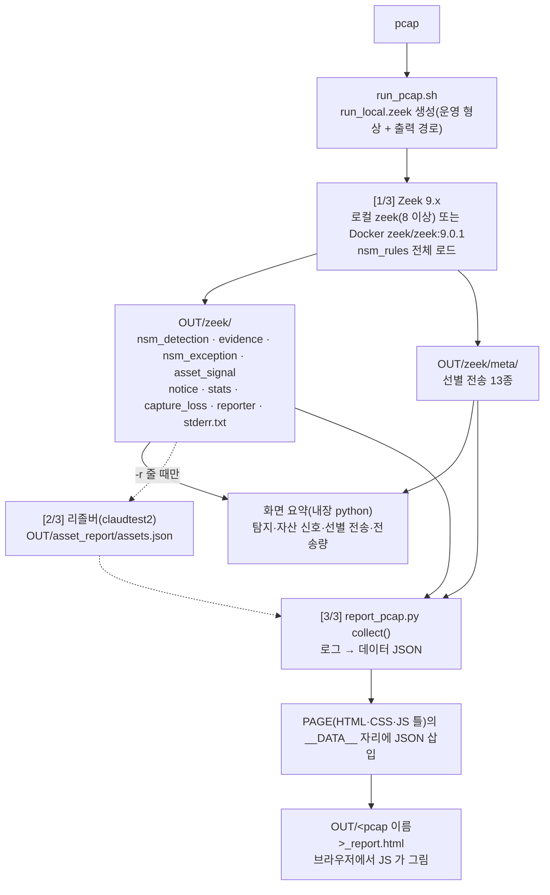

# 통합 리포트 생성 구조와 스펙

작성: 2026-11-18 · 갱신: 2026-11-20 · 기준: main(PR #117까지) · 대상: 리포트를 고치거나 결과를 해석하는 개발·검증 담당자
관련: 사용법 요약 [SRS_METADATA_EXPORT.md](SRS_METADATA_EXPORT.md) 8장(측정·확인 도구) · 결과 로그 형식 [POC_RESULT.md](POC_RESULT.md) 부록 · 탐지 설명 [DETECTION_GUIDE.md](DETECTION_GUIDE.md)

PoC에서는 Manager 화면이 없어서, pcap 하나를 운영과 같은 설정으로 돌린 결과를 HTML 파일 하나(`<pcap 이름>_report.html`)로 묶어 봅니다. 이 문서는 그 리포트가 **어떤 순서로, 어떤 로그에서, 어떤 규칙으로** 만들어지는지 정리합니다. 리포트 규칙은 운영 Manager 화면의 시제품이기도 합니다.

| 구성 요소 | 파일 | 역할 |
| --- | --- | --- |
| 실행 스크립트 | `tests/run_pcap.sh` (bash, 약 260줄) | Zeek 실행, 화면 요약, (선택) 자산 판정, 리포트 생성 호출. 디렉터리를 주면 파일마다 반복 |
| 리포트 생성기 | `tests/report_pcap.py` (python3 표준 라이브러리만, 약 1,200줄) | Zeek 로그 디렉터리를 읽어 데이터 JSON을 만들고 HTML 틀에 넣음 |
| 자산 정보 보강 | `tests/asset_enrich.py` (표준 라이브러리만) | OUI 제조사, Recog 지문, TCP SYN OS 계열. Manager 후처리 시제품(자산 식별 SPEC 4.11) |
| 자산 판정(선택) | claudtest2 `tools/asset_resolver.py` | `asset_signal.log`를 자산 단위로 묶은 `assets.json`. 이 저장소 밖 |

---

## 1. 전체 흐름



- 리포트는 **파일 하나**입니다. 데이터는 `<script id="data" type="application/json">` 안에 들어 있고, 화면은 같은 파일의 JS가 그 JSON으로 그립니다. 외부 라이브러리·네트워크 없이 오프라인 VM에서 열립니다.
- 계산(조인·스토리 묶기·관측 판정)은 모두 python(`collect()`)에서 하고, JS는 표·그림·필터·툴팁만 담당합니다. 그래서 테스트는 HTML 안의 JSON을 꺼내 검사합니다(7장).
- 리포트에는 주소·호스트명·계정 원문이 들어 있습니다. 외부로 보내지 않습니다. 화면 요약과 `report_pcap.py`의 표준 출력에는 원문을 넣지 않습니다(숫자·종류만).

---

## 2. `run_pcap.sh` 스펙

### 2.1 사용법과 옵션

```
tests/run_pcap.sh [-o 출력] [-n 내부 대역] [-x 예외 파일] [-r claudtest2 경로] [-z "zeek 인자"] [-u OUI.csv] [-g Recog xml 폴더] [-k] <pcap | 디렉터리> ...
```

| 옵션 | 기본값 | 뜻 |
| --- | --- | --- |
| `-o DIR` | `out/<pcap 이름>`(여러 개면 `out/<디렉터리 이름>` 또는 `out/batch`) | 출력 디렉터리 |
| `-n CIDRS` | 없음(사설 대역만 내부) | 내부 대역, 쉼표 구분. `Site::local_nets`에 더하고 리포트의 내부·외부 판정에도 넘김. 내부에 공인 IP를 쓰면 반드시 지정 |
| `-x FILE` | 없음 | 예외 파일(SRS 7.8절). `zeek/exceptions.tsv`로 복사해 `NSM::exception_file`로 넘김 |
| `-r DIR` | 없음 | claudtest2 경로. 주면 리졸버로 자산을 판정해 리포트를 자산 단위로 만듦 |
| `-z ARGS` | 없음 | zeek에 넘길 추가 인자(예: `-z "AssetID::suppress_interval=30min"`) |
| `-u FILE` | 없음 | OUI 목록 CSV(IEEE 원본 `oui.csv`·`mam.csv`·`oui36.csv` 또는 maclookup.app 내보내기, 여러 번 가능). 자산 표에 MAC 제조사. 한 줄도 못 읽은 파일은 화면 요약·리포트에 경고 |
| `-g DIR` | 없음 | Recog 지문 xml 폴더(github.com/rapid7/recog 의 `xml/`). 자산 표에 제품·장비 종류 |
| `-k` | 끔 | Zeek 원본 로그(conn·dns·http·ssl·files·weird 등)를 모두 남김(`NSM::keep_all_log_streams = T`). 탐지·선별 결과는 같고 디스크만 더 씀 |
| `ZEEK_IMAGE` 환경 변수 | `zeek/zeek:9.0.1` | 로컬 zeek가 없거나 8 미만일 때 쓰는 Docker 이미지 |

### 2.2 실행 설정(`zeek/run_local.zeek`)

`nsm_rules` 전체(탐지 + 예외 엔진 + 자산 식별 + 선별 전송)를 운영과 같이 로드하고, 경로만 출력 디렉터리로 바꿉니다.

| 설정 | 값 | 이유 |
| --- | --- | --- |
| `NSM::log_paths` | `{}` | 운영 경로(`/log/zeek/…`) 대신 현재 디렉터리에 씀 |
| `NSM::create_log_dirs` | `F` | 디렉터리는 스크립트가 미리 만듦(`zeek/meta/`) |
| `Log::default_rotation_interval` | `0secs` | 회전하지 않고 파일 하나로 |
| `NSM::meta_export_enable` | `T` | 선별 전송 켬 |
| `NSM::meta_path_prefix` | `"meta/"` | 선별 전송은 `zeek/meta/`에 |
| `Site::local_nets` | `-n` 값 추가 | |
| `NSM::exception_file` | `"exceptions.tsv"` | `-x`를 줄 때 |
| `NSM::keep_all_log_streams` | `T` | `-k`를 줄 때 |

Zeek는 `-C`(체크섬 무시)로 실행하고, 표준 오류는 `zeek/stderr.txt`에 남깁니다. `warning`·`error`·`fatal`이 있으면 화면에 앞 3줄을 보입니다.

### 2.3 출력 디렉터리

```
OUT/
  <pcap 이름>_report.html      통합 리포트(pcap 이름은 확장자를 뺀 파일 이름)
  zeek/
    run_local.zeek  stderr.txt  exceptions.tsv(-x)
    nsm_detection.log  evidence.log  nsm_exception.log  asset_signal.log     Manager 로 가는 로그
    notice.log  stats.log  capture_loss.log  reporter.log  loaded_scripts.log 센서 로컬 로그
    conn.log  dns.log …                                                       -k 원본 로그
    meta/  kerberos.log … flow_summary.log  dns_summary.log  meta_export_stats.log  선별 전송
  asset_report/  report.html  report.txt  assets.csv  assets.json             -r 자산 판정
```

### 2.4 화면 요약

`[1/3]` Zeek 실행이 끝나면 내장 python이 로그를 읽어 다음을 출력합니다. 주소·도메인 원문은 출력하지 않습니다.

| 줄 | 내용 |
| --- | --- |
| 캡처 구간 | 로그 `ts`의 처음\~끝(분)과 처리 시간(초) |
| `[탐지]` | 탐지 요약 건수(상관·suppress 표시 따로), 근거 행 수, notice 종류별 건수·출발지 수, 예외 적재 종류·적중 상위 5개 |
| `[자산 식별]` | 신호 행·IP 수·바이트, 신호 종류별 건수 |
| `[선별 전송]` | 로그별 바이트·행 수와 합계 |
| `[전송량]` | Manager로 가는 로그 = 선별 전송 + 자산 신호 + 탐지 로그(탐지 요약·근거·예외), 센서 로컬 로그, `-k` 원본 로그(따로), 하루 환산 |

- **캡처 구간:** 모든 로그의 `ts` 중 1e9보다 큰 값의 최소\~최대입니다. 두 가지를 뺍니다. `reporter.log`는 pcap을 읽기 전 행에 실제 시계 시각이 찍히고, `-k` 원본 로그는 운영 형상이 아니라서입니다. 예외 적재 행처럼 ts가 0인 행도 빠집니다.
- **하루 환산:** 캡처 구간이 10분(600초) 이상일 때만 `Manager 전송 × 86400 / 구간`으로 계산합니다. 요약 로그는 주기 끝이나 종료 때 한꺼번에 쓰이므로 짧은 캡처일수록 과대평가됩니다.

### 2.5 여러 pcap(일괄 모드)

디렉터리나 pcap 여러 개를 주면 하위 디렉터리까지 `*.pcap`·`*.pcapng`·`*.cap`을 찾아 **파일마다 이 스크립트를 다시 실행**합니다.

- 출력은 `OUT/<이름>/`이고, 하위 디렉터리 파일은 경로를 `_`로 이어 이름을 만듭니다. 이름이 겹치면 시작 전에 멈춥니다.
- 각 실행의 화면 출력은 `OUT/<이름>/run.txt`에 남고, 한 파일이 실패해도 나머지는 계속합니다. 끝에 파일별 상태·탐지 건수 표와 `OUT/index.html`(각 리포트·`run.txt` 링크)을 만들고, 실패가 있으면 0이 아닌 값으로 끝납니다.
- 파일 사이의 탐지 집계·상관은 이어지지 않습니다. 한 캡처를 나눠 저장한 파일은 `mergecap`으로 합쳐 한 번에 돌립니다.

---

## 3. `report_pcap.py` 스펙

### 3.1 입력

```
python3 tests/report_pcap.py <zeek 로그 디렉터리> -o <출력 html> [--assets assets.json] [--asset-report 상대 경로]
        [--pcap 이름] [--elapsed 초] [--tz 9] [--nets CIDRS] [--oui OUI.csv ...] [--recog DIR]
```

| 인자 | 뜻 |
| --- | --- |
| `zeek_dir` | `run_pcap.sh`의 `OUT/zeek`. `*.log`와 `meta/*.log`를 읽음(JSON 한 줄 한 행, `#`으로 시작하는 줄은 무시) |
| `-o` | 출력 HTML 경로 |
| `--assets` | 리졸버 `assets.json`. 있으면 자산 단위, 없으면 자산 신호 단위 |
| `--asset-report` | 리포트에서 링크할 자산 리포트 경로(리포트 기준 상대 경로) |
| `--pcap`, `--elapsed` | 머리말에 보일 pcap 이름·처리 시간 |
| `--tz` | 표시 시간대(UTC 오프셋, 기본 9 = KST) |
| `--nets` | 내부 대역(`-n`과 같음). 사설 대역은 항상 내부 |
| `--oui`, `--recog` | 자산 정보 보강 DB(`-u`·`-g`와 같음). 없으면 로컬·랜덤 MAC 여부와 TCP SYN 계열만 |

`run_pcap.sh` 없이 단독으로도 돌릴 수 있습니다(예: 운영 센서 로그 디렉터리를 복사해 와서).

### 3.2 처리 단계(`collect()`)

| 순서 | 단계 | 규칙 |
| --- | --- | --- |
| 1 | 로그 읽기 | 탐지 요약·근거·notice·예외·자산 신호, 선별 전송 13종 |
| 2 | 내부 판정 | 사설 대역 또는 `--nets` 안이면 내부. 대상이 외부면 `ext` 표시(C2·유출·비표준 포트의 연결 대상 서버) |
| 3 | IP에 이름 붙이기 | 리졸버가 있으면 탐지 시각에 그 IP를 쓰던 자산(IP 점유 구간, 구간 밖이면 가장 가까운 구간)의 이름·역할·OS·대표 키. 없으면 자산 신호의 호스트명 > 머신 계정 > FQDN > DNS 이름을 참고값(`guess`)으로 |
| 4 | 탐지 정리 | 탐지 요약을 시각순으로 읽고 근거를 `evidence_ids`로 붙임(탐지당 최대 200행). 같은 사건(`incident_id`)의 갱신 탐지(`occurrence` > 1)는 첫 탐지 한 행으로 합쳐 횟수·마지막 시각·근거를 더함. 상관 탐지는 합치지 않음. 근거에 `via_proxy=주소:포트`가 있고 대상이 그 주소면(유출 10·12·14, C2·AI 07·09·24·30·33의 프록시 경유 탐지) 대상에 `proxy`(중계 장비)를 달고 외부처럼 다룸: 실제 목적지는 근거의 `host=`(`targets`), 없으면 "목적지 확인 안 됨"(연결 시작 CONNECT를 캡처하지 못함). 프록시는 자산 표의 관련 탐지 수와 같은 인프라 키에서 뺌 |
| 5 | 추정 근거(`enrich`) | 탐지마다 공격자·대상·시간창으로 선별 전송 로그를 맞춰 계정·공유·호출·SNI·바이트를 붙임(3.3절) |
| 6 | 공격 스토리(`build_stories`) | 공격자별로 확정 체인과 확산으로 이어진 탐지를 묶음(3.4절) |
| 7 | 메타데이터 관측(`meta_observe`) | 같은 공격 인프라에 붙은 host, 확인이 필요한 내부 접속(3.5절) |
| 8 | 근거 연결률(`story_coverage`) | 탐지 종류별로 근거 계정·추정 근거·추정 계정·외부 이름·근거 uid가 붙은 건수(빈틈 검토용, 숫자만) |
| 9 | 자산 표 | 리졸버 모드 또는 신호 모드(3.6절) |
| 10 | 전송량·센서 상태 | 로그별 바이트·행, Manager 전송·센서 로컬·원본(-k) 구분, 최대 캡처 손실, NSM 외 notice, stderr 경고(최대 20줄) |

### 3.3 추정 근거(`enrich`)

탐지 로그의 근거(`evidence`)는 탐지 ID로 연결된 정확한 값입니다. 여기에 더해, **같은 출발지·대상·시간의 선별 전송 행**을 맞춰 "어떻게"를 보충합니다. uid가 아니라 출발·대상·시간으로 맞춘 **추정값**이므로 화면에 "추정"으로 표시합니다.

- 시간창: 탐지 `first_seen − 10분` \~ `last_seen + 10분`. 흐름·DNS 요약은 주기 요약이라 앞쪽을 30분 더 넓힘.
- 대상이 있으면 대상으로 간 행만 씁니다. Kerberos는 KDC로 가므로 대상 대신 서비스 이름 접두사로 거릅니다(예: 관리 공유 `cifs/`·`host/`, RDP `termsrv/`, WinRM `http/`·`wsman/`).
- 탐지 종류별로 맞출 로그는 `ENRICH` 표에 있습니다(진단명 마지막 토큰 기준). 표에 없으면 흐름 요약만 씁니다.

| 탐지 종류(예) | 맞추는 로그 | 화면 항목 |
| --- | --- | --- |
| 스캔 | 흐름 요약 | 연결 범위(대상 host·포트 수) |
| 웹 공격·웹 로그인 | http, 흐름 | HTTP(메서드·Host·경로), 연결 |
| NTLM·Kerberos 자격증명 | ntlm, kerberos, 흐름 | NTLM 계정, Kerberos 계정, 요청 서비스 |
| 확산·원격 실행·AD 공격 | ntlm, kerberos, smb\_mapping, smb\_files, dce\_rpc, rdp, 흐름 | NTLM 계정, Kerberos 티켓(계정 → 서비스), SMB 공유·파일, 원격 호출, RDP |
| C2·유출(TLS·HTTP) | ssl, http, 흐름 | TLS(SNI·JA3), HTTP, 연결(횟수·보냄/받음·포트·서비스) |
| DGA·DNS 터널링·DNS 유출 | dns\_summary | DNS 질의 예 |

### 3.4 공격 스토리(`build_stories`)

공격자 한 명이 무엇을 했는지 시간순으로 보여 주는 묶음입니다.

1. **확정 체인:** 상관 탐지가 묶은 탐지(`evidence_ids`로 찾음)는 그 공격자의 확정 단계입니다.
2. **확산으로 닿은 host:** 초기 침투·확산 탐지의 내부 대상은 "닿은 host"가 됩니다. 닿은 host가 **닿은 뒤 24시간 안에**(1분 여유) 공격자로 나온 탐지는 같은 스토리의 후보 단계입니다. 더 이상 늘지 않을 때까지 반복합니다.
3. 닿은 host가 공격자인 확정 체인도 이 스토리의 확정 단계로 넣습니다(침투당한 웹서버가 이후 체인을 만든 경우).
4. 레인(그림의 가로줄) 순서: 시작 공격자 → 닿은 순서대로 내부 host → 그 밖의 내부 대상 → 외부 대상.
5. 다른 스토리에 단계가 모두 들어 있는 작은 스토리는 뺍니다.

### 3.5 메타데이터 관측(`meta_observe`)

탐지 밖에서 스토리를 넓히는 두 가지입니다. 둘 다 추정이며, 리포트에서 체크 상자로 끌 수 있습니다.

**1) 같은 공격 인프라:** 스토리의 C2·유출 탐지가 연결한 외부 목적지(IP, 근거의 `host=`·`sni=` 이름, 이름의 등록 도메인. 프록시 경유 대상은 프록시 IP가 아니라 `host=` 이름만)에 **스토리 기간 앞뒤 24시간 안에** 접속한 다른 내부 host를 찾습니다(ssl SNI, 외부 http Host, dns\_summary 도메인, 외부 IP).

- 상태: `story`(스토리 공격자), `other`(다른 C2·유출 탐지의 공격자), `obs`(관측만).
- 내부 DNS 서버의 이름 조회는 뺍니다. 자산 신호에서 DNS를 제공한 IP(`service` `udp/53`·`tcp/53`)이거나, 다른 host들이 조회한 도메인(5개 이상)의 절반 이상을 자기도 조회하는 host입니다.
- 흔한 목적지: 붙은 내부 host가 50대를 넘거나, 5대 이상이면서 외부 유니캐스트 주소로 접속한 내부 host의 절반 이상이면 흔한 목적지로 봅니다. 이때 `obs` host는 표에 넣지 않고 수만 셉니다. 분모는 외부 유니캐스트로 접속한 내부 host이고, 멀티캐스트·링크 로컬·예약 주소로만 보낸 host는 세지 않습니다.

**2) 확인이 필요한 내부 접속:** 스토리 host가 **스토리에 들어온 시각 10분 전부터 마지막 탐지 1시간 뒤까지** 다른 내부 host로 한 관리 접속·인증 가운데 탐지 기준에는 못 미친 것입니다. 탐지가 아니라 통신 기록으로 찾은 후보라서, 공격과 관련 있는지 관리자가 확인해야 한다는 뜻으로 이 이름을 씁니다(예전 이름: 관측된 내부 이동, 탐지 밖 내부 이동).

| 접속 종류 | 조건 |
| --- | --- |
| SMB 공유(smb\_mapping) | KDC로 가는 공유 연결은 관리 공유(`ADMIN$`·`C$`)만 |
| 원격 호출(dce\_rpc) | 원격 실행·레지스트리·디렉터리·계정·강제 인증 관련 인터페이스 18종(`OBS_RPC`) |
| RDP, SSH | 모두 |
| NTLM | KDC로 가는 것 제외 |
| 흐름 요약 | KDC로 가는 것과 DNS·Kerberos·NTP·LDAP·GC 포트 제외 |

- host가 스토리에 들어온 시각: 공격자는 첫 탐지 시각, 확산 대상은 공격자 → 대상의 첫 메타데이터 행(탐지 1시간 전 이내)이 있으면 그 시각입니다. 집계형 확산 탐지는 집계 창이 끝날 때 나오므로, 이 시각으로 내러티브 순서를 바로잡습니다(`est_first`).
- 이미 탐지가 잇는 (공격자, 대상) 쌍은 뺍니다.
- **평소 통신 제외:** 두 경우는 관측으로 보지 않고 건수만 남깁니다(`observed_skip`).
  - 그 host가 스토리에 들어오기 10분 넘게 전부터 같은 대상에 같은 종류의 접속을 했던 경우
  - 스토리 밖 host 3대 이상이 같은 대상에 같은 종류의 접속을 하는 경우

  다만 원격 실행·원격 레지스트리 RPC 7종(`OBS_RISKY_RPC`)과 관리 공유는 여러 host가 해도 빼지 않습니다.
- 강한 신호(관리 공유·원격 호출·RDP·SSH)를 먼저, 스토리당 최대 40쌍까지 남깁니다.

### 3.6 자산 표

| 모드 | 조건 | 행 | 내용 |
| --- | --- | --- | --- |
| 리졸버(`resolver`) | `--assets` 있음 | 자산 | 이름, 대표 키(종류·신뢰도), IP, MAC, OS, 역할, 사용자(5명), 보안 제품, 신호 수, 관련 탐지 수 |
| 신호(`signals`) | 없음 | IP | 이름(호스트명·머신 계정·FQDN), MAC(상위 2개), OS 힌트(신뢰도·횟수 가장 큰 값), 보안 제품(AhnLab 제품·MDS Agent), "역할·서비스" 칸(판정 전이라 장비 종류와 응답한 서비스 상위 6개), 신호 수, 관련 탐지 수 |

신호 모드의 MAC 표시 규칙입니다. IPv6 링크 로컬은 같은 host라 세지 않습니다.

- 같은 MAC을 쓰는 IPv4가 2개면 `(IPv4 2개 공유)`로 표시합니다. 이중화 VIP일 수 있습니다.
- 3개 이상이면 `(IPv4 n개 공유, 라우터 추정)`으로 표시합니다.
- 라우팅 뒤 구간이면 표 위에 한 번만 설명하고, 행에는 `(라우터)`만 적습니다. 판단 기준은 MAC이 있는 IP 중 절반 이상, 10개 이상이 라우터 MAC인 경우입니다. 이때 센서가 L3 장비를 지난 트래픽을 보는 것으로 봅니다.

두 모드 모두 자산의 IP로 정보 보강 열을 붙입니다(자산 식별 SPEC 4.11).

| 열 | 내용 |
| --- | --- |
| 장비 유형 | 자산 식별 SPEC 4.12 규칙의 유형(네트워크 장비·프린터·모바일·PC(노트북·데스크톱)·서버 등). 마우스를 올리면 근거·신뢰도, 신뢰도 낮음은 기울임. 자산 절 아래에 유형별 개수 |
| MAC·제조사 | MAC 아래에 OUI 목록의 제조사. 로컬 관리 비트가 켜진 MAC은 "로컬·랜덤 MAC". 라우터 공유 MAC(IPv4 2개 이상)에는 붙이지 않음 |
| 지문(제품·장비) | 프록시·중계 추정 IP(서로 다른 HTTP Server 값 3개 이상)는 맨 앞에 "프록시·중계 추정" 표시, 이때 HTTP로 얻은 OS는 OS 칸에 쓰지 않음. Recog 결과(제조사·제품·버전 · OS [장비 종류], 제조사가 제품명에 들어 있거나 다른 부분에 포함된 부분은 한 번만). 칩에 마우스를 올리면 입력 출처(SSH 배너, HTTP Server, HTTP 인증 realm, SIP, FTP·SMTP·POP3 접속 인사, MySQL 버전, SNMP sysDescr, 인증서 주체 등) |
| OS | 센서 OS 힌트. 없으면 지문 OS(`(지문(Recog))`), 그것도 없으면 TCP SYN 계열(`(TCP SYN 추정)`). 힌트가 있으면 TCP 계열을 아래 줄에 참고로 |

관련 탐지 수가 많은 순, 신호 수가 많은 순으로 정렬합니다. 대상이 외부 IP인 탐지는 자산 표에 나오지 않습니다.

### 3.7 출력 데이터(JSON) 주요 키

| 키 | 내용 |
| --- | --- |
| `pcap`, `elapsed`, `tz`, `span`, `start`, `end`, `generated` | 머리말: pcap 이름, 처리 시간, 시간대, 캡처 구간 |
| `detections` | 탐지(단일·상관). 시각, ID, 진단명, 기법·단계(상관은 `->`로 이은 문자열), 공격자·대상(`ip`·`name`·`ext`·`roles`·`os`·`guess`), 근거, 사건 횟수(`occurrences`)·마지막 시각, 처리(`disposition`·`exception_id`), 추정 근거(`how`), 계정(`accounts`·`ev_accounts`), 근거 요약(`facts`), 한국어 이름(`ko`) |
| `stories` | 스토리마다 시작 공격자(`seed`), 단계(탐지 번호), 확정 단계, 체인 ID, 레인, 같은 인프라(`infra`), 외부 대상 키(`ext_keys`), 확인이 필요한 내부 접속(`observed`), 평소 통신으로 뺀 수(`observed_skip`), 추정 첫 접속(`est_first`) |
| `stage_order`, `coverage` | 단계 순서, 근거 연결률 |
| `exceptions` | `nsm_exception.log` 행 그대로 |
| `assets`, `asset_mode`, `mac_summary`, `asset_report` | 자산 표와 모드, 라우팅 뒤 구간 요약, 자산 리포트 링크. 자산 행의 보강 값: `vendor`, `mac_local`, `fp`(출처·내용), `fp_dev`, `tcp_os`, `tcp_basis`, `os_src`, `proxy_like`, `dev_class`·`dev_basis`·`dev_conf`(장비 유형·근거·신뢰도) |
| `enrich` | 보강 DB 상태: OUI 파일·항목 수·못 읽은 파일(`oui_empty`), Recog 폴더·지문 수·변환 실패 수, 프록시·중계 추정 IP 수(`proxy_like`) |
| `signal_counts`, `signal_rows`, `signal_ips` | 자산 신호 종류별 건수, 행·IP 수 |
| `meta`, `mgr`, `local`, `raw` | 선별 전송 로그별 바이트·행, Manager 전송 로그(탐지 요약·근거·예외·자산 신호), 센서 로컬, `-k` 원본 |
| `sensor` | 최대 캡처 손실(%), NSM 외 notice, Zeek 경고 |

JSON은 `</`를 `<\/`로 바꿔 넣으므로, 로그 값에 `</script>`가 있어도 페이지가 깨지지 않습니다. 화면에 쓰는 모든 값은 JS의 `esc()`로 이스케이프합니다.

---

## 4. 화면 구성

| 순서 | 섹션 | 내용 |
| --- | --- | --- |
| 1 | 요약 | 카드 8개: 탐지(단일), 킬체인(최종), 공격자 IP, 자산(판정) 또는 자산 신호 IP, 탐지 관련 자산, Manager 전송, 하루 환산(구간 10분 이상), 최대 캡처 손실 |
| 2 | 공격 스토리 | 스토리 선택, 체인 밖 탐지 보기·메타데이터 관측 보기 체크 상자, 요약 칸, 그림 세 개(아래), 같은 인프라·확인이 필요한 내부 접속 표, 근거 연결률(접힘) |
| 3 | 탐지 | 진단명별 막대, 탐지 표(시각, 진단과 사건 횟수, 기법, 단계, 공격자, 대상, 근거 수, 처리). 행을 누르면 근거 표. 필터는 진단·IP·자산 이름·역할·OS·기법 |
| 4 | 킬체인 상관 | 상관 탐지 표. 기본은 공격자별 최종 체인만(체인이 한 단계 길어질 때마다 새 상관 탐지가 나오므로), 체크하면 중간 단계 포함 |
| 5 | 자산 | 자산 표(3.6절), 라우팅 뒤 구간 설명, 필터 |
| 6 | 전송량 | 선별 전송 로그별 크기, Manager 전송 합계, 센서 로컬, 원본(-k) |
| 7 | 예외 | 적재·거부·만료·적중 행 |
| 8 | 센서 상태 | 최대 캡처 손실, NSM 외 notice, Zeek 경고 |

공격 스토리의 그림 세 개는 같은 번호를 씁니다.

| 그림 | 보여 주는 것 |
| --- | --- |
| 어느 단계까지 왔나(진행 보드) | 7단계 칸에 단계별 탐지 번호. 도달한 마지막 단계 강조 |
| 어디서 어디로 퍼졌나(확산 경로) | 시작 공격자에서 건너간 host를 열로. 대상이 5대를 넘으면 묶음. 확인이 필요한 내부 접속은 보라 점선과 "관측만" 상자 |
| 무슨 일이 있었나(내러티브) | 번호·시각·문장·근거. 관측(같은 인프라 첫 접속, 확인이 필요한 내부 접속)은 번호 없는 보라 줄로 시간 순서에 끼움 |

요약 칸은 다음을 보여 줍니다.

- 기간(최초 관측 \~ 마지막 활동)과 관측까지 포함한 전체 기간
- 최초 관측에서 첫 탐지까지 걸린 시간(탐지 전 체류)
- 탐지 수(확정 체인)
- 탐지로 확인된 내부 host와 관측으로만 드러난 내부 host
- 외부 대상 수

---

## 5. 조정 상수

`report_pcap.py` 앞부분 상수입니다. 리포트 표시 규칙이며 센서 동작과는 무관합니다.

| 상수 | 값 | 뜻 |
| --- | --- | --- |
| `REACH_WINDOW` | 86400초 | 확산으로 닿은 host의 탐지를 같은 스토리로 보는 시간 |
| `SLACK` | 60초 | 닿은 시각보다 조금 앞선 탐지 허용 |
| `INFRA_WINDOW` | 86400초 | 같은 인프라를 찾는 스토리 앞뒤 시간 |
| `INFRA_POPULAR` | 50 | 이보다 많은 내부 host가 붙으면 흔한 목적지 |
| `INFRA_POPULAR_MIN` / `INFRA_POPULAR_RATIO` | 5 / 0.5 | 또는 5대 이상이면서 외부 접속 host의 절반 이상 |
| `RESOLVER_MIN_DOMAINS` / `RESOLVER_COVER` | 5 / 0.5 | 내부 리졸버 판정(다른 host 조회 도메인 5개 이상 중 절반 이상을 조회) |
| `OBS_AFTER` | 3600초 | 마지막 탐지 뒤 확인이 필요한 내부 접속을 찾는 시간 |
| `OBS_MAX` | 40 | 스토리당 확인이 필요한 내부 접속 최대 수 |
| `OBS_COMMON` | 3 | 스토리 밖 host 이 수 이상이 같은 접속을 하면 평소 통신 |
| `OBS_SKIP_PORTS` | 53, 88, 123, 389, 636, 3268, 3269 | 일상 통신이라 확인이 필요한 내부 접속에서 빼는 포트 |
| `SHARED_MAC_IPS` / `ROUTER_MAC_IPS` | 2 / 3 | MAC 공유·라우터 추정 표시 |
| `ROUTED_VIEW_RATIO` / `ROUTED_VIEW_MIN` | 0.5 / 10 | 라우팅 뒤 구간 판정 |

---

## 6. 탐지·로그가 바뀔 때 고칠 곳

| 바뀌는 것 | `report_pcap.py`에서 고칠 곳 |
| --- | --- |
| 새 탐지 추가 | `NOTE_KO`(스토리 문장용 한국어 이름), `ENRICH`(맞출 선별 전송 로그와 Kerberos 서비스 접두사), `DIAG_NOTE`(진단명 ↔ notice 이름, 근거 연결률용) |
| 새 단계·단계 이름 변경 | `STAGES`, `PIVOT_STAGES`(대상이 다음 행위자가 되는 단계), `INFRA_STAGES`, JS의 `STK`(한국어 단계 이름) |
| 탐지 로그 목록 필드 형식 | `split_list`(배열·쉼표 문자열 모두 읽음), `chain_text`(상관은 `->`, 단일은 `, `로 이어 화면에 표시) |
| 선별 전송 로그 추가·필드 변경 | `STORY_META`, `enrich`의 필드 이름, `obs_sig`(확인이 필요한 내부 접속의 종류) |
| 리포트 섹션 추가 | `collect()` 반환 JSON에 키 추가 → `PAGE`에 `<section>` 추가 → JS에서 그리기 |

`run_pcap.sh`의 화면 요약과 `report_pcap.py`는 로그를 따로 읽습니다. 로그 이름·Manager 전송 구분(`MGR`, `SENSOR_LOCAL`)을 바꾸면 두 곳을 함께 고칩니다.

---

## 7. 테스트

리포트 동작은 btest로 검사합니다. 각 테스트는 합성 pcap으로 Zeek를 돌린 뒤 `report_pcap.py`로 리포트를 만들고, HTML 안의 데이터 JSON을 꺼내 값을 확인합니다.

| 테스트 | 확인 내용 |
| --- | --- |
| `rules/report-story-meta` | 같은 C2에 몇 번만 접속한 host를 "같은 인프라·관측만"으로, 확산 대상의 확인이 필요한 내부 접속을 관측으로 |
| `rules/report-story-meta-base` | 비콘 전부터 하던 접속과 스토리 밖 3대도 하는 접속은 평소 통신으로 빼고 건수만 |
| `rules/report-story-meta-resolver` | 자산 신호로 DNS를 제공한 서버는 조회 도메인이 적어도 내부 DNS 서버로 빼기 |
| `rules/report-story-meta-active` | 흔한 목적지 분모: 외부 유니캐스트로 접속한 host만 세기 |
| `rules/report-assets-signal` | 신호 모드 자산 표의 MAC·OS 힌트·서비스, MAC 공유 표시 |
| `rules/report-assets-routed` | 라우팅 뒤 구간을 표 위에 한 번만 설명하고 행은 `(라우터)` |
| `rules/report-mds-agent` | 보안 제품 열의 MDS Agent, 장비 종류 |
| `rules/report-asset-banners` | 서비스 배너(HTTP 인증 realm, SIP, FTP·SMTP·POP3, MySQL)를 Recog 형식 지문과 맞춤. Negotiate 토큰·프록시 응답은 지문 없음 |
| `rules/report-device-class` | 장비 유형: 스마트폰·태블릿·모바일(UA), PC 또는 모바일(Apple 연결 확인), PC, 노트북(LAPTOP-·MacBook)·데스크톱(DESKTOP-), 서버(Windows Server), 서버(추정, OS 모르는 웹 서버) |
| `rules/report-proxy-target` | 프록시 경유 유출 탐지의 대상: CONNECT를 본 연결은 실제 목적지, 못 본 연결은 "목적지 확인 안 됨". 프록시는 관련 탐지 수·스토리 레인에서 중계 장비로 |
| `rules/report-asset-proxy-like` | 서로 다른 HTTP Server 값 3개 이상인 IP는 프록시·중계 추정, HTTP로 얻은 OS 안 씀(2개인 IP·단일 서버는 그대로) |
| `rules/report-asset-enrich` | 테스트용 OUI CSV(IEEE·maclookup 형식, 열 이름이 다른 CSV는 경고)·Recog 형식 지문으로 제조사(MA-M 우선, 로컬·랜덤 MAC), 지문(SNMP·SSH·HTTP·인증서 순서 뒤집기), OS 칸 채우기. DB 없이 돌리면 TCP 계열만 |

전체 테스트는 `tests/run_tests.sh`로 돌립니다(CI는 Zeek 9.0.1·8.0.9).

---

## 8. 한계

- 추정 근거와 메타데이터 관측은 uid가 아니라 출발·대상·시간으로 맞춘 값입니다. 같은 시간대에 같은 대상으로 간 다른 통신이 섞일 수 있습니다.
- 평소 통신 판정은 리포트에 넣은 로그 기간 안에서만 봅니다. 하루치 pcap이면 그날 아침까지가 기준입니다. 운영 Manager에서는 쌓인 며칠치를 기준으로 삼아야 합니다.
- 내부 일반 포트 이동은 선별 전송에 없어(흐름 요약은 경계와 내부 관리 포트만) 관측되지 않습니다.
- 파일 사이의 탐지·스토리는 이어지지 않습니다(일괄 모드는 파일마다 따로).
- 리졸버 없이 만든 자산 이름·OS는 신호 값 그대로인 참고값입니다. 판정(엔티티 리졸루션)은 리졸버 또는 Manager 몫입니다.
