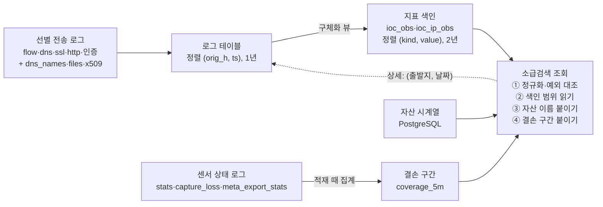

# 소급검색 설계안

작성: 2026-11-17 · 상태: 설계안(결정 대기, 7장) · 관련: [메타데이터 선별 전송 SRS](SRS_METADATA_EXPORT.md), [POC 결과 보고서](POC_RESULT.md) 저장소 설계

## 1. 목적과 범위

새로 받은 위협 지표(IP·도메인·SNI·JA3·파일 해시·인증서·계정)를 최근 1년 메타데이터에 대어 **누가, 언제, 몇 번 닿았는지를 수 초 안에** 답하는 기능을 설계합니다. 핵심은 Manager 쪽의 지표 색인 테이블 하나와, 지금 센서가 보내지 않는 해시·인증서·전체 도메인 이름을 보강하는 것입니다.

| 구분 | 내용 |
| --- | --- |
| 다루는 것 | 지표 일치 소급검색(저장·조회 설계), 결손 구간 표시, 센서 메타데이터 보강, 용량 |
| 다루지 않는 것 | 새 탐지 룰을 과거 데이터에 다시 돌리기. 룰은 Zeek 이벤트 위에서 상태를 쌓으므로 줄인 메타데이터로 재현할 수 없고, 원본·pcap 보관이 필요해 별도로 결정합니다 |
| 다루지 않는 것 | 자유 질의 헌팅(ClickHouse SQL로 가능하나 화면·권한 설계는 Manager 몫), 위협 인텔 피드 수집 방식 |
| 관계 | 센서의 실시간 일치(JA3 블록리스트 `intel_ja3.zeek`, 97개)는 앞으로의 트래픽을 봅니다. 소급검색은 같은 지표로 지난 트래픽을 봅니다. 지표를 한 곳(Manager 지표 목록)에 등록하면 양쪽에 쓰는 구조를 목표로 합니다 |

## 2. 현재 상태

지금 설계로는 **외부 IP·등록 도메인·SNI·JA3·계정은 찾을 수 있고, 파일 해시·인증서·하위 도메인은 찾을 수 없습니다.** 메타데이터 선별 기준이 전송량을 줄이는 쪽으로 잡혀 있고, 소급검색은 요구사항에 없었기 때문입니다.

| 지표 | 남는 곳 | 지금 | 빈틈 |
| --- | --- | --- | --- |
| 계정 | kerberos, ntlm, rdp | 됨 | 없음(줄이지 않고 전량) |
| 외부 IP | flow_summary | 됨 | 30분 단위 요약. 내부→내부는 관리 포트만 |
| 등록 도메인 | dns_summary | 됨 | 예외 도메인 제외, 출발지당 시간 100개 초과분은 `(other)` |
| 하위 도메인(FQDN) | dns_summary `sample_names` | 거의 안 됨 | (출발지, 도메인)당 시간 3개만 |
| IP→도메인 되짚기 | dns_summary `answers` | 일부 | 응답 3개만 |
| SNI·JA3 | ssl | 됨 | (출발지, SNI, JA3) 24시간 1행이라 횟수 없음 |
| URL | http | 경로만 | 쿼리 문자열 제외(개인정보), 10분 중복 억제 |
| User-Agent | http_ua_summary | 됨 | 24시간 요약 |
| 파일 해시 | 없음 | 안 됨 | files 로그를 보내지 않음 |
| 인증서 지문·발급자 | 없음 | 안 됨 | x509 로그를 보내지 않음 |
| JA3S·JA4·HASSH | 없음 | 안 됨 | JA3S는 센서에 있으나 전송 필드에 없음. JA4·HASSH는 수집 안 함 |

구조적으로 걸리는 점은 세 가지입니다.

1. **목적지 기준 검색이 느립니다.** 테이블 정렬 키가 `(orig_h, ts)`라서 누가 이 IP·도메인에 붙었는지 묻는 질의는 1년치를 거의 통째로 읽습니다.
2. **결과가 없을 때 없었던 건지 알 수 없습니다.** 분당 상한(`dropped_rate`), `(other)` 묶음, 예외 도메인, 패킷 손실(capture_loss), 센서 중단 구간은 행이 남지 않는데, 이를 검색 결과와 잇는 장치가 없습니다.
3. **정밀도가 로그마다 다릅니다.** 행 단위(정확한 시각), 30분·1시간·24시간 요약, 24시간 중복 억제(첫 시각만)가 섞여 있어, 결과에 어느 정밀도인지 밝혀야 합니다.

## 3. 요구사항

지표 1개를 90일치에 **5초 안에**, 1년치에 **30초 안에** 답하고, 결과에는 못 본 구간을 함께 내는 것을 기준으로 잡습니다. 시간 목표는 CIC 메타데이터를 ClickHouse에 넣어 재고 확정합니다.

| ID | 요구 | 기준 |
| --- | --- | --- |
| RS-1 | 지원 지표 | IP(v4·v6, 대역), 도메인(정확·접미사 일치, 등록 도메인·FQDN), SNI, JA3·JA3S, Host+경로, User-Agent(부분 일치), 파일 MD5·SHA1·SHA256, 인증서 SHA1·SHA256 지문·발급자·시리얼, 계정 |
| RS-2 | 기간 | 기본 90일, 최대 1년(메타데이터 TTL과 같음). 지표 색인은 2년 |
| RS-3 | 응답 시간 | 지표 1개: 90일 5초, 1년 30초. 지표 100개 일괄: 90일 1분 |
| RS-4 | 결과 내용 | 지표별 첫·마지막 관측, 출발지 host 목록(자산 이름 붙임), 날짜별 건수, 나온 로그 종류, 연결 `uid`(있을 때) |
| RS-5 | 정밀도 표시 | 결과 행마다 정밀도: 정확(행 단위), 주기 요약(30분·1시간·24시간), 첫 관측만(24시간 중복 억제) |
| RS-6 | 결손 표시 | 조회 기간 안의 센서 중단, 패킷 손실 1% 초과, 분당 상한 버림, `(other)` 묶음을 센서·5분 단위로 함께 보여 줌. 예외 도메인에 걸린 지표는 결과 0건 대신 제외 사실을 알림 |
| RS-7 | 지표 등록 | 등록 즉시 1회 소급검색, 이후 실시간 일치에도 쓰임(센서 배포 또는 Manager 수집 단계 일치). 지표마다 출처·등록자·만료일 |
| RS-8 | 적중 처리 | 소급 적중은 조사 결과로만 보여 주고 자동으로 사건을 만들지 않음. 운영자가 사건으로 올리면 탐지와 같은 사건 처리 경로를 탐 |
| RS-9 | 개인정보 | URL 쿼리 문자열·인증 응답값은 계속 보내지 않음(NFR-M7 유지). 파일 이름은 보냄 |

## 4. 저장 설계

로그 테이블은 그대로 두고, 적재할 때 **지표 색인 테이블 `ioc_obs` 하나를 구체화 뷰로 함께 채웁니다.** 색인은 (지표, 날짜, 출발지)마다 한 행으로 묶여 작고, 정렬 키가 지표라서 목적지 기준 검색이 범위 읽기 한 번으로 끝납니다. 상세가 필요하면 색인이 준 (출발지, 날짜)로 원 테이블을 읽는데, 이는 원 테이블 정렬 키 `(orig_h, ts)`와 맞습니다.



조회는 지표 색인만 읽고, 원 로그 테이블은 상세를 눌렀을 때만 읽습니다.

| 방식 | 장점 | 단점 | 판단 |
| --- | --- | --- | --- |
| 원 테이블에 bloom_filter 보조 인덱스(`resp_h`, `domain`, `server_name`, `ja3`) | 테이블 추가 없음 | 1년치 파티션마다 인덱스를 읽음. 로그마다 따로 질의 | 보조로만 |
| 테이블별 projection(목적지 정렬 사본) | 질의는 그대로 | 해당 테이블 용량이 거의 2배 | 안 씀 |
| **지표 색인 테이블 `ioc_obs`** | 모든 로그를 질의 하나로, 묶어서 작음, 원 로그보다 오래 보관 가능 | 구체화 뷰 관리 | **채택** |

### 4.1 지표 색인 `ioc_obs`

```sql
CREATE TABLE ioc_obs (
  kind       LowCardinality(String),  -- ip, domain, fqdn, sni, ja3, ja3s, url, ua, md5, sha1, sha256, cert_sha1, cert_sha256, cert_issuer, cert_serial, account
  value      String,                  -- 도메인류는 뒤집어 저장(moc.elpmaxe.www.) → 접미사 일치 = 접두사 범위 읽기
  day        Date,
  sensor     LowCardinality(String),
  orig_h     IPv6,
  src_log    LowCardinality(String),  -- flow_summary, dns_summary, dns_names, ssl, http, files, x509, kerberos ...
  precision  LowCardinality(String),  -- exact, summary, first_only
  first_ts   SimpleAggregateFunction(min, DateTime64(3)),
  last_ts    SimpleAggregateFunction(max, DateTime64(3)),
  hits       SimpleAggregateFunction(sum, UInt64),
  sample_uid SimpleAggregateFunction(any, String)
) ENGINE = AggregatingMergeTree
PARTITION BY toYYYYMM(day)
ORDER BY (kind, value, day, sensor, orig_h, src_log, precision)
TTL day + INTERVAL 2 YEAR;

-- 예: flow_summary → 목적지 IP
CREATE MATERIALIZED VIEW mv_ioc_flow TO ioc_obs AS
SELECT 'ip' AS kind, toString(resp_h) AS value, toDate(ts) AS day, sensor, orig_h,
       'flow_summary' AS src_log, 'summary' AS precision,
       ts AS first_ts, ts AS last_ts, conns AS hits, sample_uid
FROM flow_summary;
```

구체화 뷰는 로그와 지표 종류마다 하나씩 둡니다.

| 원 로그 | kind ← 필드 | precision | hits |
| --- | --- | --- | --- |
| flow_summary | ip ← `resp_h` | summary(30분) | `conns` |
| dns_summary | domain ← `domain`, ip ← `answers` | summary(1시간) | `queries` |
| dns_names(신규) | fqdn ← `query`, ip ← `answers` | first_only(24시간) | 1 |
| ssl | sni ← `server_name`, ja3, ja3s, cert_sha256 ← `cert_fp`(서버 인증서) | first_only(24시간) | 1 |
| http | domain·fqdn ← `host`, url ← `host`+`uri_path` | exact(10분 억제) | 1 |
| http_ua_summary | ua ← `user_agent` | summary(24시간) | `requests` |
| files(신규) | md5, sha1, sha256 | first_only(24시간) | 1 |
| x509(신규) | cert_sha1, cert_sha256, cert_issuer, cert_serial | first_only(24시간) | 1 |
| kerberos, ntlm, rdp | account ← `client`·`username`·`cookie` | exact | 1 |

- IP 대역 검색을 위해 IP는 `value` 문자열 대신 `IPv6` 열을 쓰는 같은 모양의 `ioc_ip_obs`에 따로 둡니다. 대역이 범위 읽기가 됩니다.
- 도메인류는 소문자로 바꾸고 뒤집어 넣습니다. `evil.com`을 찾으면 `moc.live.`로 시작하는 행을 읽어 `a.evil.com`까지 한 번에 나옵니다.
- User-Agent 부분 일치는 `kind='ua'` 행만 훑습니다. 종류가 수천 단위라 인덱스 없이도 충분합니다.
- 정밀도가 다른 행이 합쳐지지 않도록 `precision`을 정렬 키에 둡니다. SNI처럼 첫 관측만 남는 지표는 같은 날 같은 목적지의 flow_summary 연결 수를 결과에 덧붙여 횟수를 보완합니다.

### 4.2 결손 테이블 `coverage_5m`

```sql
CREATE TABLE coverage_5m (
  sensor           LowCardinality(String),
  t                DateTime,   -- 5분 구간 시작
  up               UInt8,      -- stats.log 행이 있었는지
  capture_loss_pct Float32,    -- capture_loss.log
  dropped_rate     UInt32,     -- meta_export_stats, 스트림 합
  other_rows       UInt32      -- dns_summary domain='(other)'
) ENGINE = ReplacingMergeTree
ORDER BY (sensor, t)
TTL t + INTERVAL 2 YEAR;
```

센서가 이미 보내는 상태 로그(stats, capture_loss, meta_export_stats)로 채웁니다. 센서 쪽 변경은 없습니다.

### 4.3 조회 흐름

1. 지표 정규화: 종류 판별, 소문자, 도메인 뒤집기, IP 대역 범위 계산.
2. 예외 도메인(`meta_domain_allowlist`)과 대조: 걸리면 결과에 "수집 제외 대상"을 표시.
3. `ioc_obs`·`ioc_ip_obs` 범위 읽기: 날짜·센서·출발지별 첫·마지막 시각, 건수, 정밀도.
4. 출발지에 자산 이름 붙이기: PostgreSQL IP-자산 시계열에서 관측 시각 기준.
5. `coverage_5m`에서 조회 기간의 결손 구간을 센서별로 묶어 붙이기.
6. (선택) 행을 눌러 상세: (출발지, 날짜)로 원 테이블을 읽고, `sample_uid`가 있으면 센서 T2 원본까지.

## 5. 센서 보강

센서에는 **선별 전송 스트림 3개(`dns_names`, `files`, `x509`)를 추가하고 ssl 행에 필드 2개를 더합니다.** 모두 기존 선별 전송 틀(범위 → 조건 → 중복 억제 → 분당 상한 → 통계)을 그대로 타고, 각각 끌 수 있게 둡니다.

| 출력 | 원본 | 범위 | 조건 | 중복 억제 키 · 기간 | 필드 |
| --- | --- | --- | --- | --- | --- |
| dns_names | dns.log | 전체 | dns_summary와 같은 제외(빈 질의, 역방향, 예외 도메인, 내부 리졸버 출발지). (출발지, 등록 도메인)당 하루 50개, 출발지당 하루 2,000개까지 | (출발지, FQDN) · 24시간 | ts, uid, orig_h, query, qtype, rcode, answers(최대 5) |
| files | files.log | 경계 또는 내부 관리 | 출처가 HTTP·SMB·FTP, 해시가 계산됨(파일을 끝까지 봄), 인증서 제외 | (출발지, SHA1) · 24시간 | ts, uid, orig_h, resp_h, source, mime_type, filename, total_bytes, md5, sha1, sha256 |
| x509 | x509.log | (연결 정보 없음) | 서버 인증서(체인 첫 값) | 지문 · 24시간(센서 전체) | ts, fingerprint(SHA256), sha1, subject, issuer, serial, not_valid_before, not_valid_after, san_dns |
| ssl(필드 추가) | ssl.log | 기존과 같음 | 기존과 같음 | (출발지, SNI, JA3, **cert_fp**) · 24시간 | + `ja3s`, `cert_fp`(서버 인증서 SHA256) |

구현에서 확인한 것(Zeek 9.0.1 스크립트):

- **파일 해시:** 기본으로는 계산하지 않습니다. `policy/frameworks/files/hash-all-files`는 모든 파일에 MD5·SHA1·SHA256 분석기를 붙이므로, 그대로 쓰지 않고 `file_new`에서 출처(HTTP·SMB·FTP)와 범위를 본 뒤 필요한 파일에만 붙입니다. files.log에는 연결 `uid`와 `id`가 있어 출발지를 바로 알 수 있습니다.
- **인증서 지문:** Zeek x509 지문은 `X509::hash_function` 기본값인 SHA256입니다. 위협 피드(예: SSL 블랙리스트)는 SHA1을 쓰는 경우가 많아, 인증서 DER에서 SHA1을 따로 계산해 함께 보냅니다.
- **ssl과 인증서 잇기:** ssl.log `cert_chain_fps` 첫 값이 서버 인증서 지문입니다. 이를 `cert_fp`로 보내고, 인증서 내용은 x509 스트림에 하루 한 번만 보냅니다. TLS 1.3은 인증서가 암호화되어 이 두 값이 비어 있습니다.
- **JA3S:** 센서의 `rules/ja3`(ja3s.zeek)가 이미 계산합니다. 전송 필드에 더하기만 하면 됩니다.
- **dns_names 메모리:** 중복 억제 키를 24시간 들고 있어야 합니다. 1,000대 × 하루 300개면 약 30만 키입니다. 키 상한(`meta_dns_names_max_keys`)을 두고, 넘으면 새 이름은 쓰지 않고 버린 수를 통계에 남깁니다.
- **DNS 터널:** 하위 도메인을 대량으로 만드는 트래픽은 (출발지, 등록 도메인)당 50개 상한에서 멈춥니다. 이런 트래픽은 탐지 룰(`DNS_Tunneling`)과 dns_summary의 `unique_names`가 다룹니다.
- **더 미룸:** JA4는 외부 패키지이고, JA4+ 일부는 라이선스가 달라 따로 검토합니다. HASSH도 같은 이유로 다음 단계입니다.

파라미터(기본값은 초안, 고객 측정 후 확정):

| 이름 | 기본값 | 의미 |
| --- | --- | --- |
| `meta_dns_names` | T | dns_names 스트림 켬 |
| `meta_dns_names_per_domain` / `meta_dns_names_per_src` | 50 / 2,000 | (출발지, 등록 도메인)·출발지별 하루 상한 |
| `meta_dns_names_max_keys` | 500,000 | 중복 억제 키 상한(메모리 보호) |
| `meta_files_hash` | T | 파일 해시 계산과 files 스트림 |
| `meta_files_sources` | HTTP, SMB, FTP | 해시를 계산할 출처 |
| `meta_files_max_bytes` | 100MB | 이보다 큰 파일은 해시 안 함(처리 시간 보호, `Content-Length`·SMB 크기로 판단) |
| `meta_x509` | T | x509 스트림과 ssl `cert_fp` |

## 6. 용량 추정

1,000명 규모에서 **센서 전송량은 하루 약 85MB(기존 1\~3GB의 3\~8%), Manager 디스크는 1년 약 30GB(복제 2벌 포함)** 늘어날 것으로 봅니다. 기존 1년 설계 0.3\~0.6TB의 5\~10%입니다. 아래는 일반적인 사내 단말 기준 가정으로 만든 추정이고, 이 로그로 재지 않았습니다.

| 항목 | 가정 | 하루 행 | 행 크기 | 하루(압축 전) |
| --- | --- | --- | --- | --- |
| dns_names | 단말당 하루 고유 FQDN 300개 | 30만 | 200B | 60MB |
| ssl 필드 추가 | ssl 행 10만에 `ja3s`·`cert_fp` | (기존 행) | +100B | 10MB |
| files | 단말당 하루 해시 대상 파일 30개 | 3만 | 300B | 9MB |
| x509 | 하루 서로 다른 서버 인증서 1만 개 | 1만 | 600B | 6MB |
| **센서 추가 합계** | | | | **약 85MB** |

| Manager 저장 | 계산 | 1년(복제 2벌) |
| --- | --- | --- |
| 신규·추가 로그 | 85MB × 365일 = 31GB, 압축 1/5\~1/10 | 6\~12GB |
| `ioc_obs`·`ioc_ip_obs` | 단말당 하루 지표 약 1,000행(IP·FQDN·도메인·SNI 등) → 100만 행, 압축 후 행당 약 30B | 약 22GB |
| `coverage_5m` | 센서당 하루 288행 | 1GB 미만 |
| **합계** | | **약 30GB** |

- 처리 부하는 파일 해시가 가장 큽니다. 해시 연산량은 평문 파일 바이트에 비례하므로, SMB 파일 서버가 많은 고객에서 더 커집니다. 기존 처리 시간 측정 방식으로 켬·끔을 비교합니다.
- 확정 방법: 고객 센서 하루 로그로 스트림별 행 수를 재고, CIC 메타데이터를 ClickHouse에 넣어 `ioc_obs` 행 수와 압축률을 잽니다.

## 7. 단계별 계획과 결정할 것

**1단계는 센서를 고치지 않고 Manager만으로 할 수 있습니다.** 지금 오는 로그로 IP·도메인·SNI·JA3·URL·UA·계정 소급검색과 결손 표시가 되므로, Manager 적재를 만들 때 함께 넣는 것이 가장 싼 길입니다.

| 단계 | 내용 | 바뀌는 곳 | 선행 조건 |
| --- | --- | --- | --- |
| 1. 색인·결손 | `ioc_obs`·`ioc_ip_obs`·`coverage_5m`, 구체화 뷰, 조회 API와 결과 형식(RS-4\~6) | Manager | ClickHouse 적재 구현 |
| 2. 도메인·인증서 보강 | `dns_names`, `x509`, ssl `ja3s`·`cert_fp`, btest, `SRS_METADATA_EXPORT.md` 갱신 | 센서(`nsm_rules/metadata/`) | 없음(1단계와 병행 가능) |
| 3. 파일 해시 | `files` 스트림과 해시 분석기 선택 부착, 처리 시간 측정 | 센서 | 고객 트래픽 처리 시간 측정 |
| 4. 지표 목록 단일화 | Manager 지표 목록 등록 → 즉시 소급검색 + 센서 실시간 일치용 파일 생성(지금 `intel_ja3.zeek` 생성 방식 확장) | Manager + 센서 배포 | 1단계 |
| 5. 용량 확정 | 고객 센서 하루 측정, CIC 메타데이터 적재로 행 수·압축률·응답 시간 확인 | 측정 | 1·2단계 |

결정할 것:

- [ ] 지원 지표 범위: 파일 해시를 1차에 넣을지(처리 부하가 가장 큼)
- [ ] 기간: 원 로그 1년, 지표 색인 2년으로 둘지
- [ ] 응답 시간 목표(RS-3)가 운영 요구에 맞는지
- [ ] 실시간 일치를 센서(Zeek 파일 배포)에서 할지, Manager 적재 단계에서 할지
- [ ] 소급 적중을 자동으로 사건으로 올릴지(제안은 올리지 않음, RS-8)
- [ ] 탐지 룰 과거 재실행이 필요한지. 필요하면 원본(T2)·pcap 보관 정책을 따로 정해야 함
