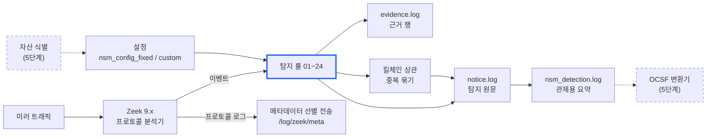

# NSM 탐지룰 SRS (소프트웨어 요구사항 명세)

최종 수정: 2026-11-11 · 원본: 이 파일(`docs/SRS.md`). 룰·설정을 바꾸는 PR에서 함께 고칩니다. PoC 결과는 [탐지 PoC 결과 보고](DETECTION_POC_RESULT.md)에 있습니다.

nsm_rules는 미러 트래픽을 Zeek로 분석해 킬체인 7단계(정찰 → 초기 침투 → 자격증명 접근 → 확산 → C2 → 유출 → 영향)의 위협 29종을 탐지 룰 23개로 탐지하고, 탐지마다 근거와 요약 로그를 남기는 Zeek 패키지입니다. 이 문서는 2026-11-09 main(6c1484c, PR #1\~#22 반영) 기준으로 시스템이 무엇을 해야 하는지와 어떻게 설정하는지를 정리합니다.

## 1. 개요

이 시스템의 목적은 네트워크 미러 트래픽만으로 공격 단계별 위협을 찾아내고, 담당자가 바로 확인할 수 있는 근거를 남기는 것입니다. 단말 에이전트 없이 동작합니다.

### 1.1 범위

| 구분 | 포함 | 제외 |
| --- | --- | --- |
| 탐지 | 탐지 룰 23개(파일 01\~24, 11번은 08번에 통합), 탐지 유형 29종 | 페이로드 복호화(TLS·SMB3 암호화 내용) |
| 공통 기능 | 근거 기록, 탐지 요약, ATT&CK 매핑, 알람 억제, 킬체인 상관, 로그 필터 | 경보 전송(메일·SIEM 연동)은 외부 시스템 몫 |
| 운영 | 단일 프로세스, 클러스터(manager·proxy·worker) | 센서 하드웨어·미러 구성 |
| 검증 | btest 34개, 합성 pcap 21개 + Zeek 공개 trace 1개, CI(Zeek 9.0.1·8.0.9) | 실제 고객망 성능 측정 |

### 1.2 대상 독자

- **보안 관제 담당자**: 어떤 탐지가 무슨 뜻인지(4·6장)
- **배포·운영 담당자**: 무엇을 설정해야 하는지(3·7장, 부록 A)
- **룰 개발자**: 요구사항과 검증 기준(5·8·9장)

### 1.3 용어

| 용어 | 뜻 |
| --- | --- |
| Zeek | 네트워크 트래픽을 프로토콜별 이벤트와 로그로 바꿔 주는 오픈소스 분석기 |
| 룰 | `nsm_rules/detections/NN_*.zeek` 파일 하나. 한 위협 주제를 탐지 |
| notice | 탐지 1건. `notice.log`에 남고 `NSM::Port_Scan`처럼 탐지 유형 이름을 가짐 |
| 근거(evidence) | 탐지를 뒷받침하는 관측 1건(누가·어디서·무엇을). `evidence.log` |
| 탐지 요약(detection) | notice 1건을 관제용으로 정리한 행. `nsm_detection.log` |
| 킬체인 상관 | 같은 공격자의 여러 탐지를 단계 순서로 이어 붙인 탐지(`Correlated_KillChain`) |
| 내부망 | `Site::local_nets`에 등록한 대역. 모든 방향 판정(내부→외부 등)의 기준 |
| 예외 목록(allowlist) | 탐지에서 빼는 출발지·목적지·도메인 목록. 예외 엔진으로 옮기는 중(5.4절) |
| 예외 엔진 | 예외를 룰 코드가 아니라 데이터(예외 파일)로 관리하는 공통 모듈. 재시작 없이 다시 읽음(5.4절) |
| 처리(disposition) | 예외에 맞았을 때의 동작. `drop`(기록하지 않음, 기본) 또는 `suppress`(기록하되 알림 표시만 끔) |
| 집계 창(epoch/interval) | 개수를 세는 시간 단위. 창이 끝나거나 임계를 넘으면 판정 |
| SumStats | Zeek의 분산 집계 프레임워크. 클러스터에서 워커 값을 매니저가 합침 |
| fan-out | 한 출발지가 여러 목적지로 퍼지는 형태(확산 탐지의 기본 모양) |

## 2. 시스템 구성

Zeek가 미러 트래픽을 프로토콜 이벤트로 바꾸면, nsm_rules 패키지의 탐지 룰이 설정값을 기준으로 판정하고 로그 3종을 남깁니다.



파란 테두리가 판정의 중심인 탐지 룰이고, 점선 상자는 아직 연결되지 않은 다음 단계입니다.

| 구성 요소 | 파일 | 역할 |
| --- | --- | --- |
| 로더 | `nsm_rules/__load__.zeek` | 모든 구성 요소를 정해진 순서로 로드(7.1절) |
| 공통 정의 | `detections/main.zeek` | 탐지 유형(notice) 목록, 공통 파라미터·함수, 킬체인 단계명 |
| 탐지 룰 | `detections/01~24_*.zeek`, `web_common.zeek` | 위협별 탐지(4장) |
| 근거·요약 | `evidence_log.zeek`, `detection_log.zeek`, `attack_mapping.zeek` | 근거 기록, 탐지 요약, ATT&CK 매핑 |
| 상관·묶기 | `correlation_killchain.zeek`, `notice_aggregation.zeek` | 킬체인 상관, 중복 묶기 |
| 설정 | `nsm_config_fixed.zeek`, `nsm_config_custom.zeek`, `intel_ja3.zeek` | 운영 기본값, 고객별 값, JA3 목록(7장) |
| 로그 필터 | `rules/filter_log.zeek` | 남길 로그·경로·회전 |
| 메타데이터 선별 전송 | `metadata/main.zeek` | 조사용 프로토콜 메타데이터를 골라 별도 경로로 기록(5.3절) |
| 외부 패키지 | `rules/ja3/` | Salesforce JA3 지문 계산(BSD) |
| 테스트 | `tests/` | btest·합성 pcap·생성기(9장) |

## 3. 운영 환경과 제약

Zeek 9.0.1을 기준으로 하고 8.0.9에서도 같은 결과를 내야 하며, 내부망(`Site::local_nets`)이 정확히 설정돼 있어야 대부분의 룰이 동작합니다.

| 항목 | 요구사항 | 비고 |
| --- | --- | --- |
| Zeek 버전 | 9.0.1(기준), 8.0.9(호환) | CI가 두 버전 모두 검사. 자산 식별 PoC와 같은 9.x 기준 |
| 설치 | `@load /경로/nsm_rules` 한 줄(`local.zeek`) | 패키지가 룰·상관·설정·로그 필터를 정해진 순서로 로드 |
| 배포 형태 | 단일 프로세스 또는 클러스터(manager + proxy + worker) | 클러스터 백엔드: Zeek 9 ZeroMQ, Zeek 8 Broker 모두 동작 |
| 내부망 정의 | `Site::local_nets`에 고객 내부 대역을 등록(**필수**) | 비어 있으면 내부·외부 판정이 모두 틀어짐. `172.0.0.0/8`이 아니라 `172.16.0.0/12` |
| 센서 위치 | 룰마다 필요한 구간이 다름(아래 표) | 보이지 않는 구간의 룰은 조용히 동작하지 않음 |
| 로그 형식 | 운영: JSON(`policy/tuning/json-logs`), 테스트: TSV | 로그 경로는 `filter_log.zeek`에서 지정 |
| 암호화 트래픽 | 내용 복호화 없음 | TLS·SMB3 암호화·Kerberos 티켓 내용은 보지 않고 메타데이터만 사용 |

### 3.1 룰별로 센서가 봐야 하는 구간

| 구간 | 필요한 룰 |
| --- | --- |
| 인터넷 경계(내부 ↔ 외부) | 07 비커닝, 09 암호화 C2, 10·12·14 유출, 19 외부향 SMB, 24 비표준 포트·장기 연결 |
| 클라이언트 ↔ DNS 서버 | 08 DNS 터널링·유출, 13 DGA |
| 클라이언트 ↔ 도메인 컨트롤러(88, 135, 동적 RPC) | 17 Kerberos 스프레이, 18 Kerberoasting, 23 DCSync |
| 클라이언트 ↔ 파일 서버(445) | 05 NTLM 스프레이, 06 관리 공유, 21 랜섬웨어 |
| 내부 호스트 간(동서 구간) | 01·02 스캔, 15 RDP, 16 SSH, 20 WinRM·DCOM 확산 |
| 내부 웹서버 인입 | 03 SQLi, 04 웹쉘 |
| 같은 L2 세그먼트(브로드캐스트·멀티캐스트) | 22 LLMNR/NBT-NS/mDNS 포이즈닝 |

## 4. 탐지 기능 요구사항

탐지 룰 23개가 탐지 유형 29종을 내며, 모두 `__load__.zeek`에서 활성화돼 있습니다(비활성 룰 0개). 아래 ‘판정 조건’의 숫자는 `nsm_config_fixed.zeek`까지 적용된 현재 운영 기본값입니다.

### 4.1 룰 목록 (킬체인 순서)

‘구분’은 룰이 언제부터 있었는지를 나타냅니다.

- 기존: 이번 정비 전부터 켜져 있던 룰(01·02·06·07·09·10·12·13·14·15·16). 정비 중 오탐·성능 개선이 들어간 룰도 있습니다(예: 13 무작위형 라벨 판정, 14 1MB 단위 집계, 07 클러스터 상태 모으기).
- 기존(재작성): 원래 있던 룰이지만 오탐 때문에 꺼져 있다가 판정 로직을 새로 쓰고 다시 켠 룰(03·04·05·08). 08은 이전 11번(DNS 유출)을 합쳐서 11번 파일은 없습니다.
- 신규: 2026-11 4단계 이후 새로 추가한 룰(17\~32).

| 단계 | 구분 | 룰 파일 | 탐지 유형(notice) | ATT&CK | 판정 조건 (기본값) | 주요 오탐 통제 |
| --- | --- | --- | --- | --- | --- | --- |
| 정찰 | 기존 | 01_port_scan | Port_Scan | T1046 | 내부 출발지가 한 목적지에 5분 안 고유 포트 25개 이상(응답 없거나 거부된 시도만) | 예외 출발지, 제외 포트 |
| 정찰 | 기존 | 02_host_scan | Host_Scan | T1018 | 내부 출발지가 같은 포트로 5분 안 고유 호스트 25개 이상 | 80·443·53 포트 기본 제외 |
| 초기 침투 | 기존(재작성) | 03_sqli | SQL_Injection | T1190 | 내부 웹서버로 들어오는 URI·POST/PUT 본문에 SQL 구문 구조(UNION SELECT, ' or 1=1, sleep( 등) | URL 2회 디코딩 후 검사, 검색어에 흔한 `#`·`select..from` 단독은 무시 |
| 초기 침투 | 신규 | 27_heartbleed | TLS_Heartbleed | T1190 | 평문 하트비트 요청의 선언 페이로드 길이가 실제 레코드보다 큼(시도)·응답이 요청보다 큼(성공), 암호화된 하트비트는 응답 레코드가 요청보다 32바이트 넘게 큼(성공)·응답 없는 요청 4개 이상(시도). 성공은 첫 유출 즉시 | 서버가 하트비트 확장을 수락한 연결만 핸드셰이크 뒤까지 분석, 출발지 예외 |
| 초기 침투 | 신규 | 28_xss | Cross_Site_Scripting | T1190 | 내부 웹서버로 들어오는 URI·POST/PUT 본문에 스크립트가 실행되는 구조(`<script>`, 태그 안 `onerror=` 등, `javascript:` 호출, `document.cookie`) | URL 2회 디코딩 후 검사, 태그·`alert(` 단독은 무시 |
| 초기 침투 | 기존(재작성) | 04_webshell | Webshell_Access | T1505.003 | 웹쉘 파일명+스크립트 확장자, 명령 파라미터 값이 실제 명령(`cmd=whoami`), China Chopper류 본문 | 파라미터 이름만으로는 탐지하지 않음 |
| 자격증명 접근 | 기존(재작성) | 05_ntlm_spray | NTLM_Spray | T1110.003 | 한 출발지에서 10분 안 **인증 실패** 고유 계정 10개 이상(SMB 상태코드·SPNEGO reject) | 성공은 세지 않음, 대소문자 정규화 |
| 자격증명 접근 | 신규 | 17_kerberos_spray | Kerberos_Spray | T1110.003 | 10분 안 AS 사전인증 실패(코드 24·6·18·23) 고유 계정 10개 이상 | 정상 로그온 첫 단계(코드 25) 제외 |
| 자격증명 접근 | 신규 | 17_kerberos_spray | Kerberos_Bruteforce | T1110.001 | 한 출발지가 같은 계정으로 10분 안 비밀번호 실패(코드 24·18) 20회 이상 | 예외 출발지 |
| 자격증명 접근 | 신규 | 26_service_bruteforce | SSH_Bruteforce | T1110.001 | 같은 (출발지, 목적지)로 5분 안 인증이 성공하지 않은 SSH 세션 20개 이상 | 인증 성공 추정 세션 제외, 출발지·목적지 예외 |
| 자격증명 접근 | 신규 | 26_service_bruteforce | FTP_Bruteforce | T1110.001 | 같은 (출발지, 목적지)로 5분 안 FTP 로그인 실패(530) 10회 이상 | 출발지·목적지 예외 |
| 자격증명 접근 | 신규 | 29_http_bruteforce | HTTP_Bruteforce | T1110.001 | 내부 웹서버의 같은 경로로 5분 안 서로 다른 비밀번호 값 20가지 이상(폼·JSON 로그인), 또는 Basic 인증 401 20회 이상 | 같은 비밀번호 반복·NTLM 챌린지 제외, 비밀번호 값 기록 안 함 |
| 자격증명 접근 | 신규 | 18_kerberoasting | Kerberoasting | T1558.003 | 10분 안 RC4·DES 서비스 티켓을 받은 고유 SPN 5개 이상 | krbtgt·kadmin 제외 |
| 자격증명 접근 | 신규 | 18_kerberoasting | ASREP_Roasting | T1558.004 | 사전인증 없는 AS 요청에 RC4·DES로 암호화된 AS-REP(계정마다 1건) | AES 응답은 제외(스마트카드 오탐 방지) |
| 자격증명 접근 | 신규 | 19_outbound_smb | NTLM_Credential_Leak | T1187 | 내부 호스트가 외부 서버에 NTLM 인증을 보냄(1건) | 익명 인증 제외, 허용 목적지 |
| 자격증명 접근 | 신규 | 22_name_poisoning | Name_Poisoning | T1557.001 | 한 응답자가 10분 안 LLMNR·NBT-NS·mDNS로 고유 이름 5개 이상에 긍정 응답 | mDNS 서비스 광고(PTR 등) 제외, WINS 예외 |
| 자격증명 접근 | 신규 | 32_machine_account | Machine_Account_Misuse | T1557.001 | 한 출발지가 10분 안 서로 다른 머신 계정(`host$`) 2개 이상으로 인증(NTLM·Kerberos AS-REQ) | NAT·장애 조치 클러스터 출발지 예외 |
| 자격증명 접근 | 신규 | 23_dcsync | DCSync | T1003.006 | DC가 아닌 호스트의 DRSUAPI DRSGetNCChanges 요청(1건) | DC 목록+자동 학습, Azure AD Connect 예외 |
| 확산 | 기존 | 06_smb_admin_share | SMB_Admin_Share | T1021.002 | 1분 안 관리 공유(`ADMIN$`·`C$` 등)에 접근한 고유 피해 호스트 2대 이상 | `IPC$`·`PRINT$` 제외, 관리 서버 예외 |
| 확산 | 기존 | 15_rdp_lateral | RDP_Lateral | T1021.001 | 1분 안 내부 RDP 고유 목적지 3대 이상 | 점프 서버 예외 |
| 확산 | 기존 | 16_ssh_lateral | SSH_Lateral | T1021.004 | 1분 안 SSH 인증 성공 고유 목적지 3대 이상 | 즉시 끊긴 연결 제외 |
| 확산 | 신규 | 20_winrm_dcom_lateral | WinRM_Lateral | T1021.006 | 5분 안 WinRM(5985·5986) 연결 고유 내부 목적지 3대 이상 | 관리 서버 예외(필수 등록) |
| 확산 | 신규 | 20_winrm_dcom_lateral | DCOM_Lateral | T1021.003 | 5분 안 원격 COM 객체 생성(RemoteCreateInstance) 고유 목적지 3대 이상 | 같은 인터페이스의 다른 호출 제외 |
| 확산 | 신규 | 31_remote_exec | Remote_Service_Creation | T1569.002 | 내부 → 내부 svcctl 원격 서비스 생성(CreateService\*), 대상 1대여도(1건) | 조회 호출 제외, 관리 서버 예외 |
| 확산 | 신규 | 31_remote_exec | Remote_Task_Creation | T1053.005 | 내부 → 내부 원격 예약 작업 등록(atsvc NetrJobAdd, ITaskSchedulerService SchRpcRegisterTask)(1건) | 관리 서버 예외 |
| 확산 | 신규 | 31_remote_exec | Remote_WMI_Execution | T1047 | 내부 → 내부 원격 WMI 메서드 호출(IWbemServices ExecMethod)(1건) | ExecQuery 등 조회 제외, 관리 서버 예외 |
| C2 | 기존 | 07_http_beaconing | HTTP_Beaconing | T1071.001 | 같은 목적지로 3초\~1시간 주기의 HTTP 콜백 12회(오차 25%, 누락 2회 허용) | 도메인·출발지 예외 |
| C2 | 기존(재작성) | 08_dns_tunneling | DNS_Tunneling | T1071.004 | (출발지, 등록 도메인)별 5분 안 고유 서브도메인 50개 이상 + 수상한 질의 비율 0.5 이상 | 내부 리졸버 제외, AV·DNSBL 도메인 기본 예외 |
| C2 | 기존 | 09_encrypted_c2 | Encrypted_C2 | T1573.002 | TLS 점수 3 이상(자체서명 2, SNI 없음 1, SNI 불일치 1(자체서명과 함께면 0), JA3 차단목록 2, JA4 차단목록 3, JA4-a 1) | SNI·출발지 예외 |
| C2 | 기존 | 13_dga | DGA_Domain | T1568.002 | 10분 안 NXDOMAIN 50개 이상 + NXDOMAIN 비율 0.8 이상 + 무작위형 라벨 비율 0.5 이상 | 역방향 조회 제외 |
| C2 | 신규 | 24_nonstd_port | Nonstandard_Port | T1571 | 외부향 연결의 프로토콜(HTTP·TLS·SSH)이 표준 포트가 아님(1건) | 표준 포트 표, 허용 포트·목적지 |
| C2 | 신규 | 24_nonstd_port | Long_Connection | T1572 | 외부향 TCP 연결이 6시간 이상 지속(연결 중 실시간) | VPN·메신저 목적지 예외 |
| C2 | 신규 | 30_tls_beaconing | TLS_Beaconing | T1071.001 | 같은 외부 목적지로 3초\~1시간 주기의 TLS 연결 12회 연속 + 연결 크기가 기준 ±25%(또는 512바이트) 안 | 2분 넘는 연결 제외, SNI·목적지 예외 |
| C2 | 신규 | 25_unknown_protocol | Unknown_Protocol | T1095 | 외부향 TCP에서 프로토콜 미식별 + 표준 포트 아님 + 한 방향 1MB 이상, 또는 30분 이상 + 양방향 10KB 이상 | 표준 포트 제외, 목적지·포트 예외 |
| 유출 | 기존(재작성) | 08_dns_tunneling | Exfil_DNS | T1048.003 | (출발지, 등록 도메인)별 5분 안 서브도메인 누적 256KB 이상 + 수상한 질의 비율 0.5 이상 | DNS_Tunneling과 같음 |
| 유출 | 기존 | 10_large_transfer_exfil | Exfil_Large_Transfer | T1041 | 외부향 단일 연결 업로드 50MB 이상 | 1시간 억제 |
| 유출 | 기존 | 12_web_upload_exfil | Exfil_Web_Upload | T1567.002 | 클라우드 저장소(지정 호스트 패턴)로 50MB 이상 업로드 | 출발지 예외 |
| 유출 | 기존 | 14_large_transfer_exfil | Exfil_Volume_Aggregate | T1041 | 한 호스트의 외부향 업로드 합계가 1분 안 50MB 이상(1MB 단위 실시간 집계) | 5분 억제 |
| 유출 | 신규 | 19_outbound_smb | Outbound_SMB | T1048 | 내부 → 외부 445·139 TCP 연결 성립(1건) | 경계에서 막힌 시도는 제외 |
| 영향 | 신규 | 21_smb_ransomware | SMB_Ransomware | T1486 | 1분 안 확장자가 바뀐 이름 변경 30개 이상, 또는 랜섬 노트 생성 폴더 5개 이상 | Office 임시 파일 제외, 백업 서버 예외 |

킬체인 상관 탐지 `Correlated_KillChain`은 위 탐지들을 이어 붙여 만드는 별도 유형입니다(5장).

### 4.2 탐지 방식

| 방식 | 룰 | 동작 |
| --- | --- | --- |
| 단건 | 03, 04, 09, 10, 12, 19, 23, 24 | 조건에 맞는 연결 하나가 보이면 바로 탐지. 같은 대상은 일정 시간 억제 |
| 임계 집계 | 01, 02, 05, 14, 17, 18, 21, 22 | 창 안에서 개수·바이트를 세다가 임계를 넘는 순간 탐지(창당 1건) |
| 창 종료 판정 | 06, 08, 13, 15, 16, 20 | 창이 끝날 때 한 번 판정. 최대 창 길이만큼 늦게 나오지만 창당 1건으로 깔끔 |
| 상태 추적 | 07 | 목적지별 주기를 추적(클러스터에서는 한 노드에 모음) |

### 4.3 룰별 탐지 상세

탐지 유형(notice)마다 공격이 어떻게 동작하고 정상과 무엇이 다른지, 그 차이를 Zeek의 어떤 이벤트·필드로 보는지, 무엇을 빼는지를 정리합니다. 숫자는 4.1절과 같은 현재 운영 기본값이고, 파라미터 이름과 조정 방법은 7.4절(01\~16)·7.5절(17\~32)에 있습니다.

각 항목의 목록은 다음 순서로 씁니다.

- 주체: notice의 `src`·`dst`를 무엇으로 정했는지. 킬체인 상관(5.1절)이 이 값으로 단계를 잇습니다.
- 집계·억제: 무엇을 어떤 창에서 세는지, 같은 탐지를 얼마 동안 다시 내지 않는지.
- 제외·오탐 통제: 무엇을 왜 빼는지. 룰에 남긴 탐지 정의(예: 80·443·53 제외)와, 예외 엔진(5.4절)에서 쓸 수 있는 축·기존 호환 설정 이름.
- 근거: `evidence.log`에 남기는 내용과 상관용 피해 host(`lm_targets`).

#### 4.3.1 정찰

##### 포트 스캔 (`Port_Scan`, T1046) · 01_port_scan

공격자는 한 대상에서 열린 서비스를 찾으려고 여러 포트에 연결을 시도합니다. 정상 클라이언트는 한 서버의 몇 개 포트만 씁니다. 그래서 **한 내부 출발지가 한 목적지에 5분 안에 시도한 고유 포트가 25개 이상**이면 탐지합니다.

| 데이터 | 값을 얻는 방법 (Zeek 이벤트·필드) |
| --- | --- |
| 응답 없는 시도 | `connection_attempt` (SYN에 응답 없음) |
| 거부된 시도 | `connection_rejected` (RST) |
| 열린 포트 | `connection_established`. 기본은 세지 않음(`port_scan_count_established = F`) |

- 주체: `src` = 스캐너, `dst` = 대상 host.
- 집계·억제: (출발지, 목적지)별 고유 목적지 포트 수(SumStats UNIQUE). 임계를 넘는 순간 탐지하고, 같은 (스캐너, 대상)은 5분 억제합니다.
- 제외·오탐 통제: 내부 출발지만(`port_scan_local_only`), 예외 출발지 `port_scan_allowlist`, 제외 포트 `port_scan_exclude_ports`. 성공한 연결을 세지 않아 서버 여러 포트를 정상으로 쓰는 클라이언트는 걸리지 않습니다. 예외는 예외 엔진(5.4절)으로 집계 전에 거르며, 기존 설정은 그대로 동작합니다(drop 예외로 자동 등록).
- 근거: 트래픽이 많아 탐지 시점에 요약 1행만 남깁니다.

##### 호스트 스캔 (`Host_Scan`, T1018) · 02_host_scan

같은 포트를 여러 host에 두드려 살아 있는 서버를 찾는 수평 스윕(예: 445 스윕)입니다. 정상 단말이 한 포트로 수십 대에 짧은 시간 안에 접속하는 일은 드뭅니다. **한 내부 출발지가 같은 포트로 5분 안에 시도한 고유 host가 25개 이상**이면 탐지합니다.

| 데이터 | 값을 얻는 방법 (Zeek 이벤트·필드) |
| --- | --- |
| 시도 | 01과 같음(`connection_attempt`, `connection_rejected`, 기본은 성공 연결 제외) |

- 주체: `src` = 스캐너.
- 집계·억제: (출발지, 목적지 포트)별 고유 목적지 host 수. 임계 즉시 탐지, (스캐너, 포트) 단위 5분 억제.
- 제외·오탐 통제: 80·443·53(TCP·UDP)과 7680/tcp는 기본 제외(`host_scan_exclude_ports`). 웹·DNS는 정상적으로 많은 목적지로 가고, 7680은 Windows 배달 최적화(업데이트를 내부 PC끼리 나눠 받음)가 같은 대역 여러 대에 연결하는 포트입니다. 예외 출발지 `host_scan_allowlist`. 예외는 예외 엔진(5.4절)으로 집계 전에 거르며, 기존 설정은 그대로 동작합니다(drop 예외로 자동 등록).
- 근거: 탐지 시점 요약 1행.

#### 4.3.2 초기 침투

##### SQL Injection (`SQL_Injection`, T1190) · 03_sqli

공격자는 웹 파라미터에 SQL 구문을 넣어 쿼리를 바꿉니다. 정상 요청에도 `select`, `#`, `--` 같은 단어는 나오므로, **SQL 구문 구조가 있어야 맞는 시그니처**(UNION SELECT, `' or 1=1`, `sleep(5)`, `information_schema.tables`, `; drop table`, `xp_cmdshell` 등)로만 탐지합니다.

| 데이터 | 값을 얻는 방법 (Zeek 이벤트·필드) |
| --- | --- |
| URI | `http_request`의 `original_URI` |
| POST·PUT 본문 | `http_entity_data` (요청 쪽, 연결당 앞 4096바이트까지) |
| 정규화 | `+` → 공백, URL 디코딩 2회(이중 인코딩 우회 대응), 소문자 (`web_common.zeek`) |

- 주체: `src` = 공격 출발지, `dst` = 대상 웹서버.
- 집계·억제: 단건. (출발지, 서버) 단위 10분 억제.
- 제외·오탐 통제: 내부 웹서버로 들어오는 요청만(`web_attack_local_servers_only`). 내부 사용자의 외부 사이트 요청은 보지 않습니다. 주석·구문 종료 문자 단독(`#`, `--`)과 `select ... from` 단독 패턴은 검색어 오탐 때문에 넣지 않았습니다. 취약점 스캐너·모의해킹 장비는 예외로 뺍니다(기존 `web_attack_allowlist`, 출발지). 예외는 예외 엔진(5.4절)으로 거르며, 기존 설정은 그대로 동작합니다(drop 예외로 자동 등록). 요청 줄 시점에는 Host 헤더가 없어 `domain` 축은 맞지 않습니다.
- 근거: 매칭 위치(uri·body), 메서드, 원문 앞부분, uid.

##### 웹쉘 접근 (`Webshell_Access`, T1505.003) · 04_webshell

웹쉘은 서버에 올린 스크립트로 명령을 실행합니다. 파라미터 이름(`cmd=`)만으로는 정상 요청(`cmd=refresh`)과 구분이 안 되므로, **웹쉘 파일명, 실제 명령이 담긴 파라미터 값, 웹쉘 클라이언트의 본문 페이로드** 중 하나가 보일 때 탐지합니다.

| 데이터 | 값을 얻는 방법 (Zeek 이벤트·필드) |
| --- | --- |
| 웹쉘 파일명 | `http_request` URI: `c99`·`r57`·`b374k`·`wso`·`regeorg`·`tunnel` 등 + 스크립트 확장자(php·jsp·asp·aspx 등) |
| 명령 실행 | URI 파라미터 `cmd`·`exec`·`c` 등의 값이 `whoami`, `net user`, `cat /etc/passwd`, `powershell`, `cmd.exe /c` 같은 명령 |
| 코드 실행 함수 | URI에 `eval(base64_decode(`, `assert(` + 사용자 입력 등 |
| 본문 페이로드 | `http_entity_data`: China Chopper·AntSword 서명(`@ini_set("display_errors","0")`, `@set_time_limit(0)` 등), ASP(X) chopper |

- 주체: `src` = 공격 출발지, `dst` = 웹쉘이 있는 서버.
- 집계·억제: 단건. (출발지, 서버) 단위 10분 억제.
- 제외·오탐 통제: 03과 같은 대상 판정·정규화·예외. 경로 조작(`../`)은 웹쉘이 아니라서 넣지 않았습니다.
- 근거: 매칭 위치, 메서드, 원문 앞부분, uid.

##### Heartbleed (`TLS_Heartbleed`, T1190) · 27_heartbleed

OpenSSL 1.0.1–1.0.1f(CVE-2014-0160)는 하트비트 요청이 선언한 페이로드 길이를 실제 받은 길이와 비교하지 않고 그만큼 메모리를 복사해 돌려줍니다. 공격자는 페이로드 길이를 16KB로 선언하고 실제로는 거의 보내지 않아 서버 메모리(개인 키·세션 쿠키·비밀번호)를 빼냅니다. 정상 하트비트는 선언 길이만큼 페이로드가 실려 있고 응답도 같은 크기입니다. 하트비트는 핸드셰이크 전에 평문으로 보낼 수도 있고, Heartleech처럼 핸드셰이크를 마친 뒤 암호화해 보낼 수도 있습니다. **평문은 선언 페이로드 길이가 실제 레코드에서 헤더(3바이트)와 최소 패딩(16바이트)을 뺀 길이보다 크면 시도, 응답이 요청 레코드보다 크면 성공으로 봅니다. 암호화는 응답 레코드가 요청 레코드보다 32바이트 넘게 크면 성공, 응답 없는 요청이 4개 이상이면 시도로 봅니다.** 성공은 요청보다 큰 응답이 처음 보이는 즉시 탐지합니다.

| 데이터 | 값을 얻는 방법 (Zeek 9.0.1·8.0.9 확인) |
| --- | --- |
| 하트비트 요청·응답 | `ssl_heartbeat`(`heartbeat_type` 1 = 요청, 2 = 응답)의 `length`(레코드 길이)와 `payload_length`(선언 길이). Zeek 기본 `policy/protocols/ssl/heartbleed.zeek`와 같은 비교 |
| 판정 시점 | 연결 상태(`connection` 레코드 확장)에 요청·응답 수, 마지막 요청 길이, 최대 응답 길이를 모읍니다. 성공은 요청보다 큰 응답이 처음 보이는 `ssl_heartbeat`·`ssl_encrypted_data`에서, 암호화 시도는 응답 없는 요청이 4개가 되는 요청에서 바로 냅니다. 응답을 기다려야 하는 평문 과다 읽기 시도만 `connection_state_remove`에서 냅니다 |
| 암호화된 하트비트 | `ssl_encrypted_data`에서 `content_type` 24(하트비트)인 레코드의 방향과 길이 |
| 분석기 유지 | 기본 설정 `SSL::disable_analyzer_after_detection=T`는 `ssl_established` 때(`finish()`, priority -5) SSL 분석기를 떼어 내 이후 레코드가 보이지 않습니다. `ssl_extension`(서버 쪽, 코드 15)으로 서버가 하트비트 확장을 수락한 연결을 표시하고, 그 연결만 `ssl_established`(priority 0)에서 `c$ssl$analyzer_id`를 지워 분석기를 남깁니다. `finish()`는 analyzer_id가 있을 때만 떼어 냅니다. 전역 옵션은 바꾸지 않습니다(Zeek 기본 `heartbleed.zeek`는 모든 TLS에 대해 F로 바꿈) |

- 주체: `src` = 공격 host(TLS 클라이언트), `dst` = 대상 서버.
- 집계·억제: 연결 단위로 결과(시도·성공)마다 최대 1건, (출발지, 서버, 결과) 단위 1시간 억제. 같은 연결에서 시도를 낸 뒤 성공이 보이면 성공을 한 번 더 냅니다. 결과는 근거 `operation`의 `tls_heartbleed_attempt`·`tls_heartbleed_success`와 `sub`의 `result=`로 구분합니다. CIC-IDS2017 Wednesday처럼 20분 이어진 공격도 연결이 끝나기를 기다리지 않고 첫 유출 때 알립니다.
- 처리 부하: 하트비트 확장을 켠 서버는 OpenSSL 1.1.0(2016) 이후 기본값이 꺼져 드물어서 분석기가 남는 연결은 적습니다. `ssl_encrypted_data`는 분석기가 붙어 있는 동안 암호화 레코드마다 오지만, 대부분의 연결은 핸드셰이크까지라 몇 건이고 하트비트가 아니면 바로 돌아갑니다.
- 제외·오탐 통제: 기본 Zeek 스크립트를 로드하지 않아도 동작하며 그 스크립트의 notice와는 별개입니다. 암호화 판정은 길이만 보므로 응답에 MAC·패딩 차이를 넘는 여유(32바이트)를 둡니다. 취약점 스캐너는 예외 엔진(5.4절, `exception_drop`)으로 출발지 축 예외를 등록합니다. 새 `*_allowlist`는 두지 않습니다.
- 근거: 결과, 요청·응답 수, 마지막 요청 길이, 최대 응답 길이, 과다 읽기 요청 여부, 포트, uid. 킬체인 묶음에는 넣지 않았습니다(초기 침투 묶음이 없음). 탐지 요약 진단명 `NSM.WebAttack.Heartbleed`.

##### 크로스 사이트 스크립팅 (`Cross_Site_Scripting`, T1190) · 28_xss

XSS는 웹 파라미터에 스크립트를 넣어 다른 사용자의 브라우저에서 실행되게 합니다(반사형은 URI, 저장형은 게시판 같은 POST 본문). 정상 요청에도 `<b>` 같은 태그나 `alert(` 같은 단어는 나오므로, **스크립트가 실행되는 HTML 구조가 있어야 맞는 시그니처**(`<script>` 태그, 태그 안의 이벤트 핸들러 `onerror=`·`onload=`, `javascript:`·`vbscript:` URL의 함수 호출, `document.cookie`·`document.domain`, `src`·`href`의 `data:text/html`, `iframe`·`object` 등의 외부 자원 지정)로만 탐지합니다.

| 데이터 | 값을 얻는 방법 (Zeek 9.0.1·8.0.9 확인) |
| --- | --- |
| URI | `http_request`의 `original_URI` |
| POST·PUT 본문 | `http_entity_data` (요청 쪽, 연결당 앞 4096바이트까지, 03과 같은 예산) |
| 정규화 | `+` → 공백, URL 디코딩 2회, 소문자 (`web_common.zeek`, 03과 같음) |

- 주체: `src` = 공격 출발지, `dst` = 대상 웹서버.
- 집계·억제: 단건. (출발지, 서버) 단위 10분 억제.
- 제외·오탐 통제: 내부 웹서버로 들어오는 요청만(`web_attack_local_servers_only`). 서식 있는 글(`<b>`·`<p>`)과 `alert(` 단어 단독은 보지 않습니다. 관리자가 분석 스크립트 같은 `<script>` 조각을 CMS에 정상으로 올리는 서버는 예외 엔진(5.4절, `exception_drop`)으로 출발지·목적지 축 예외를 등록합니다. 취약점 스캐너는 03과 같이 출발지 예외(기존 `web_attack_allowlist`도 이 룰에 적용).
- 근거: 매칭 위치(uri·body), 메서드, 원문 앞부분, uid. 탐지 요약 진단명 `NSM.WebAttack.Xss`. 킬체인 묶음에는 넣지 않았습니다(초기 침투 묶음 없음).
- 검증: CIC-IDS2017 Thursday "Web Attack – XSS"(DVWA `xss_r`·`xss_s`)를 놓쳤던 것을 보완합니다.

#### 4.3.3 자격증명 접근

##### NTLM 패스워드 스프레이 (`NTLM_Spray`, T1110.003) · 05_ntlm_spray

스프레이는 잠금을 피하려고 비밀번호 몇 개를 많은 계정에 대 봅니다. 터미널 서버·프록시처럼 많은 사용자가 정상 인증하는 출발지와 구분하려고 성공은 세지 않고, **한 출발지에서 10분 안에 인증에 실패한 고유 계정이 10개 이상**이면 탐지합니다.

| 데이터 | 값을 얻는 방법 (Zeek 이벤트·필드) |
| --- | --- |
| 계정 | `ntlm_authenticate`의 `domain_name`·`user_name`. 소문자 `domain\user`로 정규화해 연결에 보관 |
| SMB 실패 | `smb2_message`·`smb1_message`에서 세션 설정 응답의 상태 코드가 `STATUS_LOGON_FAILURE`, `STATUS_WRONG_PASSWORD`, `STATUS_NO_SUCH_USER`, `STATUS_ACCOUNT_LOCKED_OUT` 등 |
| 그 밖의 실패 | `gssapi_neg_result`의 SPNEGO negState = reject(2) |

- `ntlm.log`의 `success`는 SPNEGO 결과로만 채워집니다. SMB 서버는 실패 시 보안 버퍼 없이 상태 코드만 돌려주므로, SMB 실패는 상태 코드로 직접 판정합니다.
- 주체: `src` = 스프레이 출발지. 대상 서버는 근거에 남깁니다.
- 집계·억제: 출발지별 실패 고유 계정 수, 임계 즉시 탐지, 1시간 억제.
- 제외·오탐 통제: 내부 서버 대상만(`ntlm_spray_local_servers_only`), 익명(null session) 제외, 예외 출발지 `ntlm_spray_allowlist`(인증 프록시·VDI 게이트웨이). 대소문자만 바꾼 같은 계정은 1개로 셉니다. 예외는 예외 엔진(5.4절)으로 집계 전에 거르며, 기존 설정은 그대로 동작합니다(drop 예외로 자동 등록).
- 근거: 계정, 대상 서버, 실패 결과(상태 코드 이름), 연결 uid 표본.

##### SSH 무차별 대입 (`SSH_Bruteforce`, T1110.001) · 26_service_bruteforce

Hydra·Patator·Medusa 같은 도구는 비밀번호마다 SSH 연결을 새로 열거나 짧은 연결 안에서 몇 번 시도하고 끊습니다. SSH는 암호화라 계정·비밀번호는 보이지 않지만, 정상 사용자는 한 번 인증에 성공해 세션을 이어 가고 공격은 인증이 성공하지 않은 짧은 세션을 같은 서버에 대량으로 남깁니다. **같은 (출발지, 목적지)로 5분 안에 버전 교환까지 마치고 인증이 성공하지 않은 SSH 세션이 20개 이상**이면 탐지합니다.

| 데이터 | 값을 얻는 방법 (Zeek 9.0.1·8.0.9 확인) |
| --- | --- |
| SSH 세션 | `connection_state_remove`의 `c$ssh`. `c$ssh$client`·`c$ssh$server`(버전 문자열)가 모두 있는 세션만 셈 |
| 인증 결과 | `c$ssh$auth_success`(Zeek가 패킷 크기로 추정). `T`인 세션은 빼고, `F`이거나 추정되지 않은(값 없음) 세션은 셈 |
| 계정 | 없음(암호화). 근거에는 클라이언트 버전 문자열을 남깁니다 |

- 주체: `src` = 공격 host, `dst` = 대상 SSH 서버.
- 집계·억제: SumStats (출발지, 목적지) 키, 5분 창 종료 시 판정(창당 1건). 같은 창 동안 억제.
- 제외·오탐 통제: 인증 성공 추정 세션은 세지 않아 Ansible·백업처럼 키로 바로 로그인하는 자동화는 쌓이지 않습니다. 배너만 확인하는 모니터링(분당 1회 수준)은 임계 아래입니다. 인터넷에 노출된 SSH 서버로 들어오는 외부 스캐너도 조건에 맞으므로, 노출 서버가 있으면 예외 엔진(5.4절, `exception_drop_agg`)으로 목적지 축 예외를 등록합니다. 내부 취약점 점검 장비는 출발지 축 예외.
- 근거: 실패 세션 수, 창 길이, 표본 세션의 uid와 클라이언트 버전(최대 10개). 킬체인 묶음은 자격증명(`corr_cred_notes`).

##### FTP 무차별 대입 (`FTP_Bruteforce`, T1110.001) · 26_service_bruteforce

FTP는 평문이라 로그인 시도마다 `USER`·`PASS`와 서버의 결과 코드가 보입니다. 정상 사용자는 비밀번호를 한두 번 틀리는 정도이고, 무차별 대입은 같은 서버에서 실패(530)를 연속으로 받습니다. **같은 (출발지, 목적지)로 5분 안에 FTP 로그인 실패 응답(530)이 10회 이상**이면 탐지합니다.

| 데이터 | 값을 얻는 방법 (Zeek 9.0.1·8.0.9 확인) |
| --- | --- |
| 로그인 실패 | `ftp_reply`의 `code` = 530. 기본 FTP 스크립트가 `c$ftp`를 채운 뒤 보도록 `&priority=-5` |
| 계정 | `c$ftp$user`(마지막 `USER` 값, 소문자). Zeek 기본값 `<unknown>`이면 비움 |

- 주체: `src` = 공격 host, `dst` = 대상 FTP 서버.
- 집계·억제: SumStats (출발지, 목적지) 키, 실패 수(SUM)·고유 계정 수(UNIQUE)·표본(SAMPLE). 5분 창 종료 시 판정(창당 1건).
- 제외·오탐 통제: 실패 뒤 성공(230)한 연결도 실패 횟수는 셉니다(성공한 공격도 놓치지 않기 위해). 접속 확인용 자동 점검 계정 등은 예외 엔진(5.4절, `exception_drop_agg`)으로 출발지·목적지 축 예외를 등록합니다.
- 근거: 실패 수, 고유 계정 수, 표본 계정·uid(계정당 1행). 킬체인 묶음은 자격증명.

##### 웹 로그인 무차별 대입 (`HTTP_Bruteforce`, T1110.001) · 29_http_bruteforce

웹 로그인 무차별 대입은 같은 로그인 경로로 비밀번호만 바꿔 가며 요청을 반복합니다. 정상 사용자는 한두 번 틀리고, 자동화·헬스 체크는 같은 비밀번호를 반복합니다. 그래서 요청 수가 아니라 **같은 (출발지, 서버, 경로)로 5분 안에 서로 다른 비밀번호 값이 20가지 이상**이면 탐지합니다. HTTP Basic 인증은 **같은 (출발지, 서버, 경로)에서 Basic 인증 헤더를 보낸 요청이 5분 안에 401을 20회 이상** 받으면 탐지합니다.

| 데이터 | 값을 얻는 방법 (Zeek 9.0.1·8.0.9 확인) |
| --- | --- |
| 폼 로그인(GET) | `http_request`의 `original_URI` 쿼리에서 비밀번호형 파라미터(`web_bf_password_params`: password·passwd·pwd·j_password 등)와 계정형 파라미터(`web_bf_user_params`) |
| 폼 로그인(POST·PUT) | `http_entity_data` 첫 조각(앞 4096바이트): 폼 인코딩이면 같은 파라미터, `{`·`[`로 시작하면 JSON의 `"password": "…"` |
| Basic 인증 | `http_reply` 401이면서 `c$http$username`이 있음(기본 HTTP 스크립트가 `Authorization: Basic`에서 채움). NTLM·Negotiate의 정상 401 챌린지는 이 값이 없어 세지 않음 |
| 비밀번호 고유 수 | 값의 MD5만 SumStats UNIQUE로 셉니다. 비밀번호 값은 어떤 로그에도 남기지 않습니다 |

- 주체: `src` = 공격 host, `dst` = 대상 웹서버.
- 집계·억제: SumStats (출발지, 서버\|경로) 키, 5분 창(`svc_bf_epoch`, 26과 공통) 종료 시 판정(창당 1건).
- 제외·오탐 통제: 내부 웹서버로 들어오는 요청만. 같은 비밀번호를 반복하는 자동 로그인·모니터링은 고유 값이 1이라 쌓이지 않습니다. 예외는 관측 전에 `exception_drop_agg`로 거릅니다(축: 출발지·목적지·포트). 취약점 스캐너는 출발지 예외(기존 `web_attack_allowlist`도 적용).
- 근거: 시도 수, 고유 비밀번호 수, 고유 계정 수, 경로, 표본 요청의 계정·uid(계정당 1행). Basic은 401 수와 사용자명. 킬체인 묶음은 자격증명(`corr_cred_notes`). 탐지 요약 진단명 `NSM.CredentialAccess.HttpBruteforce`.
- 검증: CIC-IDS2017 Thursday "Web Attack – Brute Force"(DVWA `brute`, GET 로그인)를 놓쳤던 것을 보완합니다.

##### Kerberos 패스워드 스프레이 (`Kerberos_Spray`, T1110.003) · 17_kerberos_spray

AD 도메인 인증은 NTLM보다 Kerberos가 주류라 스프레이도 KDC로 갑니다. 정상 로그온은 첫 AS-REQ에 사전인증 필요(코드 25)를 받고 바로 성공하므로, **한 출발지에서 10분 안에 AS 인증에 실패한 고유 계정이 10개 이상**이면 탐지합니다.

| 데이터 | 값을 얻는 방법 (Zeek 이벤트·필드) |
| --- | --- |
| 계정 | `krb_as_request`의 `client_name`@`service_realm`(소문자)을 연결에 보관 |
| 성공 | `krb_as_response` → 보관한 계정을 지움 |
| 실패 | `krb_error`의 `error_code`가 24(비밀번호 틀림), 6(없는 계정), 18(잠김·비활성), 23(비밀번호 만료) |
| 요청을 못 본 경우 | 비대칭 경로 등으로 AS-REQ를 놓치면 KRB-ERROR의 `client_name`을 씀 |

- 주체: `src` = 시도 출발지. KDC와 계정은 근거에 남깁니다.
- 집계·억제: 출발지별 실패 고유 계정 수, 임계 즉시 탐지, 1시간 억제.
- 제외·오탐 통제: 코드 25(PREAUTH_REQUIRED)와 TGS 오류는 세지 않습니다. 내부 KDC만(`krb_spray_local_kdc_only`), 예외 출발지 `krb_spray_allowlist`. 예외는 예외 엔진(5.4절)으로 집계 전에 거르며, 기존 설정은 그대로 동작합니다(drop 예외로 자동 등록).
- 근거: 계정, KDC, 결과 코드 이름, 연결 uid 표본.

##### Kerberos 무차별 대입 (`Kerberos_Bruteforce`, T1110.001) · 17_kerberos_spray

스프레이와 반대로 한 계정에 비밀번호를 계속 바꿔 넣습니다. **한 출발지가 같은 계정으로 10분 안에 비밀번호 실패(코드 24·18)를 20회 이상** 받으면 탐지합니다.

| 데이터 | 값을 얻는 방법 (Zeek 이벤트·필드) |
| --- | --- |
| 실패 | `Kerberos_Spray`와 같은 경로. 그중 `krb_bruteforce_codes`(24·18)만 셈 |

- 주체: `src` = 시도 출발지.
- 집계·억제: (출발지, 계정)별 실패 횟수, 임계 즉시 탐지, (출발지, 계정) 단위 1시간 억제.
- 제외·오탐 통제: 스프레이와 같은 예외. 없는 계정(6)과 만료(23)는 비밀번호 추측이 아니라서 세지 않습니다. 예외는 예외 엔진(5.4절)으로 집계 전에 거르며, 기존 설정은 그대로 동작합니다(drop 예외로 자동 등록).
- 근거: 계정, KDC, 결과 코드, 연결 uid 표본.

##### Kerberoasting (`Kerberoasting`, T1558.003) · 18_kerberoasting

서비스 티켓이 약한 암호(RC4·DES)로 암호화되면 그 서비스 계정 비밀번호를 오프라인으로 깰 수 있습니다. 공격 도구는 RC4를 요청해 여러 SPN의 티켓을 한꺼번에 받습니다. **한 출발지가 10분 안에 약한 암호 서비스 티켓을 받은 고유 SPN이 5개 이상**이면 탐지합니다.

| 데이터 | 값을 얻는 방법 (Zeek 이벤트·필드) |
| --- | --- |
| 티켓 암호 | `krb_tgs_response`의 `ticket$cipher`가 1·3(DES), 23·24(RC4) |
| SPN | `ticket$service_name` (소문자) |
| 요청 계정 | `client_name`·`client_realm` (근거용) |

- 주체: `src` = 티켓 요청 출발지, `dst` = KDC.
- 집계·억제: 출발지별 고유 SPN 수, 임계 즉시 탐지, 1시간 억제.
- 제외·오탐 통제: `krbtgt/`·`kadmin/`은 제외(`krb_roast_excluded_services`). 내부 KDC만, 예외 출발지 `krb_roast_allowlist`(레거시 RC4 서비스를 많이 쓰는 서버). AES를 강제한 환경에서는 RC4 티켓 자체가 드뭅니다. 예외는 예외 엔진(5.4절)으로 집계 전에 거르며, 기존 설정은 그대로 동작합니다(drop 예외로 자동 등록).
- 근거: SPN, KDC, 암호 이름, 요청 계정, 연결 uid 표본.

##### AS-REP Roasting (`ASREP_Roasting`, T1558.004) · 18_kerberoasting

사전인증을 요구하지 않게 설정된 계정은 사전인증 없는 AS-REQ에도 AS-REP를 돌려주고, AS-REP의 암호화 부분을 오프라인으로 깰 수 있습니다. 정상 Windows 로그온은 사전인증 없는 첫 요청에 코드 25 오류를 받으므로 이 흐름이 나오지 않습니다. **사전인증 없는 AS-REQ에 약한 암호의 AS-REP가 오면** 계정마다 1건 탐지합니다.

| 데이터 | 값을 얻는 방법 (Zeek 이벤트·필드) |
| --- | --- |
| 사전인증 여부 | `krb_as_request`의 `pa_data`에 PA-ENC-TIMESTAMP(2)·PA-FX-FAST(136)가 없음 → 계정을 연결에 보관 |
| 응답 | `krb_as_response`의 `enc_part$cipher`가 DES·RC4 |

- 주체: `src` = 요청 출발지, `dst` = KDC.
- 집계·억제: 단건. (출발지, 계정) 단위 1시간 억제.
- 제외·오탐 통제: PKINIT(스마트카드) 사전인증은 Zeek의 `pa_data`에 나타나지 않아 사전인증 없음으로 보입니다. 그래서 AES 응답은 제외합니다(`asrep_require_weak_cipher = T`). 예외 출발지는 Kerberoasting과 공유합니다. 예외는 예외 엔진(5.4절)으로 집계 전에 거르며, 기존 설정은 그대로 동작합니다(drop 예외로 자동 등록).
- 근거: 계정, KDC, 암호 이름, uid.

##### 외부 NTLM 인증 (`NTLM_Credential_Leak`, T1187) · 19_outbound_smb

문서·바로가기의 UNC 경로나 피싱 메일로 강제 인증을 일으키면, 내부 host가 공격자 서버에 NTLM 인증을 보내 NetNTLM 해시가 밖으로 나갑니다. 해시는 오프라인 크래킹이나 릴레이에 쓰입니다. 업무상 외부 서버에 NTLM 인증을 할 일은 드물므로 **내부 host가 외부 서버에 NTLM AUTHENTICATE를 보내면** 1건 탐지합니다.

| 데이터 | 값을 얻는 방법 (Zeek 이벤트·필드) |
| --- | --- |
| 인증 | `ntlm_authenticate`의 `user_name`·`domain_name`·`workstation`. SMB 외에 NTLM을 싣는 프로토콜(DCE-RPC 등)도 포함 |
| 방향 | 내부 출발지 → 외부 목적지 |

- 주체: `src` = 내부 출발지, `dst` = 외부 서버.
- 집계·억제: 단건. (출발지, 목적지, 계정) 단위 1시간 억제.
- 제외·오탐 통제: 익명 인증은 해시가 없어 제외. 협력사 파일 서버 등 허용 목적지(기존 `outbound_smb_allowed_dsts`), 예외 출발지(기존 `outbound_smb_allowlist`). 예외는 예외 엔진(5.4절)으로 거르며, 기존 설정은 그대로 동작합니다(drop 예외로 자동 등록).
- 근거: 계정, 포트, 워크스테이션 이름, uid.

##### LLMNR/NBT-NS/mDNS 포이즈닝 (`Name_Poisoning`, T1557.001) · 22_name_poisoning

Windows는 DNS로 못 찾은 이름을 LLMNR·NBT-NS로 묻고, Responder·Inveigh는 어떤 이름이든 자기라고 답해 NTLM 인증을 가로챕니다. 정상 host는 자기 이름에만 답하므로, **한 응답자가 10분 안에 긍정 응답한 고유 이름이 5개 이상**이면 탐지합니다.

| 프로토콜 | 이름을 얻는 방법 (Zeek 9.0.1 소스 확인) |
| --- | --- |
| LLMNR (5355) | `dns_A_reply` / `dns_AAAA_reply` 응답 레코드 이름 |
| mDNS (5353) | 같음. mDNS 응답은 질문 섹션이 없어(RFC 6762) 레코드 이름을 씀 |
| NBNS (137) | NB 응답 레코드는 Zeek가 이벤트를 내지 않음(`ParseRR_NBS`가 건너뜀). 그래서 `dns_request`의 질의 이름을 (질의 host, 트랜잭션 ID)로 30초 기억했다가 `dns_message`의 긍정 응답과 짝지음 |

- 응답자 = 응답 패킷의 출발 주소(연결 방향과 무관, `get_current_packet_header`). LLMNR 유니캐스트 응답은 Zeek가 서버 포트 기준으로 방향을 뒤집으므로 `resp_p = 5355`로 들어옵니다.
- 주체: `src` = 응답자(공격 host).
- 집계·억제: 응답자별 고유 "프로토콜·이름" 수, 임계 즉시 탐지, 1시간 억제.
- 제외·오탐 통제: mDNS 서비스 광고(PTR/SRV/TXT)는 한 장비가 여러 이름을 정상적으로 내므로 제외(A/AAAA만). NBNS는 A·NB·AAAA·ANY 질의만 셉니다. WINS 서버 등은 `poisoning_allowlist`. 예외는 예외 엔진(5.4절)으로 집계 전에 거르며, 기존 설정은 그대로 동작합니다(drop 예외로 자동 등록).
- 근거: 응답한 이름과 피해 질의 host. `lm_targets` = 피해 host(상관 연동). 멀티캐스트·브로드캐스트로 보낸 응답은 질의 host를 알 수 없어 비워 둡니다.

##### 남의 머신 계정 사용 (`Machine_Account_Misuse`, T1557.001) · 32_machine_account

머신 계정(`host$`)은 그 PC 자신만 씁니다. NTLM 릴레이(ntlmrelayx)는 강제 인증·이름 응답 위조로 받은 다른 PC의 인증을 대상 서버로 전달하므로, 공격 host 한 대가 여러 머신 계정으로 인증하는 모습이 됩니다. 탈취한 머신 계정 해시를 쓸 때도 같습니다. **한 출발지가 10분 안에 서로 다른 머신 계정 2개 이상으로 인증**하면 탐지합니다.

| 데이터 | 값을 얻는 방법 (Zeek 9.0.1·8.0.9 확인) |
| --- | --- |
| NTLM | `ntlm_authenticate`의 `user_name`이 `$`로 끝남, `domain_name` |
| Kerberos | `krb_as_request`의 `client_name`(`@` 앞)이 `$`로 끝남, `service_realm`. 서비스 주체(`a/b`)는 제외 |
| 계정 맞추기 | `도메인 첫 레이블\계정`(소문자). NTLM `CORP`와 Kerberos `CORP.EXAMPLE`을 같은 도메인으로 셉니다 |

- 주체: `src` = 계정을 쓴 host, `dst` = 표본 인증 대상 서버.
- 집계·억제: SumStats 출발지 키, 고유 머신 계정 수(UNIQUE)·표본(SAMPLE). 10분 창 종료 시 판정.
- 제외·오탐 통제: 자기 머신 계정만 반복하는 PC와 사용자 계정은 세지 않습니다. NAT·프록시 뒤 여러 PC, 장애 조치 클러스터 노드(노드 계정과 클러스터 이름 계정을 함께 씀)는 예외 엔진(5.4절, `exception_drop_agg`)으로 출발지 축 예외를 등록합니다.
- 근거: 머신 계정마다 1행(계정, 인증 대상, uid, NTLM·Kerberos 구분). 자산 식별(SPEC 4.6)이 같은 조건의 IP를 식별 키에서 빼던 것을 탐지로 올렸습니다. 킬체인 묶음은 자격증명.

##### DCSync (`DCSync`, T1003.006) · 23_dcsync

DCSync(mimikatz `lsadump::dcsync`, impacket secretsdump)는 DC인 척 디렉터리 복제 API를 호출해 krbtgt를 포함한 계정 해시를 가져갑니다. 이 호출을 정상적으로 하는 것은 다른 DC뿐이므로 **DC가 아닌 출발지의 DRSGetNCChanges 요청**은 1건으로 탐지합니다(고신뢰).

| 데이터 | 값을 얻는 방법 (Zeek 이벤트·필드) |
| --- | --- |
| 인터페이스 | `dce_rpc_bind`의 UUID가 DRSUAPI(`e3514235-4b06-11d1-ab04-00c04fc2dcd2`) → (fid, ctx_id)를 연결에 보관 |
| 호출 | `dce_rpc_request`의 opnum 3(DRSGetNCChanges)이 보관한 (fid, ctx_id)로 옴 |
| DC 판정 | `dcsync_domain_controllers`(설정) + `krb_as_response`·`krb_tgs_response`를 보낸 내부 host 학습(`dcsync_learn_dcs`) |

- DRSUAPI는 동적 RPC 포트를 쓰지만 Zeek의 DCE-RPC DPD 서명으로 포트와 무관하게 해석됩니다. 패킷 프라이버시로 스텁이 암호화돼도 바인드의 UUID와 요청의 opnum은 평문입니다.
- 주체: `src` = 복제를 요청한 출발지, `dst` = 대상 DC.
- 집계·억제: 단건. (출발지, DC) 단위 1시간 억제.
- 제외·오탐 통제: Azure AD Connect·ADFS 동기화 서버처럼 복제 권한을 정상적으로 쓰는 서버는 예외로 뺍니다(기존 `dcsync_allowlist`). 예외는 예외 엔진(5.4절)으로 거르며, 기존 설정은 그대로 동작합니다(drop 예외로 자동 등록). DC 목록(`dcsync_domain_controllers`)은 예외가 아니라 탐지 조건이라 그대로 설정에 둡니다. 클러스터에서는 DC 학습이 워커별이라 DC 목록을 설정에 적는 것을 권장합니다.
- 근거: 포트, 대상이 알려진 DC인지, 스텁 길이, uid, 계정(같은 연결의 NTLM 인증, 없으면 인증 맥락의 drsuapi·ldap 티켓 계정. 5.6절).

#### 4.3.4 확산

##### SMB 관리 공유 (`SMB_Admin_Share`, T1021.002) · 06_smb_admin_share

PsExec 같은 원격 실행 도구는 관리 공유(`ADMIN$`, `C$`)에 서비스 파일을 올립니다. 한 대 접근은 관리 작업일 수 있지만 짧은 시간에 여러 대로 퍼지면 확산입니다. **한 출발지가 1분 안에 관리 공유에 접근한 고유 host가 2대 이상**이면 탐지합니다.

| 데이터 | 값을 얻는 방법 (Zeek 이벤트·필드) |
| --- | --- |
| 공유 경로 | `smb2_tree_connect_request`·`smb1_tree_connect_andx_request`의 `path`가 `\\host\X$` 형태(`admin_share_pattern`) |

- 주체: `src` = 확산 기점 host. `lm_targets` = 피해 host 집합.
- 집계·억제: 출발지별 고유 목적지 host 수. 창이 끝날 때 1회 판정(창당 1건).
- 제외·오탐 통제: `IPC$`(`exclude_ipc_share`)와 `PRINT$`(`smb_lm_exclude_shares`) 제외. SCCM·백업·AV 관리 서버는 `smb_lm_allowlist`에 등록하는 것이 핵심입니다(20번의 `lm_mgmt_allowlist`와 별개라 둘 다 등록). 예외는 예외 엔진(5.4절)으로 집계 전에 거르며, 기존 설정은 그대로 동작합니다(drop 예외로 자동 등록).
- 근거: 표본 목적지마다 1행. 대표 연결 uid(관리 공유에 접근한 연결)와 계정(같은 대상 NTLM 인증, 없으면 출발지의 `cifs`·`host` 서비스 티켓 계정. 5.6절).

##### RDP 확산 (`RDP_Lateral`, T1021.001) · 15_rdp_lateral

한 host가 짧은 시간에 여러 내부 host의 RDP로 접속하는 수평 확산입니다. RDP 본문은 암호화돼 있어 누가 어디로 접속했는지만 봅니다. **한 출발지가 1분 안에 RDP로 접속한 고유 내부 host가 3대 이상**이면 탐지합니다.

| 데이터 | 값을 얻는 방법 (Zeek 이벤트·필드) |
| --- | --- |
| 접속 | `rdp_connect_request` |
| 계정 | 같은 이벤트의 `cookie`에서 `mstshash=<user>` 추출 |

- 주체: `src` = 확산 기점, `lm_targets` = 피해 host.
- 집계·억제: 출발지별 고유 목적지 수, 창 종료 시 판정(창당 1건).
- 제외·오탐 통제: 내부 → 내부만(외부에서 들어오는 RDP는 성격이 달라 제외). 점프 서버·IT 관리자 PC·원격지원 서버는 `rdp_lm_allowlist`. 예외는 예외 엔진(5.4절)으로 집계 전에 거르며, 기존 설정은 그대로 동작합니다(drop 예외로 자동 등록).
- 근거: 목적지·계정·연결 uid 표본. cookie가 없으면(NLA 전용 클라이언트 등) 같은 대상 NTLM이나 `termsrv` 티켓 계정(5.6절).

##### SSH 확산 (`SSH_Lateral`, T1021.004) · 16_ssh_lateral

한 host가 짧은 시간에 여러 내부 host에 SSH 세션을 여는 수평 확산입니다. 스캔·거부와 구분하려고 세션이 실제로 성립한 것만 셉니다. **한 출발지가 1분 안에 SSH 세션을 연 고유 내부 host가 3대 이상**이면 탐지합니다.

| 데이터 | 값을 얻는 방법 (Zeek 이벤트·필드) |
| --- | --- |
| 인증 성공 (1순위) | `ssh_auth_successful`. 비표준 포트 SSH도 잡음 |
| 세션 성립 (폴백) | 인증 이벤트가 없던 연결을 `connection_state_remove`에서 판정: 22/tcp 또는 SSH 분석기 + 클라이언트 → 서버 1000바이트 이상 + 서버 응답 있음 + 0.05초 이상 |

- 주체: `src` = 확산 기점, `lm_targets` = 피해 host.
- 집계·억제: 출발지별 고유 목적지 수, 창 종료 시 판정. 같은 연결은 uid로 한 번만 셉니다.
- 제외·오탐 통제: 내부 → 내부만. CI/CD·Ansible·모니터링·백업·점프 서버는 예외 엔진(5.4절)으로 거릅니다. 집계 전에 판정하므로 (출발지, 목적지) 쌍 예외도 됩니다. 기존 `ssh_lm_allowlist`는 그대로 동작합니다(drop 예외로 자동 등록). 경로별로 `ssh_lm_use_auth_event`·`ssh_lm_conn_fallback`으로 끌 수 있습니다.
- 근거: 표본 목적지마다 1행, 대표 연결 uid. SSH는 암호화돼 계정을 알 수 없습니다.

##### WinRM 확산 (`WinRM_Lateral`, T1021.006) · 20_winrm_dcom_lateral

PowerShell Remoting, evil-winrm, CrackMapExec winrm은 WinRM으로 원격 명령을 실행합니다. **한 출발지가 5분 안에 WinRM으로 연결한 고유 내부 host가 3대 이상**이면 탐지합니다.

| 데이터 | 값을 얻는 방법 (Zeek 이벤트·필드) |
| --- | --- |
| 연결 | `connection_established`에서 목적지 포트가 5985(HTTP)·5986(HTTPS) (`winrm_ports`) |

- 주체: `src` = 확산 기점, `lm_targets` = 피해 host.
- 집계·억제: 출발지별 고유 목적지 수, 창 종료 시 판정(창당 1건).
- 제외·오탐 통제: 내부 → 내부만. SCCM·모니터링·Ansible·점프 서버는 원격 관리를 대량으로 하므로 `lm_mgmt_allowlist` 등록이 필수입니다. 예외는 예외 엔진(5.4절)으로 집계 전에 거르며, 기존 설정은 그대로 동작합니다(drop 예외로 자동 등록).
- 근거: 표본 목적지마다 1행. 대표 연결 uid와 계정(같은 대상 NTLM, 없으면 `http`·`wsman` 서비스 티켓 계정. 5.6절).

##### DCOM 확산 (`DCOM_Lateral`, T1021.003) · 20_winrm_dcom_lateral

MMC20.Application·ShellWindows를 이용한 원격 실행(dcomexec)과 원격 WMI(wmiexec)는 원격 COM 객체 생성으로 시작합니다. **한 출발지가 5분 안에 원격 COM 객체를 만든 고유 내부 host가 3대 이상**이면 탐지합니다.

| 데이터 | 값을 얻는 방법 (Zeek 이벤트·필드) |
| --- | --- |
| 인터페이스 | `dce_rpc_bind`의 UUID가 ISystemActivator(`000001a0-0000-0000-c000-000000000046`) → (fid, ctx_id) 보관 |
| 호출 | `dce_rpc_request`의 opnum 4(RemoteCreateInstance) |

- 주체: `src` = 확산 기점, `lm_targets` = 피해 host.
- 집계·억제: WinRM과 같음.
- 제외·오탐 통제: 같은 인터페이스의 다른 호출은 세지 않습니다. 관리 서버는 `lm_mgmt_allowlist`. 예외는 예외 엔진(5.4절)으로 집계 전에 거르며, 기존 설정은 그대로 동작합니다(drop 예외로 자동 등록).
- 근거: 표본 목적지마다 1행. 대표 연결 uid와 계정(같은 대상 NTLM, 없으면 `rpcss`·`host` 서비스 티켓 계정. 5.6절).

##### 단일 대상 원격 실행 (`Remote_Service_Creation` T1569.002, `Remote_Task_Creation` T1053.005, `Remote_WMI_Execution` T1047) · 31_remote_exec

SMB 관리 공유(2대)·WinRM·DCOM(3대) 확산은 여러 대를 노려야 탐지됩니다. PsExec·impacket smbexec·`sc \\host create`(원격 서비스), `at`·`schtasks /s`(원격 예약 작업), `wmic /node … process call create`·wmiexec(원격 WMI)로 서버 한 대만 노리면 보이지 않았습니다. 정상 업무에서 PC가 다른 PC에 원격으로 서비스·예약 작업을 만드는 일은 드물므로, **내부 → 내부 원격 서비스 생성, 원격 예약 작업 등록, 원격 WMI 메서드 호출을 대상 1대여도 1건으로** 탐지합니다.

| 데이터 | 값을 얻는 방법 (Zeek 9.0.1·8.0.9 확인) |
| --- | --- |
| 호출 이름 | Zeek 기본 DCE-RPC 스크립트가 `dce_rpc_response`(priority 5)에서 바인드 정보로 채우는 `c$dce_rpc$endpoint`·`operation`을 priority 0에서 봄. SMB 명명된 파이프(`\svcctl`, `\atsvc`)와 TCP 동적 포트 모두 |
| 원격 서비스 | `svcctl`의 `CreateServiceW`·`CreateServiceA`·`CreateServiceWOW64W`·`CreateServiceWOW64A`·`CreateWowService` |
| 원격 예약 작업 | `atsvc`의 `NetrJobAdd`, `ITaskSchedulerService`의 `SchRpcRegisterTask` |
| 원격 WMI | `IWbemServices`의 `ExecMethod`·`ExecMethodAsync`. WMI는 보통 패킷 암호화지만 바인드(인터페이스)와 opnum은 평문 |

- 주체: `src` = 실행한 host, `dst`·`lm_targets` = 대상 host(확산 묶음, 대상이 다음 탐지의 출발지가 되면 이어짐).
- 집계·억제: 단건. (출발지, 대상, 종류) 단위 1시간 억제.
- 제외·오탐 통제: 조회성 호출(OpenSCManager, ExecQuery 등)은 보지 않습니다. SCCM·백업·배포 도구 등 관리 서버는 예외 엔진(5.4절, `exception_drop`)으로 출발지 축 예외를 등록합니다.
- 근거: 인터페이스·호출 이름, 포트, 명명된 파이프, uid, 계정(같은 연결 NTLM, 없으면 `cifs`·`host`·`rpcss` 서비스 티켓 계정. 5.6절).

#### 4.3.5 C2

##### HTTP 비커닝 (`HTTP_Beaconing`, T1071.001) · 07_http_beaconing

감염 host의 악성코드는 정해진 주기로 C2 서버에 접속해 명령을 받습니다. 사람이 쓰는 웹 트래픽은 간격이 불규칙합니다. **같은 외부 목적지로 3초\~1시간 주기의 HTTP 연결이 12회 연속**(주기 오차 25%, 중간 누락 2회까지 허용)이면 탐지합니다.

| 데이터 | 값을 얻는 방법 (Zeek 이벤트·필드) |
| --- | --- |
| 연결 시각 | `connection_state_remove`에서 HTTP 분석기가 붙은 연결(`c$http`)의 `start_time` |
| 목적지 이름 | `c$http$host` (도메인 예외 판정용) |
| 주기 판정 | (출발지, 목적지)별 상태머신: 기준 주기를 정하고, 다음 간격이 기준 주기의 정수배(1\~3배) ± 기준 주기 × 25% 안이면 연속 횟수 증가, 벗어나면 새 주기로 다시 시작 |

- 클러스터에서는 같은 (출발지, 목적지)의 관측을 HRW 해시로 프록시 한 대(없으면 매니저)에 모아 판정합니다. 도착 순서가 뒤바뀐 과거 시각은 무시합니다.
- 주체: `src` = 감염 host, `dst` = C2 서버.
- 집계·억제: 상태 추적. 주기가 끊겼다가 다시 생기면 재탐지할 수 있고, 같은 (출발지, 목적지)는 30분 억제.
- 제외·오탐 통제: 내부 → 외부 HTTP만(암호화 C2는 09). 3초보다 짧은 간격(한 페이지의 여러 객체)은 연속 횟수에 넣지 않습니다. 예외 목적지 `beacon_allowlist`, 도메인 예외 `beacon_allowlist_domains`(업데이트·텔레메트리). 예외는 예외 엔진(5.4절)으로 집계 전에 거르며, 기존 설정은 그대로 동작합니다(drop 예외로 자동 등록). 워커에서 연결이 끝날 때 판정하므로 HTTP Host(`domain` 축)를 씁니다.
- 근거: 기준 주기, 연속 횟수, Host, uid.

##### DNS 터널링 (`DNS_Tunneling`, T1071.004) · 08_dns_tunneling

DNS 터널(iodine, dnscat2 등)은 공격자 도메인의 서브도메인에 데이터를 인코딩해 질의합니다. CDN·클라우드도 서브도메인이 많지만 라벨이 짧거나 단어형입니다. **(출발지, 등록 도메인)별로 5분 안에 고유 서브도메인 50개 이상이고 수상한 질의 비율이 0.5 이상**이면 탐지합니다.

| 데이터 | 값을 얻는 방법 (Zeek 이벤트·필드) |
| --- | --- |
| 질의 | `dns_request`의 `query`, `qtype` |
| 등록 도메인 | `parent_domain()` (co.kr 등 2단계 공용 접미사 처리) |
| 수상한 질의 | TXT(16)·NULL(10) 질의, 서브도메인에 40자 이상 라벨, 20자 이상이면서 무작위형(13 DGA의 라벨 점수 2 이상) 라벨 중 하나 |

- 주체: `src` = 감염 host.
- 집계·억제: (출발지, 등록 도메인)별 전체 질의·수상한 질의·고유 서브도메인 수. 창 종료 시 판정, (출발지, 도메인) 단위 1시간 억제.
- 제외·오탐 통제: 내부 출발지만, 내부 재귀 리졸버 제외(`dns_tunnel_resolvers`), 역방향 조회 제외, 도메인 예외 `dns_tunnel_allowlist_domains`(기본: AV·스팸 평판 조회 도메인, AWS 로드밸런서 이름 `elb.amazonaws.com`). 로드밸런서 이름(`<이름>-<10자리 숫자>.<리전>.elb.amazonaws.com`)은 무작위처럼 보여 수상한 질의로 세지지만 AWS가 발급하는 이름이라 데이터를 실을 수 없습니다. CIC-IDS2017 5일 동안 광고 서버 로드밸런서 조회로 9건이 오탐됐습니다(표본 질의 기준, 8건은 내부 리졸버가 출발지). 같은 `amazonaws.com`의 다른 이름은 그대로 셉니다. 예외는 예외 엔진(5.4절)으로 집계 전에 거르며, 기존 설정은 그대로 동작합니다(drop 예외로 자동 등록). 터널링과 DNS 유출은 같은 집계를 쓰므로, 두 탐지 모두에 걸리는 예외는 질의 단위로 집계 전에, 한 탐지에만 걸리는 예외는 창 판정 때 (출발지, 등록 도메인) 기준으로 거릅니다. 내부 리졸버 목록(`dns_tunnel_resolvers`)은 환경 사실이라 설정에 둡니다.
- 근거: 수상한 질의 표본.

##### 암호화 C2 (`Encrypted_C2`, T1573.002) · 09_encrypted_c2

TLS로 감싼 C2는 본문을 볼 수 없어 핸드셰이크 메타데이터로 판단합니다. 신호 하나만으로는 오탐이 많아 **신호별 점수를 더해 3점 이상**이면 탐지합니다.

| 신호 (점수) | 값을 얻는 방법 (Zeek 이벤트·필드) |
| --- | --- |
| 자체서명 인증서 (2) | `ssl_established`에서 `c$ssl$subject` = `c$ssl$issuer` |
| SNI 없음 (1) | `c$ssl$server_name`이 없거나 빈 값 |
| SNI·인증서 불일치 (1, 자체서명과 함께면 0) | `c$ssl$sni_matches_cert` = F (와일드카드·SAN을 인증서 규칙대로 비교) |
| JA4 차단목록 (3) | `get_ja4` 훅 값이 `ja4_blocklist`에 정확히 일치 |
| JA4-a 워치리스트 (1) | JA4 첫 구간이 `ja4_a_watchlist`에 있음(단독으로는 임계 미달) |
| JA3 차단목록 (2) | `get_ja3` 훅 값이 `ja3_blocklist`에 있음(레거시, 전환기 병행). 흔한 브라우저·라이브러리와 지문이 겹쳐 단독으로는 임계에 못 미침 |

- TLS 1.3은 인증서가 암호화돼 자체서명·불일치 신호가 없습니다. 이때는 SNI 없음과 지문만 점수에 들어갑니다(JA3는 SNI 없음과 함께여야 탐지).
- JA3 가중치를 3에서 2로 낮춘 이유: 공개 데이터셋 CIC-IDS2017 Monday(공격 없는 날)에서 차단목록의 "Adware" 해시 3개가 정상 브라우저 지문과 같아 JA3 단독으로 1,176건이 오탐됐습니다. 지문만으로 판정하려면 JA4 차단목록(3)을 씁니다.
- 자체서명이면서 SNI가 맞지 않으면 불일치는 0점으로 셉니다(`enc_c2_w_mismatch_selfsigned`). 호스팅 업체의 기본 자체서명 인증서(Plesk, `localhost.localdomain` 등)를 쓰는 일반 웹사이트는 자체서명이면 SNI도 당연히 맞지 않아 같은 원인을 두 번 세게 됩니다. CIC-IDS2017 5일 동안 이 조합만으로 3점이 된 일반 사이트 접속이 52건(암호화 C2 오탐 56건 중)이었습니다. SNI 없는 자체서명(Cobalt Strike 기본 설정 등)은 그대로 3점입니다. 자체서명 인증서에 다른 이름의 SNI를 쓰는 C2까지 잡으려면 1로 되돌립니다(이전 동작).
- 주체: `src` = 감염 host, `dst` = C2 서버.
- 집계·억제: 연결 단위 단건. (출발지, 목적지) 단위 1시간 억제.
- 제외·오탐 통제: 내부 → 외부만. 예외는 예외 엔진(5.4절)으로 거릅니다(축: 목적지, SNI, JA4 등). 기존 `enc_c2_allowlist`(목적지)·`enc_c2_allowlist_sni`(SNI)는 그대로 동작합니다(drop 예외로 자동 등록).
- 근거: 점수, 신호 목록, SNI, 발급자, 지문.

##### DGA 도메인 (`DGA_Domain`, T1568.002) · 13_dga

DGA 악성코드는 알고리즘으로 만든 도메인을 대량 조회하고, 그중 공격자가 등록한 몇 개만 응답합니다. 그래서 응답 대부분이 NXDOMAIN이고 이름이 무작위형입니다. **10분 안에 NXDOMAIN 50개 이상, NXDOMAIN 비율 0.8 이상, NXDOMAIN 중 무작위형 라벨 비율 0.5 이상**을 모두 만족하면 탐지합니다.

| 데이터 | 값을 얻는 방법 (Zeek 이벤트·필드) |
| --- | --- |
| 응답 | `dns_message`(응답 쪽)의 `rcode`(3 = NXDOMAIN), `c$dns$query` |
| 등록 라벨 | `registered_label()`: `www.xk3f.com` → `xk3f`, `a.b.xk3f.co.kr` → `xk3f` |
| 무작위형 점수 | 모음 비율 0.25 미만(+1), 연속 자음 4자 이상(+1), 길이 정규화 엔트로피 0.9 이상(+1), 숫자 비율 0.15\~0.70(+1), 16자 이상(+1), 16진수만 + 숫자·문자 혼합 8자 이상(+2). 합이 2 이상이면 무작위형 |

- 주체: `src` = 감염 host.
- 집계·억제: 출발지별 전체 응답·NXDOMAIN·무작위형 NXDOMAIN 수. 창 종료 시 판정, 1시간 억제.
- 제외·오탐 통제: 6자 미만 라벨(wpad, dc01 등)은 무작위형으로 보지 않음, 역방향 조회 제외, 도메인 예외 `dga_allowlist_domains`(예외 도메인은 비율 계산에서도 뺌). 7자 이하 무작위 라벨은 판정력이 낮습니다(시뮬레이션 약 72%). 예외는 예외 엔진(5.4절)으로 집계 전에 거르며, 기존 설정은 그대로 동작합니다(drop 예외로 자동 등록).
- 근거: 무작위형 NXDOMAIN 질의만 표본으로 남깁니다(질의, 점수, uid).

##### 비표준 포트 프로토콜 (`Nonstandard_Port`, T1571) · 24_nonstd_port

C2·터널은 방화벽 정책을 피하려고 HTTP·TLS·SSH를 4444, 8081, 2222 같은 임의 포트에서 씁니다. 포트가 아니라 내용으로 프로토콜을 확인한 뒤, **내부 → 외부 연결에서 확인된 프로토콜이 그 프로토콜의 표준 포트가 아니면** 1건 탐지합니다.

| 데이터 | 값을 얻는 방법 (Zeek 이벤트·필드) |
| --- | --- |
| 프로토콜 | `analyzer_confirmation_info`의 분석기 이름(DPD로 내용 확인, 소문자: http·ssl·ssh) |
| 표준 포트 | `nonstd_port_standard`: HTTP 80·8080·8000·8008·8888·3128, SSL 443·8443과 메일·LDAPS·FTPS 등, QUIC 443/udp·853/udp, 푸시·시간 동기화(5223 Apple 푸시, 5228 Google 푸시, 4460 NTS), SSH 22 |

- SSH는 Zeek가 NEWKEYS(키 교환 완료) 시점에 확인합니다.
- QUIC(HTTP/3, DNS over QUIC)은 Zeek가 핸드셰이크를 SSL 분석기로 넘겨 UDP 연결도 `ssl`로 확인됩니다. 그래서 443/udp·853/udp를 SSL 표준 포트로 둡니다(이전에는 정상 HTTP/3가 모두 비표준 포트로 잡힘). 다른 UDP 포트의 QUIC은 탐지합니다. 단, Zeek 8.x는 QUIC을 443/udp에서만 분석하므로 그 경우는 Zeek 9 이상에서만 보입니다.
- HTTP 프록시 터널(`CONNECT`) 안의 TLS는 프록시 포트(80·8080·3128 등)에서 `ssl`로 확인되지만 비표준 포트 사용이 아니므로 제외합니다(같은 연결의 HTTP 메서드가 `CONNECT`).
- 주체: `src` = 내부 출발지, `dst` = 외부 목적지.
- 집계·억제: 단건. (출발지, 목적지, 포트, 프로토콜) 단위 1시간 억제.
- 제외·오탐 통제: 표에 없는 프로토콜은 검사하지 않습니다. 허용 포트·목적지·출발지(기존 `nonstd_port_allowed_ports`·`nonstd_port_allowed_dsts`·`nonstd_port_allowlist`). 예외는 예외 엔진(5.4절)으로 거르며, 기존 설정은 그대로 동작합니다(drop 예외로 자동 등록).
- 근거: 프로토콜, 포트, uid.

##### 장기 외부 연결 (`Long_Connection`, T1572) · 24_nonstd_port

리버스 셸·터널·상시 C2 세션은 외부와 연결 하나를 몇 시간씩 유지합니다. **내부 → 외부 TCP 연결이 6시간 이상** 이어지면 연결이 끝나기 전에 탐지합니다.

| 데이터 | 값을 얻는 방법 (Zeek 이벤트·필드) |
| --- | --- |
| 지속 시간 | `connection_established`에서 `ConnThreshold::set_duration_threshold` 설정 → `ConnThreshold::duration_threshold_crossed` |
| 부가 정보 | `c$service`, `c$orig$size`·`c$resp$size` |

- 주체: `src` = 내부 출발지, `dst` = 외부 목적지.
- 집계·억제: 연결 중 실시간 단건. (출발지, 목적지, 포트) 단위로 기준 시간(6시간)만큼 억제.
- 제외·오탐 통제: 메신저·VPN·클라우드 동기화는 예외로 뺍니다(기존 `long_conn_allowed_dsts`·`long_conn_allowed_ports`·`long_conn_allowlist`). 예외는 예외 엔진(5.4절)으로 거르며, 기존 설정은 그대로 동작합니다(drop 예외로 자동 등록). 예외는 임계를 넘는 시점에 판정하므로 서비스·SNI 축도 쓸 수 있습니다. 환경에 따라 정상 장기 연결이 많아 초기 튜닝이 필요합니다.
- 근거: 기준 시간, 포트, 서비스, 양방향 바이트.

##### TLS 비커닝 (`TLS_Beaconing`, T1071.001) · 30_tls_beaconing

요즘 C2(Cobalt Strike·Sliver 등)는 대부분 HTTPS라 07(평문 HTTP 비커닝)으로는 주기 통신이 보이지 않습니다. 09(암호화 C2)는 인증서·SNI·지문으로 보므로 정상 인증서를 쓴 C2는 놓칩니다. 내용은 못 보지만 지시가 없는 C2 콜백은 매번 거의 같은 바이트를 주고받으므로 주기와 크기를 함께 봅니다. **같은 외부 목적지로 07과 같은 주기 조건(3초\~1시간, 오차 25%, 누락 2회 허용)의 TLS 연결이 12회 연속이고, 그 연결들의 양방향 바이트가 기준 연결의 ±25%(작은 연결은 ±512바이트) 안**이면 탐지합니다.

| 데이터 | 값을 얻는 방법 (Zeek 9.0.1·8.0.9 확인) |
| --- | --- |
| TLS 연결 | `connection_state_remove`에서 `c?$ssl`인 연결, 시작 시각 `c$start_time` |
| 크기 | `c$orig$size + c$resp$size`(양방향 페이로드) |
| 짧은 연결 | `c$duration`이 2분 이하(장기 연결은 24번 룰이 봄) |
| 클러스터 | 07과 같이 (출발지, 목적지) HRW로 프록시(없으면 매니저) 한 곳에 상태를 모음 |

- 주체: `src` = 감염 host, `dst` = C2 서버.
- 집계·억제: (출발지, 목적지) 단위 상태머신, 탐지 후 `beacon_expire`(30분) 억제. 박자나 크기가 벗어나면 연속 수를 다시 셉니다.
- 제외·오탐 통제: 내부 → 외부만. 업데이트·텔레메트리처럼 주기적이면서 크기가 일정한 정상 서비스가 걸릴 수 있어, 예외 엔진(5.4절, `exception_drop_agg`)의 SNI(`domain`)·목적지 축으로 뺍니다. 07의 주기 파라미터(`beacon_min_interval`·`beacon_max_interval`·`beacon_jitter`·`beacon_min_hits`·`beacon_max_missed`)를 같이 씁니다.
- 근거: 주기, 연속 수, 전체 연결 수, 기준 바이트, SNI, uid. 킬체인 묶음은 C2.

##### 식별 안 된 프로토콜 (`Unknown_Protocol`, T1095) · 25_unknown_protocol

Metasploit 역방향 셸이나 자체 프로토콜 RAT는 HTTP·TLS·SSH가 아닌 일반 TCP로 공격자 서버에 붙습니다. 비표준 포트 룰(24)은 프로토콜이 식별돼야 보고, 암호화 C2(09)·비콘(07)은 TLS·HTTP만 보므로 이런 채널은 지금까지 보이지 않았습니다. **내부 → 외부 TCP 연결에서 Zeek가 프로토콜을 식별하지 못했고 표준 포트가 아닌데, 한 방향으로 1MB 이상 보냈거나 30분 이상 이어지며 양방향 합계가 10KB 이상**이면 탐지합니다.

| 데이터 | 값을 얻는 방법 (Zeek 9.0.1·8.0.9 확인) |
| --- | --- |
| 프로토콜 식별 여부 | `c$service`가 비어 있음(DPD가 어떤 분석기도 확인하지 못함) |
| 바이트 | `new_connection`에서 `ConnThreshold::set_bytes_threshold`(방향별) → `ConnThreshold::bytes_threshold_crossed`. 연결 중 판정 |
| 지속 시간 | 같은 위치에서 `ConnThreshold::set_duration_threshold` → `duration_threshold_crossed`, 그때 `c$orig$size + c$resp$size` 확인 |
| 보조 판정 | 임계 이벤트가 없던 연결(캡처 손실로 데이터가 빠져 시퀀스로만 크기를 아는 경우 등)은 `connection_state_remove`에서 같은 조건 |

- 주체: `src` = 내부 출발지, `dst` = 외부 목적지.
- 집계·억제: 연결 단위 단건, (출발지, 목적지, 포트) 단위 1시간 억제. 임계는 `connection_established`가 아니라 `new_connection`에서 걸어 핸드셰이크가 캡처되지 않은 연결도 봅니다.
- 제외·오탐 통제: 표준 포트(80·443·8080·8443·메일·DNS·SSH·푸시 등, `unknown_proto_skip_ports`)는 미식별 트래픽이 많아 뺍니다. 사내 전용 프로그램·VPN·게임 서버 등은 예외 엔진(5.4절, `exception_drop`)으로 목적지·포트·출발지 축 예외를 등록합니다. 바이트 임계는 10진 MB(1,000,000)로 두어 다른 룰(14)의 ConnThreshold 임계와 겹치지 않게 합니다.
- 근거: 포트, 판정 경로(`bytes_sent>=`·`bytes_received>=`·`duration>=`·`(at_close)`), 양방향 바이트, 지속 시간, uid. 킬체인 묶음은 C2.
- 검증: 공개 데이터셋 CIC-IDS2017 Thursday에서 감염 PC 두 대의 Metasploit 역방향 연결(444/tcp, 서비스 미식별, 각 약 13MB)이 이 조건에 해당하고, 같은 날 정상 외부 트래픽 중 이 조건(100KB 기준에서도)을 넘는 (출발지, 목적지, 포트)는 없었습니다(선별 전송 `flow_summary` 기준). 실제 고객망의 미식별 프로토콜 양은 운영 pcap으로 확인이 필요합니다.

#### 4.3.6 유출

##### DNS 유출 (`Exfil_DNS`, T1048.003) · 08_dns_tunneling

DNS 터널링과 같은 방식으로 데이터를 서브도메인에 실어 내보냅니다. 판정은 데이터량으로 합니다. **(출발지, 등록 도메인)별로 5분 안에 서브도메인 누적 길이가 256KB 이상이고 수상한 질의 비율이 0.5 이상**이면 탐지합니다.

| 데이터 | 값을 얻는 방법 (Zeek 이벤트·필드) |
| --- | --- |
| 인코딩 데이터량 | `dns_request`의 질의에서 등록 도메인을 뺀 서브도메인 길이 합 |
| 그 밖 | `DNS_Tunneling`과 같음 |

- 주체: `src` = 감염 host.
- 집계·억제: `DNS_Tunneling`과 같은 집계에서 함께 판정(창 종료 시), (출발지, 도메인) 단위 1시간 억제.
- 제외·오탐 통제: `DNS_Tunneling`과 같음. 모든 질의 길이를 더하지 않고 수상한 질의 비율 조건을 함께 걸어 정상 대량 조회가 쌓이지 않게 합니다.
- 근거: 수상한 질의 표본.

##### 단일 연결 대용량 유출 (`Exfil_Large_Transfer`, T1041) · 10_large_transfer_exfil

공격자는 수집한 데이터를 압축해 한 번에 외부로 보냅니다. **내부 → 외부 연결 하나의 업로드가 50MB를 넘으면** 탐지합니다.

| 데이터 | 값을 얻는 방법 (Zeek 이벤트·필드) |
| --- | --- |
| 업로드량 | `connection_state_remove`의 `c$orig$size` (클라이언트가 보낸 페이로드) |
| 서비스 | `c$conn$service` (근거용) |

- 주체: `src` = 유출 host, `dst` = 외부 목적지.
- 집계·억제: 연결 종료 시 단건. (출발지, 목적지) 단위 1시간 억제.
- 제외·오탐 통제: 내부 → 외부만. 연결이 끝나야 판정하므로 장기 연결은 14번이 보완합니다. 백업·동기화처럼 허용한 대용량 전송은 예외 파일(5.4절)로 뺍니다.
- 근거: 전송량(MB), 서비스, uid(`conn.log`와 바로 조인).

##### 클라우드 업로드 유출 (`Exfil_Web_Upload`, T1567.002) · 12_web_upload_exfil

외부 저장소 서비스(Google Drive, Dropbox, S3, OneDrive, MEGA 등)로 올리는 유출은 정상 서비스 트래픽에 섞입니다. HTTPS라 본문은 못 보므로 목적지 이름과 업로드량으로 추론합니다. **클라우드 저장소로 판별된 목적지에 연결 하나로 50MB를 넘게 올리면** 탐지합니다.

| 데이터 | 값을 얻는 방법 (Zeek 이벤트·필드) |
| --- | --- |
| 목적지 서비스 | `c$ssl$server_name`(SNI) 우선, 없으면 `c$http$host`. `cloud_hosts` 패턴과 비교 |
| 업로드량 | `connection_state_remove`의 `c$orig$size` |

- 같은 전송에 10·14번도 함께 뜰 수 있습니다. 12번은 "어느 서비스로"가 식별된 더 구체적인 근거입니다.
- 주체: `src` = 유출 host.
- 집계·억제: 연결 종료 시 단건. (출발지, 목적지) 단위 1시간 억제.
- 제외·오탐 통제: 서비스를 식별하지 못하면 판정하지 않습니다. 예외 목적지(기존 `web_upload_allowlist`, 코드상 목적지 판정). 예외는 예외 엔진(5.4절)으로 거르며, 기존 설정은 그대로 동작합니다(drop 예외로 자동 등록). `cloud_hosts`의 `*.amazonaws.com` 등이 넓어 백업·CI 트래픽 오탐 가능성이 있습니다(10장).
- 근거: 서비스 이름, 전송량.

##### 호스트 단위 볼륨 유출 (`Exfil_Volume_Aggregate`, T1041) · 14_large_transfer_exfil

S3 multipart처럼 데이터를 여러 연결로 쪼개 보내면 연결 하나로는 임계에 닿지 않습니다. 그래서 host 단위로 합산합니다. **한 host가 1분 안에 외부로 보낸 업로드 합계가 50MB 이상**이면 탐지합니다.

| 데이터 | 값을 얻는 방법 (Zeek 이벤트·필드) |
| --- | --- |
| 업로드 증가분 | 내부 → 외부 TCP 연결 성립 시 `ConnThreshold::set_bytes_threshold`(1MB 단위) → `ConnThreshold::bytes_threshold_crossed`마다 `c$orig$size` 증가분을 관측, 연결 종료 시 남은 증가분 반영 |

- 패킷마다 이벤트를 받지 않고 1MB마다 깨어나므로 고대역에서도 부하가 작습니다. 연결 중에도 반영돼 장기 연결도 끝나기 전에 탐지합니다. 탐지는 최대 1MB만큼 늦어질 수 있습니다.
- 집계는 페이로드 기준이라 다운로드 때 내부 PC가 보내는 ACK 헤더는 외부 전송량에 들어가지 않습니다.
- 주체: `src` = 유출 host.
- 집계·억제: host별 바이트 합계(SumStats SUM), 임계 즉시 탐지, 5분 억제.
- 제외·오탐 통제: 내부 → 외부 TCP만. 허용한 백업·동기화 목적지는 예외 파일(5.4절)로 빼며, 예외에 맞은 연결은 더 세지 않습니다.
- 근거: 자기완결적 1행(합계, 창).

##### 외부향 SMB (`Outbound_SMB`, T1048) · 19_outbound_smb

기업망에서 외부 SMB(445·139)는 경계에서 막혀야 하는 정책 위반이고, 데이터 유출이나 해시 유출 경로가 됩니다. **내부 host가 외부 주소의 445·139와 TCP 연결을 성립시키면** 1건 탐지합니다.

| 데이터 | 값을 얻는 방법 (Zeek 이벤트·필드) |
| --- | --- |
| 연결 | `connection_established`에서 목적지 포트가 `outbound_smb_ports`(445·139) |

- 주체: `src` = 내부 출발지, `dst` = 외부 서버.
- 집계·억제: 단건. (출발지, 목적지) 단위 1시간 억제.
- 제외·오탐 통제: SYN만 나가고 막힌 시도는 세지 않습니다(연결 성립 기준). 허용 목적지·예외 출발지는 NTLM 인증 유출과 같은 예외를 씁니다. 예외는 예외 엔진(5.4절)으로 거르며, 기존 설정은 그대로 동작합니다(drop 예외로 자동 등록).
- 근거: 포트, uid.

#### 4.3.7 영향

##### 랜섬웨어성 SMB 파일 변경 (`SMB_Ransomware`, T1486) · 21_smb_ransomware

랜섬웨어는 파일 서버의 파일을 암호화하며 이름에 확장자를 붙이거나 바꾸고(`report.docx` → `report.docx.lockd`), 여러 폴더에 같은 안내 파일(`README_DECRYPT.txt` 등)을 만듭니다. **한 출발지가 1분 안에 확장자가 바뀐 이름 변경 30개 이상, 또는 랜섬 노트를 만든 고유 폴더 5개 이상**이면 탐지합니다.

| 데이터 | 값을 얻는 방법 (Zeek 이벤트·필드) |
| --- | --- |
| 이름 변경 | `smb2_file_rename` 시점의 `c$smb_state$current_file`의 `prev_name`(원래 이름)과 `name`(새 이름). Zeek 기본 스크립트가 먼저 채움 |
| 랜섬 노트 | `smb2_create_response`(상태 0)의 파일 이름이 `ransomware_note_names` 패턴, 폴더는 서버·공유(`current_tree$path`)·경로로 구분 |

- 주체: `src` = 파일을 바꾼 출발지(감염 host). `lm_targets` = 파일 서버 집합.
- 집계·억제: 출발지별 확장자가 바뀐 고유 파일 수와 노트를 만든 고유 폴더 수. 둘 중 하나라도 임계에 닿으면 즉시 탐지, 1시간 억제.
- 제외·오탐 통제: Office 저장 과정의 임시 파일(`~`로 시작, `.tmp`)과 확장자가 그대로인 이름 변경은 제외. 백업·동기화·DLP·아카이빙 서버는 `ransomware_allowlist`. SMB3 암호화 세션과 덮어쓰기·대량 삭제형 랜섬웨어는 보지 못합니다(10장). 예외는 예외 엔진(5.4절)으로 집계 전에 거르며, 기존 설정은 그대로 동작합니다(drop 예외로 자동 등록).
- 근거: 이름 변경 전후 파일명, 노트 경로, 연결 uid 표본. 계정은 같은 서버 NTLM, 없으면 `cifs`·`host` 서비스 티켓 계정(5.6절).

## 5. 공통 기능 요구사항

모든 룰은 탐지 1건마다 “근거 → notice → 탐지 요약” 순서로 기록하고, 공통 모듈이 ATT&CK 매핑·억제·상관·로그 필터를 맡습니다.

| ID | 요구사항 | 담당 파일 |
| --- | --- | --- |
| FR-C1 | 탐지마다 근거(누가·어디서·무엇을·어떻게)를 `evidence.log`에 1행 이상 남긴다. 집계형은 판정 시점의 표본(최대 20개)을 남긴다 | `evidence_log.zeek` |
| FR-C2 | notice와 근거는 같은 `evidence_id`로 연결되고, notice보다 근거를 먼저 기록해 근거 건수가 정확해야 한다 | 각 룰 |
| FR-C3 | notice 1건당 탐지 요약 1행을 `nsm_detection.log`에 남긴다(진단명, 기법, 킬체인 단계, 공격자, 피해 호스트, 근거 건수) | `detection_log.zeek` |
| FR-C4 | 모든 notice에 ATT&CK 기법 ID를 붙인다(`attack` 필드) | `attack_mapping.zeek` |
| FR-C5 | 같은 대상에 대한 반복 탐지는 룰별 억제 시간 동안 1건만 낸다(`identifier` + `suppress_for`). 억제 중인 반복에는 근거도 남기지 않는다(건별 룰은 근거를 쓰기 전에 `NSM::notice_suppressed`로 확인) | 각 룰, `main.zeek` |
| FR-C6 | 같은 공격자의 탐지가 정해진 순서·시간 안에 이어지면 `Correlated_KillChain`을 낸다(클러스터에서는 매니저가 판정) | `correlation_killchain.zeek` |
| FR-C7 | 운영에 필요한 로그만 남기고 나머지 Zeek 기본 로그는 끈다. 로그별 출력 경로를 지정하고 디렉터리를 만든다 | `rules/filter_log.zeek` |
| FR-C8 | (선택) 짧은 시간 안 같은 notice를 하나로 묶어 중복 건수를 표시한다. 기본은 꺼짐 | `notice_aggregation.zeek` |
| FR-C9 | 내부·외부 판정, 등록 도메인 추출(`co.kr` 등 2단계 접미사 포함), 시간 버킷 같은 공용 함수를 한 곳에서 제공한다 | `main.zeek` |
| FR-C10 | 조사용 프로토콜 메타데이터를 행·필드를 줄여 별도 경로에 기록하고, 노드당 분당 상한을 넘는 행은 버리되 건수를 남긴다. 탐지 로그는 영향받지 않는다(5.3절) | `metadata/main.zeek` |
| FR-C11 | 예외는 예외 파일에서 읽고, 파일이 바뀌면 재시작 없이 다시 읽는다. 룰은 입구에서 공통 함수로 판정하며, `drop` 예외에 맞으면 notice·근거·탐지 요약을 남기지 않는다(5.4절) | `exceptions.zeek`, 각 룰 |
| FR-C12 | 예외마다 적재 결과(적용·거부·만료)와 주기별 적중 수를 `nsm_exception.log`에 남긴다 | `exceptions.zeek` |
| FR-C13 | 자산 신호(머신 계정·DHCP·MAC·호스트명·OS·서비스 등)를 `asset_signal.log`에 남긴다. 탐지 결과에는 영향이 없다(5.5절) | `asset-id/` |
| FR-C14 | 집계형 확산·자격증명 탐지(05·06·15·16·17·18·20·21)의 근거 행에 대표 연결 uid를 남기고, 확산 탐지(06·15·20·21)와 DCSync(23)는 최근 인증(NTLM·Kerberos 서비스 티켓)으로 찾은 계정을 남긴다(5.6절) | `evidence_log.zeek`, `auth_context.zeek`, 각 룰 |

### 5.1 킬체인 상관 규칙

상관은 “앞 단계 탐지 → 다음 단계 탐지” 전이 규칙으로 동작합니다. 규칙은 탐지와 탐지를 하나씩 잇는 개별 전이 23개(chain_rules, 아래 표)와 단계 묶음 전이 15개(chain_group_rules, 5.1.1)로 나뉩니다. 판정 결과는 `nsm_detection.log`에 `category=Correlated`, `severity=Suspicious`로 남고, 단일 탐지는 `Single` / `Information`입니다.

| 전이 | 연결 방식 | 시간 창 |
| --- | --- | --- |
| 정찰(01·02) → C2(07·09·13) | 같은 출발지 | 1시간 |
| DGA(13) → C2(07·09) | 같은 출발지 | 1시간 |
| C2(07·09·13) → 확산(06·15·16) | 같은 출발지 | 30분 |
| 확산(06·15·16) → 유출(10·14) | 확산의 피해 호스트가 유출의 출발지 | 10분 |

#### 5.1.1 단계 묶음 전이 (4단계 탐지 연결)

4단계에서 추가한 탐지(17\~24번)와 05번의 NTLM 인증 유출은 **단계 묶음 전이**로 킬체인에 이어집니다. 탐지를 공격 단계별 묶음으로 나누고, "이 묶음의 어느 탐지 다음에 저 묶음의 어느 탐지가 나오면" 전이로 봅니다. Zeek가 시작할 때 묶음 전이를 개별 전이로 펼쳐 위의 23개와 합치며, 같은 전이가 양쪽에 있으면 더 긴 시간 창을 씁니다.

| 묶음 | 설정 이름 | 포함 탐지 |
| --- | --- | --- |
| 정찰 | `corr_recon_notes` | Port_Scan, Host_Scan |
| 초기 침투 | `corr_initial_notes` | SQL_Injection, Webshell_Access, Cross_Site_Scripting, TLS_Heartbleed |
| C2 | `corr_c2_notes` | HTTP_Beaconing, Encrypted_C2, DGA_Domain, DNS_Tunneling, Nonstandard_Port, Long_Connection, Unknown_Protocol, TLS_Beaconing |
| 자격증명 | `corr_cred_notes` | NTLM_Spray, Kerberos_Spray, Kerberos_Bruteforce, Kerberoasting, ASREP_Roasting, Name_Poisoning, SSH_Bruteforce, FTP_Bruteforce, HTTP_Bruteforce, Machine_Account_Misuse |
| 도메인 장악 | `corr_domain_notes` | DCSync |
| 확산 | `corr_lateral_notes` | SMB_Admin_Share, RDP_Lateral, SSH_Lateral, WinRM_Lateral, DCOM_Lateral, Remote_Service_Creation, Remote_Task_Creation, Remote_WMI_Execution |
| 유출 | `corr_exfil_notes` | Exfil_Large_Transfer, Exfil_Volume_Aggregate, Exfil_DNS, Exfil_Web_Upload, Outbound_SMB |
| 영향 | `corr_impact_notes` | SMB_Ransomware |

| 앞 단계 | 다음 단계 | 연결 방식 | 시간 창 |
| --- | --- | --- | --- |
| 정찰 | 초기 침투 | 같은 출발지 | 1시간 |
| 초기 침투 | C2, 자격증명, 도메인 장악, 확산 | 침투 대상 host가 다음 탐지의 출발지 | 2시간 |
| 정찰 | C2, 자격증명 | 같은 출발지 | 1시간 |
| C2 | 자격증명, 도메인 장악 | 같은 출발지 | 1시간 |
| C2 | 확산 | 같은 출발지 | 30분 |
| 자격증명 | 도메인 장악, 확산 | 같은 출발지 | 1시간 |
| 도메인 장악 | 확산 | 같은 출발지 | 1시간 |
| 확산 | 유출 | 확산 대상 host가 다음 탐지의 출발지 | 10분 |
| 확산 | 영향 | 확산 대상 host가 출발지, 또는 같은 출발지 | 30분 |
| 확산 | 자격증명, 도메인 장악 | 확산 대상 host가 출발지 | 1시간 |
| 유출 | 영향 | 같은 출발지 | 1시간 |
| NTLM 인증 유출 | C2 | 같은 출발지 | 1시간 |

- 체인의 기법 ID 표시는 상관 전용 표(`stage_attack`)에 없으면 탐지 공통 표(`attack_map`)를 씁니다. 그래서 8단계 체인도 `T1046->T1568.002->T1071.001->T1558.003->T1003.006->T1021.006->T1041->T1486`처럼 끝까지 기법 ID로 나옵니다.
- 묶음에 탐지를 넣거나 빼려면 해당 `corr_*_notes`를 redef 하고 `chain_group_rules`도 함께 다시 정의해야 합니다(묶음 내용은 규칙을 정의할 때 복사되기 때문).
- 초기 침투 탐지(03·04·27·28)는 침투 대상 서버를 `lm_targets`로 넘깁니다. 그래서 공격자가 웹서버를 침투한 뒤 그 서버가 C2·확산을 하면, 체인이 공격자에서 시작해 이어집니다(`tests/btest/rules/killchain-7-stages.zeek`: 정찰 → 초기 침투 → C2 → 자격증명 → 확산 → 영향).
- 회귀 테스트 `tests/btest/rules/correlation-ext-chain.zeek`가 정찰 → C2(DGA·비커닝) → Kerberoasting → DCSync → WinRM 확산 → 유출 → 랜섬웨어의 8단계 체인과, 단독 Kerberoasting·단독 랜섬웨어가 상관으로 이어지지 않는 경우를 검증합니다.

### 5.2 로그 필터 기본값

| 남기는 로그 | 기본 경로(확장자 제외) |
| --- | --- |
| nsm_detection | `/log/zeek/nsm_detection` |
| evidence | `/log/zeek/evidence` |
| notice | `/hdd_tmp/log/zeek/notice` |
| capture_loss | `/hdd_tmp/log/zeek/capture_loss` |
| loadedscripts | `/hdd_tmp/log/zeek/loadedscripts` |
| stats | `/hdd_tmp/log/zeek/stats` |
| reporter | `/hdd_tmp/log/zeek/reporter` |
| nsm_exception | `/log/zeek/nsm_exception` |
| asset_signal | `/log/zeek/asset_signal` |

conn·dns·http 등 이 목록에 없는 로그는 기본으로 꺼집니다. 켜는 방법은 7.6절에 있습니다. 메타데이터 선별 전송 대상 스트림은 꺼지지 않고, 원본 대신 선별본만 5.3절 경로에 남습니다.

### 5.3 메타데이터 선별 전송

탐지 결과 외에 조사·헌팅에 쓰는 프로토콜 메타데이터를 골라 `/log/zeek/meta/<이름>.log`(JSON)에 기록하는 기능입니다. 탐지와 별개 기능이라 요구사항·출력 명세·설정·운영 절차는 [메타데이터 선별 전송 SRS](SRS_METADATA_EXPORT.md)에 따로 정리했습니다.

| 항목 | 요약 |
| --- | --- |
| 행 단위 | kerberos, ntlm, smb_mapping, smb_files, dce_rpc, rdp, ssh, ssl, http, 센서 상태 |
| 요약 | conn → `flow_summary`(30분), dns → `dns_summary`(1시간), http User-Agent → `http_ua_summary`(24시간) |
| 판정 | 범위 → 스트림별 조건 → 중복 억제 → 노드당 분당 상한, 워커에서 판정 |
| 탐지와의 관계 | 탐지 로그는 이 기능의 켬·끔·상한과 무관하게 기록됨 |

### 5.4 예외 엔진

예외를 룰마다 다른 `redef` 목록 대신 공통 형식의 데이터(예외 파일)로 관리합니다. 설계 검토와 결정은 [예외 엔진 개발 검토](EXCEPTION_ENGINE_REVIEW.md)에 있습니다.

| 항목 | 동작 |
| --- | --- |
| 판정 지점 | 룰 입구 한 곳. 룰은 예전에 allowlist를 검사하던 자리에서 `NSM::exception_drop(note, c)`(건별 룰) 또는 `NSM::exception_drop_agg(note, c)`(집계형 룰, 관측 직전)를 부른다 |
| `drop`(기본) | 룰 입구에서 거른다. notice·근거·탐지 요약을 남기지 않는다(기존 allowlist와 같음) |
| `suppress`(선택) | 탐지는 그대로 남기고 notice·탐지 요약에 `disposition=suppressed`, `exception_id`를 붙인다. Manager는 이 탐지로 알림을 올리지 않는다. 판정은 notice 필드(src·dst·포트, 연결이 있으면 SNI 등)로 한다 |
| 집계를 공유하는 탐지(08 터널링·DNS 유출) | 두 탐지 모두에 걸리는 예외는 질의 단위로 집계 전에, 한 탐지에만 걸리는 예외는 창 판정 때 (출발지, 등록 도메인) 기준으로 거른다 |
| 집계형 룰의 쌍 예외 | 목적지 쪽 축(dst·포트·서비스·도메인·JA4)이 있는 예외는 `suppress`여도 `drop`으로 동작한다. 집계된 notice 하나에 예외 경로와 아닌 경로가 섞이기 때문 |
| 범위 | notice 이름(`SSH_Lateral`) 또는 상관 단계 묶음(`group:recon`, `c2`, `cred`, `domain`, `lateral`, `exfil`, `impact`, 5.1.1절과 같은 묶음) |
| 축 | `src`, `dst`(대역), `dst_port`, `service`, `domain`(SNI·HTTP Host·DNS 질의, 하위 도메인 포함), `ja4`. 여러 축은 모두 맞아야 한다(AND) |
| 검증(거부) | 범위가 없거나 모르는 이름, 축이 하나도 없음, `reason`·`owner` 없음, 프로토콜 없는 포트, 대역 축만 있는데 /16보다 넓음(`exception_min_prefix`) |
| 만료 | `expires`가 지나면 적용하지 않고 `nsm_exception.log`에 `expired`로 남긴다 |
| 다시 읽기 | 파일이 바뀌면 다시 읽는다(재시작 불필요). 교체는 임시 파일 + 이름 바꾸기로 한다(7.8절). pcap을 읽을 때는 처음 적재가 끝날 때까지 패킷 처리를 멈춘다. 파일이 없으면 기다리지 않고 진행한다 |
| 클러스터 | 매니저만 파일을 읽고 워커·프록시로 배포한다. 늦게 붙은 노드에도 보낸다. 적재 결과는 매니저가, 적중 수는 판정한 노드가 기록한다 |
| 기존 설정 호환 | 이관한 룰의 `*_allowlist`는 시작할 때 `drop` 예외(`legacy:<이름>`)로 등록돼 그대로 동작한다 |
| 킬체인 상관 | `suppress`로 표시된 탐지는 상관에 넣지 않는다(`drop`과 같음). 상관에 넣는 방안은 보류했다. 대량 접속 서버에 `suppress`를 걸면 그 피해 host가 다음 단계 출발지 후보로 등록돼 가짜 체인 알림이 생길 수 있기 때문이다. `suppress` 사용이 시작되면 예외마다 상관 여부를 고르는 방식으로 다시 검토한다 |
| 이관 현황 | 23개 룰 모두 이관했다(예외 설정이 없던 10·14 포함). 기존 `*_allowlist`는 호환용으로 남아 drop 예외로 등록되며 폐기 예정이다 |

### 5.5 자산 식별

미러 트래픽에서 자산 신호(머신 계정, DHCP client-id, MAC, 호스트명, OS·서비스 등)를 뽑아 `asset_signal.log`에 남기는 센서 기능입니다. 자산을 묶는 판정(엔티티 리졸루션, IP-자산 시계열)은 Manager가 합니다. PoC(`kwsjjang8901-ship-it/claudtest2`)의 센서 패키지를 `nsm_rules/asset-id/`로 옮겼습니다. 신호 정의·판정 규칙은 [자산 식별 SPEC](asset-id/SPEC.md), 설계 배경은 [DESIGN](asset-id/DESIGN.md), PoC 결과는 [POC_RESULT](asset-id/POC_RESULT.md)에 있습니다.

| 항목 | 내용 |
| --- | --- |
| 위치·로드 | `nsm_rules/asset-id/`, `__load__.zeek`에서 탐지 룰 뒤에 로드. 모듈 `AssetID`(전역 이름·기존 Info 레코드를 건드리지 않음) |
| 출력 | `asset_signal.log`(JSON), 기본 경로 `/log/zeek/asset_signal`. 로그 필터 기본 유지 목록에 포함 |
| 대상 대역 | `AssetID::asset_nets`(기본 비어 있음 → `Site::local_nets`, 그것도 비면 사설 대역). 배포 때 `Site::local_nets`를 적으면 따로 설정할 필요 없음 |
| 로그량 | 같은 (IP, 신호, 값)은 `AssetID::suppress_interval`(기본 1시간) 동안 다시 쓰지 않음. 신호 소스별 켜기·끄기는 `AssetID::enable_*`(option) |
| 탐지와의 관계 | 탐지 결과에 영향 없음(같은 이벤트에 핸들러만 추가). 서버 역할(DC·DNS·파일 서버)을 탐지 조건·예외에 자동 반영하는 것은 다음 단계(예외 엔진 E4) |
| 머지 때 고친 점 | SMB2 클라이언트 GUID용 시그니처가 Zeek 시그니처 프레임워크 기본 동작으로 SMB2 연결마다 `Signatures::Sensitive_Signature` notice(패킷 바이트 포함)를 남기던 것을 막음(`SIG_IGNORE`). 운영 필터가 `asset_signal.log`를 끄던 것(검토 C3)을 유지 목록에 추가해 해결 |
| 역방향 이름 | PTR 응답은 정규 역방향 이름만 쓴다. RFC 2317 위임 이름 등 주소로 바꿀 수 없는 이름은 무시한다(SPEC 4장 DNS 응답) |
| 남은 것 | Manager 리졸버(PoC `tools/asset_resolver.py`)는 이 저장소 밖. 선별 전송(메타데이터) 포함 여부는 [메타데이터 SRS](SRS_METADATA_EXPORT.md) P4에서 결정 |

### 5.6 인증 맥락 (확산 근거의 계정)

확산은 "어떤 계정으로 넘어갔는가"가 조사의 핵심인데, 확산 룰이 보는 연결(관리 공유 접근, WinRM 연결, 원격 COM 생성)에는 계정이 없거나 암호화돼 있습니다. `auth_context.zeek`는 최근 인증을 모아 두고, 확산 룰이 근거를 쓸 때 계정을 찾습니다.

| 출처 | 기록 키 | 정확도 |
| --- | --- | --- |
| NTLM 인증(`ntlm_authenticate`, 내부 → 내부) | (출발지, 목적지) → `domain\user` | 같은 대상에 쓴 계정이라 정확 |
| Kerberos 서비스 티켓 응답(`krb_tgs_response`, 내부 출발지) | (출발지, 서비스 종류) → `user@realm`. 종류는 SPN의 `/` 앞(`cifs`, `http`, `wsman`, `termsrv`, `rpcss`, `host`, `ldap`, drsuapi GUID) | 티켓은 DC에서 받으므로 대상은 모름. "그 시간에 출발지가 그 종류 티켓을 받은 계정" |

- 조회: 같은 대상 NTLM 계정이 있으면 그것을, 없으면 룰별 서비스 종류의 티켓 계정을 씁니다. 여러 개면 쉼표로 잇습니다(키당 최대 `auth_ctx_max_accounts`). 실패한 인증도 기록되므로 "시도한 계정"일 수 있습니다.
- 클러스터: 확산 판정(SumStats)은 매니저에서 하고, DC로 가는 티켓 요청과 확산 연결은 다른 워커가 볼 수 있습니다. 그래서 각 노드는 새 (출발지, 키, 계정) 조합을 `auth_ctx_resend`마다 한 번만 매니저로 보내고, 매니저가 `auth_ctx_expire` 동안 보관합니다. 워커에서 판정하는 DCSync는 같은 연결의 NTLM만 씁니다.
- 대표 uid: 집계형 근거는 고유 수를 세는 스트림과 별도로 "목적지|uid" 표본(`ev_observe`, 창마다 (출발지, 목적지)당 첫 연결 하나)을 두거나, 이미 있는 표본 문자열에 uid를 덧붙여 근거 행에 남깁니다. 표본 수 한도(`lm_num_samples`)를 넘으면 일부 행은 uid가 없을 수 있습니다.

## 6. 출력(로그) 요구사항

탐지 결과는 로그 세 개로 나가며, `evidence_id`로 서로 조인합니다: `notice.log`(탐지 원문) → `nsm_detection.log`(관제용 요약) → `evidence.log`(근거 행들).

### 6.1 notice.log — Zeek 기본 필드에 추가하는 필드

| 필드 | 뜻 | 예 |
| --- | --- | --- |
| `note` | 탐지 유형 | `NSM::Kerberoasting` |
| `src` / `dst` | 공격 출발지 / 대상(룰마다 ‘상관 계약’으로 의미 고정) | `10.0.0.156` / `10.0.0.10` |
| `msg` / `sub` | 사람이 읽는 설명 / 핵심 수치 | `unique_services=5` |
| `evidence_id` | evidence.log와 조인하는 키 | `10.0.0.156\|kerberoast\|...` |
| `attack` | ATT&CK 기법 ID | `T1558.003` |
| `lm_targets` | 확산·포이즈닝·랜섬웨어의 피해 호스트 집합 | `10.0.20.11,10.0.20.12` |
| `dup_count` | (중복 묶기 사용 시) 묶인 건수 | `3` |
| `exception_id` / `disposition` | (`suppress` 예외에 맞은 경우) 예외 id / `suppressed` | `E-c2-sni` / `suppressed` |

### 6.2 nsm_detection.log — 탐지 요약

| 필드 | 뜻 |
| --- | --- |
| `ts` | 탐지 시각 |
| `detection_id` | 탐지 고유 ID |
| `diagnosis` | 진단명(예: `NSM.CredentialAccess.DcSync`, `NSM.Impact.SmbRansomware`) |
| `techniques` | ATT&CK 기법 ID |
| `category` | `Single`(단일) 또는 `Correlated`(킬체인 상관) |
| `killchain_stages` | 킬체인 단계명(상관은 `정찰->C2->확산`처럼 이어 붙임) |
| `severity` | 단일 `Information`, 상관 `Suspicious` |
| `first_seen` / `last_seen` | 관측 시작·끝 |
| `attacker` / `attacker_subnet` | 공격 호스트와 그 대역 |
| `victims` | 피해 호스트(최대 8개, 쉼표 구분) |
| `evidence_count` / `evidence_ids` | 근거 행 수와 근거 키 |
| `disposition` / `exception_id` | `suppress` 예외에 맞은 탐지만: `suppressed` / 예외 id. Manager는 이 탐지로 알림을 올리지 않는다 |

### 6.3 evidence.log — 근거

| 필드 | 뜻(5W1H) |
| --- | --- |
| `ts` | 언제 |
| `evidence_id` | 어느 탐지의 근거인지(notice와 공유) |
| `note` / `killchain_stage` / `technique` | 무엇을(탐지 유형·단계·기법) |
| `account` | 누가(계정, 알 때만. 예: `user01@corp.example`, `corp\admin01`). 확산 근거는 인증 맥락에서 찾은 값(5.6절) |
| `src` / `dst` | 어디서 → 어디로 |
| `operation` | 어떻게(예: `kerberos_as_failure`, `drsuapi_DRSGetNCChanges`) |
| `uid` / `fuid` | conn.log·files.log·선별 전송 로그 조인 키. 집계형 근거는 표본 대상마다 대표 연결 하나 |
| `parent_id` | 상관 탐지가 묶는 하위 근거 |
| `detail` | 부가 정보(실패 코드, 파일명, 바이트 등) |

근거 건수 카운터는 2시간(`evidence_count_expire`) 뒤 만료됩니다. 운영에서는 세 로그 모두 JSON으로 나갑니다.

### 6.4 nsm_exception.log — 예외 적재·적중

| 필드 | 뜻 |
| --- | --- |
| `ts` / `node` | 기록 시각 / 기록한 노드 |
| `kind` | `loaded`(적용), `rejected`(검증 거부), `expired`(만료), `hits`(주기별 적중 수), `error`(예외 파일 읽기 오류) |
| `exception_id` | 예외 id(기존 설정에서 온 예외는 `legacy:<설정 이름>`) |
| `disposition` / `scope` | 처리 방식 / 범위 |
| `hits` / `last_hit` | 주기(`exception_stats_interval`, 기본 1시간) 안 적중 수 / 마지막 적중 시각. 적중이 없으면 행을 쓰지 않는다 |
| `msg` | 거부·오류 이유, 출처(`file`, `legacy`) |

적중 수의 단위는 `drop`이면 "예외에 걸린 관측(연결·이벤트) 수", `suppress`면 "표시한 notice 수"입니다. 막은 탐지 건수가 아니므로 대시보드에 단위를 함께 표시합니다.

## 7. 설정 요구사항

룰 코드는 고치지 않고, 임계값·토글은 설정 파일의 `redef` 한 줄로, **예외는 예외 파일(7.8절)로** 바꿉니다. 예외 파일은 재시작 없이 반영되고 사유·작성자·만료를 함께 남깁니다. 기존 `*_allowlist` `redef`는 호환을 위해 계속 동작하지만(drop 예외로 자동 등록) 폐기 예정이므로 새 예외에는 쓰지 않습니다. 배포 전에 **내부망(`Site::local_nets`)과 DC 목록은 반드시** 적어야 합니다.

### 7.1 설정 파일과 로드 순서

| 파일 | 용도 | 저장소에서의 상태 |
| --- | --- | --- |
| `nsm_config_fixed.zeek` | 제품 공통 운영 기본값(모든 고객 동일) | 관리됨. 룰 기본값을 덮어쓰는 값 + 주석 처리된 예시 |
| `nsm_config_custom.zeek` | **고객 환경별 값**(내부망, DC, 예외 목록, 로그 경로) | **빈 파일로 유지**. 배포 시 고객별로 별도 작성(부록 A) |
| `intel_ja3.zeek` | JA3 차단 목록 데이터 | 관리됨 |

`__load__.zeek`가 아래 순서로 로드하므로, 나중에 로드되는 파일의 값이 이깁니다.

1. `rules/ja3`(JA3 패키지) → `main` → `evidence_log`
2. 탐지 룰 23개(킬체인 순서)
3. `detection_log` → `attack_mapping` → `notice_aggregation` → `correlation_killchain` → `metadata`(메타데이터 선별 전송. 이때 `rules/filter_log`도 함께 로드)
4. `nsm_config_fixed` → **`nsm_config_custom`** → `intel_ja3`
5. `policy/protocols/conn/mac-logging`, `policy/tuning/json-logs`
6. `rules/filter_log`(로그 필터·경로. 3에서 이미 로드됨)

따라서 **값의 우선순위는 custom > fixed > 룰 파일 기본값**입니다. 설정 파일은 `redef`만 담고 `@load`는 두지 않으며, 단독으로 실행하면 선언이 없어 오류가 납니다.

### 7.2 설정 문법 빠른 안내

| 하고 싶은 일 | 형식 | 예 |
| --- | --- | --- |
| 값 바꾸기 | `redef 이름 = 값;` | `redef NSM::krb_spray_user_threshold = 15;` |
| 목록에 추가 | `redef 이름 += { ... };` | `redef NSM::lm_mgmt_allowlist += { 10.20.30.0/24 };` |
| 대역(subnet) | `a.b.c.d/n` | `10.20.40.0/28` (한 대는 `/32`) |
| 주소(addr) | `a.b.c.d` | `{ 10.0.0.10, 10.0.0.11 }` |
| 포트 | `번호/프로토콜` | `8081/tcp` |
| 도메인 목록 | 큰따옴표 문자열 | `{ "update.example.com" }` (하위 도메인 포함) |
| 시간 | 숫자+단위 | `30sec`, `5min`, `6hr` |
| 바이트 | 곱셈식 | `50*1024*1024` (= 50MB) |
| 단계 임계(vector) | `vector(...)` | `vector(3.0, 5.0)` — **첫 값만 판정에 쓰임** |
| 켜기·끄기 | `T` / `F` | `redef NSM::detect_dga = F;` |

주의: 문법이 하나라도 틀리면 Zeek가 기동하지 않습니다. 배포 전 `zeek -a /경로/nsm_rules`로 문법을 검사하세요(7.7절).

### 7.3 배포 전 필수·권장 설정

표의 예외 항목(`*_allowlist` 등)은 같은 대상을 예외 파일(7.8절)에 등록하는 것을 권장합니다. 범위는 표의 설정이 쓰이는 탐지 이름(4.3절)이나 묶음(`group:lateral` 등)으로 씁니다.

| 중요도 | 설정 | 안 하면 생기는 일 |
| --- | --- | --- |
| 필수 | `Site::local_nets` — 고객 내부 대역 전체 | 내부·외부 판정이 틀려 대부분의 룰이 미탐 또는 오탐 |
| 필수 | `NSM::dcsync_domain_controllers` — DC 주소 | 클러스터에서 DC 간 복제가 DCSync로 오탐될 수 있음 |
| 필수 | `NSM::lm_mgmt_allowlist` — SCCM·모니터링·Ansible·점프 서버 | 원격 WMI·WinRM 관리가 전부 확산으로 탐지 |
| 권장 | `NSM::dns_tunnel_resolvers` — 내부 DNS 서버 | 리졸버가 DNS 터널링 출발지로 잡힘 |
| 권장 | `NSM::web_attack_allowlist` — 취약점 스캐너·모의해킹 장비 | 정기 점검이 SQLi·웹쉘로 탐지 |
| 권장 | `NSM::ntlm_spray_allowlist`, `NSM::krb_spray_allowlist` — 인증 프록시·VDI·계정 점검 도구 | 여러 사용자의 실패가 한 IP로 모여 스프레이로 탐지 |
| 권장 | `NSM::ransomware_allowlist` — 백업·동기화·DLP 서버 | 대량 이름 변경이 랜섬웨어로 탐지 |
| 권장 | `NSM::dcsync_allowlist` — Azure AD Connect | 디렉터리 동기화가 DCSync로 탐지 |
| 권장 | `NSM::poisoning_allowlist` — WINS 서버 | NBNS 응답이 포이즈닝으로 탐지 |
| 권장 | `NSM::smb_lm_allowlist`, `rdp_lm_allowlist`, `ssh_lm_allowlist` — 관리 서버·점프 서버 | 정상 관리 접속이 확산으로 탐지 |
| 환경에 따라 | 허용 외부 서비스: `outbound_smb_allowed_dsts`, `nonstd_port_allowed_*`, `long_conn_allowed_*`, `beacon_allowlist_domains` | 업무상 허용한 통신이 정책 위반·C2로 탐지 |
| 환경에 따라 | 로그 경로 `NSM::log_paths`, 디렉터리 생성 `NSM::create_log_dirs` | 기본 경로(`/log/zeek`, `/hdd_tmp/log/zeek`)가 없는 서버에서 로그 실패 |

### 7.4 기존 룰(01\~16) 파라미터

모든 이름 앞에는 `NSM::`을 붙입니다. ‘기본값’은 `nsm_config_fixed.zeek`까지 적용된 현재 값이고, 룰 파일 기본값과 다르면 괄호에 룰 기본값을 적었습니다. `detect_*` 토글은 모두 기본 `T`(켜짐)입니다.

#### 공통 (main.zeek)

| 파라미터 | 기본값 | 의미 | 조정 가이드 |
| --- | --- | --- | --- |
| `lm_num_samples` | 20 | 집계형 탐지가 근거로 남기는 최대 표본 수 | 근거를 더 남기려면 올리되 메모리 증가 |
| `chain_max_victims` | 8 | 탐지 요약의 피해 호스트 표시 개수 | 표시용 |
| `multi_label_suffixes` | `co.kr`, `or.kr`, `go.kr` 등 | 등록 도메인을 구할 때 2단계로 보는 접미사 | 국가 도메인 추가 시 `+=` |

#### 01 포트 스캔 · 02 호스트 스캔

| 파라미터 | 기본값 | 의미 | 조정 가이드 |
| --- | --- | --- | --- |
| `scan_interval` | 5min | 01·02 공용 집계 창 | 느린 스캔까지 잡으려면 늘림 |
| `port_scan_threshold` | 25 | (출발지, 목적지)별 고유 포트 수 | 오탐이 많으면 올림 |
| `port_scan_local_only` | T | 내부 출발지만 봄 | 외부 스캔도 보려면 F |
| `port_scan_count_established` | F | F면 미응답·거부된 시도만 셈 | T면 민감해지지만 오탐 증가 |
| `port_scan_allowlist` | 비어 있음 | 예외 출발지(취약점 스캐너) | custom에 기록. 예외 엔진 drop 예외로 등록됨. 새 예외는 예외 파일 권장(7.8절) |
| `port_scan_exclude_ports` | 비어 있음 | 세지 않을 포트 | 예외 엔진 drop 예외로 등록됨. 새 예외는 예외 파일 권장(7.8절) |
| `host_scan_threshold` | 25 | (출발지, 포트)별 고유 호스트 수 |  |
| `host_scan_local_only` | T | 내부 출발지만 |  |
| `host_scan_count_established` | F | 01과 같음 |  |
| `host_scan_allowlist` | 비어 있음 | 예외 출발지(자산 관리·모니터링 서버) | custom에 기록. 예외 엔진 drop 예외로 등록됨. 새 예외는 예외 파일 권장(7.8절) |
| `host_scan_exclude_ports` | 80/tcp, 443/tcp, 53/tcp, 53/udp, 7680/tcp | 웹·DNS·Windows 배달 최적화처럼 자연스럽게 여러 호스트로 가는 포트 제외 |  |

#### 03 SQL Injection · 04 웹쉘 (web_common.zeek)

| 파라미터 | 기본값 | 의미 | 조정 가이드 |
| --- | --- | --- | --- |
| `web_attack_local_servers_only` | T | 내부 웹서버로 들어오는 요청만 검사 | 외부 사이트 요청까지 보면 오탐 급증 |
| `web_attack_allowlist` | 비어 있음 | 예외 출발지(취약점 스캐너·모의해킹). 03·04·28·29에 적용 | custom에 기록. 예외 엔진 drop 예외로 등록됨. 새 예외는 예외 파일 권장(7.8절) |
| `web_attack_body_max` | 4096 | 연결당 본문 검사 바이트 | 업로드가 많은 환경에서는 줄여 부하 감소 |
| `sqli_patterns` | SQL 구문 시그니처 12종 | 정규화(URL 2회 디코딩·소문자) 된 입력에 적용 | 추가 시 `= ... \| /새패턴/`으로 전체 재정의 |
| `webshell_uri_patterns` / `webshell_body_patterns` | 웹쉘 파일명·명령·China Chopper 서명 | 위와 같음 | 위와 같음 |

#### 05 NTLM 스프레이

| 파라미터 | 기본값 | 의미 | 조정 가이드 |
| --- | --- | --- | --- |
| `ntlm_interval` | 10min | 집계 창 |  |
| `ntlm_user_threshold` | 10 | 출발지별 인증 실패 고유 계정 수 | 계정 잠금 정책보다 낮게 |
| `ntlm_spray_local_servers_only` | T | 내부 서버 대상 인증만 |  |
| `ntlm_spray_allowlist` | 비어 있음 | 예외 출발지(인증 프록시·VDI) | custom에 기록. 예외 엔진 drop 예외로 등록됨. 새 예외는 예외 파일 권장(7.8절) |
| `ntlm_failure_statuses` | NTSTATUS 12종(LOGON_FAILURE, WRONG_PASSWORD, ACCOUNT_LOCKED_OUT 등) | 실패로 보는 SMB 상태 코드 |  |

#### 06 SMB 관리 공유 · 15 RDP · 16 SSH 확산

| 파라미터 | 기본값 | 의미 | 조정 가이드 |
| --- | --- | --- | --- |
| `smb_lm_epoch` / `rdp_lm_epoch` / `ssh_lm_epoch` | 1min | 집계 창 |  |
| `smb_lm_thresholds` | vector(2.0, 3.0) (룰 3.0) | 첫 값 = 고유 피해 호스트 임계 | psexec 1대도 잡으려면 1.0 |
| `rdp_lm_thresholds` / `ssh_lm_thresholds` | vector(3.0, 5.0, 10.0) | 첫 값 = 고유 목적지 임계 |  |
| `smb_lm_allowlist` / `rdp_lm_allowlist` / `ssh_lm_allowlist` | 비어 있음 | 예외 출발지(SCCM·백업·점프 서버) | custom에 기록. 세 설정 모두 예외 엔진의 drop 예외로 등록됨. 새 예외는 예외 파일 권장(7.8절) |
| `exclude_ipc_share` | T | `IPC$` 는 세지 않음 |  |
| `smb_lm_exclude_shares` | `PRINT$` | 세지 않을 숨김 공유 |  |
| `ssh_lm_min_orig_bytes` / `ssh_lm_min_duration` | 1000 / 0.05sec | SSH 판정 최소 바이트·지속 시간(즉시 끊긴 연결 제외) |  |
| `ssh_lm_use_auth_event` / `ssh_lm_conn_fallback` | T / T | 인증 성공 이벤트 사용 / 없을 때 연결 기반 판정 |  |

#### 07 HTTP 비커닝

| 파라미터 | 기본값 | 의미 | 조정 가이드 |
| --- | --- | --- | --- |
| `beacon_min_interval` / `beacon_max_interval` | 3sec / 3600sec | 비커닝으로 보는 주기 범위 |  |
| `beacon_jitter` | 0.25 | 주기 허용 오차(25%) |  |
| `beacon_min_hits` | 12 | 같은 주기 연속 콜백 횟수 | 패킷 손실 환경에서는 낮춤 검토 |
| `beacon_max_missed` | 2 | 허용하는 누락 콜백 수 |  |
| `beacon_expire` | 30min | 상태 만료 |  |
| `beacon_allowlist` / `beacon_allowlist_domains` | 비어 있음 | 예외 목적지 / 도메인(업데이트·텔레메트리) | custom에 기록. 예외 엔진 drop 예외로 등록됨. 새 예외는 예외 파일 권장(7.8절) |

#### 08 DNS 터널링·유출

| 파라미터 | 기본값 | 의미 | 조정 가이드 |
| --- | --- | --- | --- |
| `dnstun_interval` | 5min | 집계 창(터널링·유출 공용) |  |
| `dnstun_unique_sub` | 50 | \[터널링\] 고유 서브도메인 수 |  |
| `dnsexfil_bytes` | 256\*1024 | \[유출\] 서브도메인 누적 바이트 |  |
| `dnstun_suspicious_ratio` | 0.5 | 수상한 질의 비율(이상일 때만 판정) |  |
| `dnstun_label_len` / `dnstun_min_label_len` | 40 / 20 | 이 길이 이상 라벨 = 수상 / 무작위성 점수로 판정하는 최소 길이 |  |
| `dnstun_local_only` | T | 내부 출발지만 |  |
| `dns_tunnel_resolvers` | 비어 있음 | 내부 재귀 리졸버(출발지에서 제외) | **custom에 기록 권장** |
| `dns_tunnel_allowlist_domains` | sophosxl.net, e5.sk, spamhaus.org 등 8개 + elb.amazonaws.com | AV 평판·DNSBL 조회 도메인, AWS 로드밸런서 이름 | `+=`로 추가. 터널링·유출 두 범위의 drop 예외로 등록됨. 새 예외는 예외 파일 권장(7.8절) |

#### 09 암호화 C2

| 파라미터 | 기본값 | 의미 | 조정 가이드 |
| --- | --- | --- | --- |
| `enc_c2_score_threshold` | 3 | 탐지 점수 |  |
| `enc_c2_w_selfsigned` / `_nosni` / `_mismatch` | 2 / 1 / 1 | 자체서명 / SNI 없음 / SNI·인증서 불일치 가중치 | TLS 1.3은 인증서가 암호화돼 자체서명 신호가 없음 |
| `enc_c2_w_mismatch_selfsigned` | 0 | 자체서명이면서 SNI 불일치일 때 불일치 가중치 | 1이면 이전 동작(자체서명 + 다른 이름 SNI도 3점). 호스팅 기본 인증서 사이트 오탐이 함께 늘어남 |
| `enc_c2_w_ja3` / `_ja4` / `_ja4_a` | 2 / 3 / 1 | JA3·JA4 차단목록 일치 / JA4 a부분 워치리스트 | JA3는 단독 탐지가 안 되게 임계(3)보다 낮게 둠 |
| `ja3_blocklist` / `ja4_blocklist` / `ja4_a_watchlist` | intel_ja3 데이터 / 비어 있음 | 지문 목록 | 위협 인텔로 갱신 |
| `enc_c2_allowlist` / `enc_c2_allowlist_sni` | 비어 있음 | 예외 목적지 / SNI | 예외 엔진의 drop 예외로 등록됨. 새 예외는 예외 파일 권장(7.8절) |
| `suppress_enc_c2` | 1hr | 억제 시간 |  |

#### 10 단일 연결 유출 · 12 클라우드 업로드 · 14 볼륨 집계

| 파라미터 | 기본값 | 의미 | 조정 가이드 |
| --- | --- | --- | --- |
| `exfil_bytes_threshold` | 50*1024*1024 (룰 100MB) | \[10\] 단일 연결 업로드 바이트 | 백업 환경에서는 올림 |
| `webupload_bytes` | 50*1024*1024 | \[12\] 클라우드 업로드 바이트 |  |
| `cloud_hosts` | Google Drive·Dropbox·S3 등 패턴 | \[12\] 클라우드 저장소 호스트 |  |
| `web_upload_allowlist` | 비어 있음 | \[12\] 예외 목적지 | 예외 엔진 drop 예외로 등록됨. 새 예외는 예외 파일 권장(7.8절) |
| `exfil_epoch` | 1min | \[14\] 집계 창 |  |
| `exfil_thresholds` | vector(50.0*1024*1024) (룰 5MB) | \[14\] 호스트당 합계 임계 |  |
| `exfil_volume_step` | 1024\*1024 | \[14\] 실시간 집계 단위(1MB) |  |
| `suppress_large_exfil` / `suppress_web_upload` / `suppress_vol_agg` | 1hr / 1hr / 5min | 억제 시간 |  |

#### 13 DGA

| 파라미터 | 기본값 | 의미 | 조정 가이드 |
| --- | --- | --- | --- |
| `dga_interval` | 10min | 집계 창 |  |
| `dga_nxdomain_threshold` | 50 | 창 안 NXDOMAIN 수 |  |
| `dga_ratio_threshold` | 0.8 | NXDOMAIN / 전체 응답 비율 |  |
| `dga_like_ratio` | 0.5 | NXDOMAIN 중 무작위형 라벨 비율 |  |
| `dga_min_label_len` / `dga_label_min_score` | 6 / 2 | 무작위형 판정 최소 길이 / 최소 점수 |  |
| `dga_vowel_ratio_max` / `dga_consonant_run_min` / `dga_entropy_norm_min` | 0.25 / 4 / 0.90 | 무작위형 점수 기준(모음 비율·연속 자음·엔트로피) |  |
| `dga_exclude_reverse_dns` | T | 역방향 조회 제외 |  |
| `dga_allowlist_domains` | 비어 있음 | 예외 도메인 | 예외 엔진 drop 예외로 등록됨. 새 예외는 예외 파일 권장(7.8절) |

더 이상 쓰이지 않는 파라미터(`dnstun_entropy`, `dnsexfil_interval`, `dga_entropy`, `dga_evidence_min_entropy`)는 기존 배포 설정과의 호환을 위해 남겨 두었고, 쓰면 경고만 나옵니다.

### 7.5 신규 룰(17\~32)과 공통 모듈 파라미터

신규 룰은 `nsm_config_fixed.zeek`에서 덮어쓴 값이 없으므로 룰 파일 기본값이 그대로 운영 값입니다. fixed 파일의 \[17\]\~\[24\] 섹션에 주석 처리된 예시가 있습니다.

#### 17 Kerberos 스프레이·무차별 대입

| 파라미터 | 기본값 | 의미 | 조정 가이드 |
| --- | --- | --- | --- |
| `krb_spray_interval` | 10min | 집계 창(스프레이·무차별 대입 공용) |  |
| `krb_spray_user_threshold` | 10 | 출발지별 실패 고유 계정 수 |  |
| `krb_bruteforce_threshold` | 20 | (출발지, 계정)별 비밀번호 실패 횟수 | 계정 잠금 정책(예: 5회)보다 높으면 잠금 후에야 탐지되므로 낮춤 검토 |
| `krb_spray_local_kdc_only` | T | 내부 KDC 대상만 |  |
| `krb_spray_allowlist` | 비어 있음 | 예외 출발지(계정 점검 도구·인증 게이트웨이) | custom에 기록. 예외 엔진 drop 예외로 등록됨. 새 예외는 예외 파일 권장(7.8절) |
| `krb_failure_codes` | 6, 18, 23, 24 | 스프레이로 세는 KRB-ERROR 코드 | 25(사전인증 요구)는 넣지 말 것 |
| `krb_bruteforce_codes` | 18, 24 | 무차별 대입으로 세는 코드 |  |

#### 18 Kerberoasting · AS-REP Roasting

| 파라미터 | 기본값 | 의미 | 조정 가이드 |
| --- | --- | --- | --- |
| `krb_roast_interval` | 10min | 집계 창 |  |
| `krb_roast_service_threshold` | 5 | 출발지별 약한 암호 서비스 티켓의 고유 SPN 수 | AES 강제 환경이면 2\~3으로 낮춰도 오탐이 적음 |
| `krb_roast_local_kdc_only` | T | 내부 KDC 응답만 |  |
| `krb_roast_allowlist` | 비어 있음 | 예외 출발지(레거시 RC4 서비스를 대량 쓰는 서버) | 예외 엔진 drop 예외로 등록됨. 새 예외는 예외 파일 권장(7.8절) |
| `krb_weak_ciphers` | 1, 3(DES), 23, 24(RC4) | 약한 암호로 보는 Kerberos 암호 번호 |  |
| `krb_roast_excluded_services` | `/^(krbtgt\|kadmin)\//` | 집계에서 빼는 SPN |  |
| `asrep_require_weak_cipher` | T | T면 RC4·DES AS-REP만 탐지 | F면 사전인증 없는 AS-REP 전부(스마트카드 로그온 오탐 가능) |

#### 19 외부향 SMB · 외부 NTLM 인증

| 파라미터 | 기본값 | 의미 | 조정 가이드 |
| --- | --- | --- | --- |
| `outbound_smb_ports` | 445/tcp, 139/tcp | SMB 서비스 포트 |  |
| `outbound_smb_allowlist` | 비어 있음 | 예외 출발지 | 예외 엔진 drop 예외로 등록됨. 새 예외는 예외 파일 권장(7.8절) |
| `outbound_smb_allowed_dsts` | 비어 있음 | 허용한 외부 SMB 서버(협력사 파일 서버) | custom에 기록. 예외 엔진 drop 예외로 등록됨. 새 예외는 예외 파일 권장(7.8절) |

#### 20 WinRM · DCOM 확산

| 파라미터 | 기본값 | 의미 | 조정 가이드 |
| --- | --- | --- | --- |
| `lm_mgmt_epoch` | 5min | 집계 창 |  |
| `winrm_lm_threshold` / `dcom_lm_threshold` | 3 / 3 | 고유 내부 목적지 수 | 1로 낮추면 단일 원격 실행도 탐지(오탐 증가) |
| `winrm_ports` | 5985/tcp, 5986/tcp | WinRM 포트 |  |
| `lm_mgmt_allowlist` | 비어 있음 | 관리 서버(SCCM·모니터링·Ansible·점프) | **custom에 필수 기록**. 예외 엔진 drop 예외로 등록됨. 새 예외는 예외 파일 권장(7.8절) |

#### 21 랜섬웨어성 SMB

| 파라미터 | 기본값 | 의미 | 조정 가이드 |
| --- | --- | --- | --- |
| `ransomware_interval` | 1min | 집계 창 |  |
| `ransomware_rename_threshold` | 30 | 확장자가 바뀐 이름 변경의 고유 파일 수 |  |
| `ransomware_note_threshold` | 5 | 랜섬 노트를 만든 고유 폴더 수 |  |
| `ransomware_note_names` | readme·decrypt·restore 등 조합 패턴 | 랜섬 노트 파일명(소문자, 확장자 txt·html·hta·rtf) | 새 랜섬웨어 노트 이름 추가 시 재정의 |
| `ransomware_allowlist` | 비어 있음 | 예외 출발지(백업·동기화·DLP·아카이빙) | custom에 기록. 예외 엔진 drop 예외로 등록됨. 새 예외는 예외 파일 권장(7.8절) |

#### 22 LLMNR/NBT-NS/mDNS 포이즈닝

| 파라미터 | 기본값 | 의미 | 조정 가이드 |
| --- | --- | --- | --- |
| `poisoning_interval` | 10min | 집계 창 |  |
| `poisoning_name_threshold` | 5 | 응답자별 긍정 응답한 고유 이름 수 |  |
| `poisoning_ports` | 137/udp=nbns, 5353/udp=mdns, 5355/udp=llmnr | 감시 포트 |  |
| `poisoning_qtypes` | 1, 28, 32, 255 | NBNS에서 세는 질의 유형(A·AAAA·NB·ANY) |  |
| `poisoning_allowlist` | 비어 있음 | 예외 응답자(WINS 서버) | 예외 엔진 drop 예외로 등록됨. 새 예외는 예외 파일 권장(7.8절) |

#### 23 DCSync

| 파라미터 | 기본값 | 의미 | 조정 가이드 |
| --- | --- | --- | --- |
| `dcsync_domain_controllers` | 비어 있음 | DC 주소 목록 | **custom에 필수 기록**(클러스터에서는 자동 학습이 워커별로 따로 이뤄짐) |
| `dcsync_learn_dcs` | T | Kerberos 응답(AS-REP·TGS-REP)을 보낸 내부 호스트를 DC로 학습 | DC 목록을 정확히 적었으면 F도 가능 |
| `dcsync_allowlist` | 비어 있음 | 복제 권한을 정상 사용하는 서버(Azure AD Connect) | custom에 기록. 예외 엔진 drop 예외로 등록됨. 새 예외는 예외 파일 권장(7.8절) |

#### 24 비표준 포트 · 장기 연결

| 파라미터 | 기본값 | 의미 | 조정 가이드 |
| --- | --- | --- | --- |
| `nonstd_port_standard` | http: 80·8080·8000·8008·8888·3128 / ssl: 443·8443·993·995·465·587·636·853·989·990·5061·3389·25·143·110·5223·5228·4460(tcp), 443·853(udp, QUIC) / ssh: 22 | 프로토콜별 표준 포트 | 포트 추가는 아래 허용 포트 사용 권장 |
| `nonstd_port_allowed_ports` | 비어 있음 | 사내에서 허용한 외부 포트 | `+= { 8081/tcp }`. 예외 엔진 drop 예외로 등록됨. 새 예외는 예외 파일 권장(7.8절) |
| `nonstd_port_allowed_dsts` / `nonstd_port_allowlist` | 비어 있음 | 허용 외부 서비스 / 예외 출발지 | 예외 엔진 drop 예외로 등록됨. 새 예외는 예외 파일 권장(7.8절) |
| `long_conn_duration` | 6hr | 장기 연결 기준 시간 | 오탐이 많으면 12hr 등으로 늘림 |
| `long_conn_allowed_dsts` / `_ports` / `long_conn_allowlist` | 비어 있음 | VPN·메신저·클라우드 동기화 예외 | 초기 운영 시 튜닝 필요. 예외 엔진 drop 예외로 등록됨. 새 예외는 예외 파일 권장(7.8절) |

#### 25 식별 안 된 프로토콜

| 파라미터 | 기본값 | 의미 | 조정 가이드 |
| --- | --- | --- | --- |
| `detect_unknown_protocol` | T | 룰 켜기 |  |
| `unknown_proto_min_bytes` | 1000000 | 한 방향 페이로드 임계(바이트) | 오탐이 많으면 올림. 다른 룰의 ConnThreshold 값(1MiB 등)과 같은 값은 피함 |
| `unknown_proto_min_duration` / `unknown_proto_min_bytes_long` | 30min / 10000 | 대화형 연결 기준(지속 시간과 양방향 합계) |  |
| `unknown_proto_skip_ports` | 80·443·8080·8443·21·22·25·53·110·143·465·587·853·993·995·5223·5228(tcp) | 검사하지 않는 목적지 포트 | 고객 환경의 미식별 표준 서비스 포트를 `+=` |

#### 26 SSH·FTP 무차별 대입

| 파라미터 | 기본값 | 의미 | 조정 가이드 |
| --- | --- | --- | --- |
| `detect_ssh_bruteforce` / `detect_ftp_bruteforce` | T / T | 룰 켜기 |  |
| `svc_bf_epoch` | 5min | 집계 창 |  |
| `ssh_bf_threshold` | 20 | 창 안 인증이 성공하지 않은 SSH 세션 수 | 느린 공격까지 보려면 낮춤 |
| `ftp_bf_threshold` | 10 | 창 안 FTP 530 응답 수 |  |
| `svc_bf_num_samples` | 10 | 근거 표본 수 |  |

#### 27 Heartbleed

| 파라미터 | 기본값 | 의미 | 조정 가이드 |
| --- | --- | --- | --- |
| `detect_heartbleed` | T | 룰 켜기 |  |
| `heartbleed_enc_slack` | 32 | 암호화된 하트비트에서 응답이 요청보다 이만큼(바이트) 넘게 크면 성공 | MAC·패딩 차이 여유 |
| `heartbleed_unanswered` | 3 | 암호화된 하트비트에서 응답 없는 요청이 이 수를 넘으면 시도 |  |

#### 28 크로스 사이트 스크립팅

| 파라미터 | 기본값 | 의미 | 조정 가이드 |
| --- | --- | --- | --- |
| `detect_xss` | T | 룰 켜기 |  |
| `xss_patterns` | `<script>`, 태그 안 이벤트 핸들러 등 7개 | 시그니처(정규화된 소문자 기준) | `\|` 로 패턴 추가 |
| `web_attack_local_servers_only` / `web_attack_body_max` | T / 4096 | 03·04와 공통 |  |

#### 29 웹 로그인 무차별 대입

| 파라미터 | 기본값 | 의미 | 조정 가이드 |
| --- | --- | --- | --- |
| `detect_http_bruteforce` | T | 룰 켜기 |  |
| `web_bf_threshold` | 20 | 창 안 같은 (출발지, 서버, 경로)의 서로 다른 비밀번호 값 수 | 느린 공격까지 보려면 낮춤 |
| `web_bf_basic_threshold` | 20 | 창 안 Basic 인증 401 수 |  |
| `web_bf_password_params` / `web_bf_user_params` | password·passwd·pwd 등 15개 / username·user·email 등 14개 | 비밀번호·계정으로 보는 파라미터 이름(소문자) | 고객 앱의 로그인 필드 이름을 `+=` |
| `svc_bf_epoch` / `svc_bf_num_samples` | 5min / 10 | 26과 공통 |  |

#### 30 TLS 비커닝

| 파라미터 | 기본값 | 의미 | 조정 가이드 |
| --- | --- | --- | --- |
| `detect_tls_beaconing` | T | 룰 켜기 |  |
| `tls_beacon_size_tolerance` / `tls_beacon_size_slack` | 0.25 / 512 | 박자에 맞은 연결의 크기가 기준 연결과 이 비율(또는 바이트) 안이어야 같은 콜백 | 지터·패딩을 넣는 C2를 보려면 넓힘(오탐 늘어남) |
| `tls_beacon_max_duration` | 2min | 이보다 긴 연결은 관측에서 뺌 |  |
| 주기 파라미터 | 07과 공통 | `beacon_min_interval`·`beacon_max_interval`·`beacon_jitter`·`beacon_min_hits`·`beacon_max_missed`·`beacon_expire` |  |

#### 31 단일 대상 원격 실행

| 파라미터 | 기본값 | 의미 | 조정 가이드 |
| --- | --- | --- | --- |
| `detect_remote_exec` | T | 룰 켜기 |  |
| `remote_exec_service_ops` | CreateService 계열 5개 | svcctl에서 탐지할 호출 |  |
| `remote_exec_task_ops` | atsvc NetrJobAdd, ITaskSchedulerService SchRpcRegisterTask | (인터페이스, 호출) 쌍 |  |
| `remote_exec_wmi_ops` | ExecMethod, ExecMethodAsync | IWbemServices에서 탐지할 호출 |  |

#### 32 남의 머신 계정 사용

| 파라미터 | 기본값 | 의미 | 조정 가이드 |
| --- | --- | --- | --- |
| `detect_machine_account_misuse` | T | 룰 켜기 |  |
| `machine_acct_epoch` / `machine_acct_threshold` | 10min / 2 | 집계 창 / 서로 다른 머신 계정 수 |  |
| `machine_acct_num_samples` | 10 | 근거 표본 수 |  |

#### 공통 모듈 (근거·상관·중복 묶기)

| 파라미터 | 기본값 | 의미 | 조정 가이드 |
| --- | --- | --- | --- |
| `evidence_count_expire` | 2hr | 탐지별 근거 건수 카운터 만료 |  |
| `auth_ctx_expire` | 30min | 인증 맥락(5.6절) 보관 시간 | 확산 집계 창(최대 5분)보다 길게 |
| `auth_ctx_resend` | 5min | 같은 (출발지, 키, 계정)을 매니저로 다시 보내지 않는 시간 | 워커 → 매니저 전송량 억제 |
| `auth_ctx_max_accounts` | 3 | 키마다 남기는 계정 수 |  |
| `auth_krb_classes` | cifs, http, wsman, termsrv, rpcss, host, ldap, drsuapi GUID | 기록할 Kerberos 서비스 종류 | `+=`로 추가 |
| `chain_max_expire` | 2hr | 킬체인 상관 상태 최대 보관 시간 |  |
| `chain_rules` | 개별 전이 23개(5.1절) | 어느 탐지에서 어느 탐지로 이어지는지 | `+=`로 규칙 추가 가능 |
| `chain_group_rules / corr_*_notes` | 묶음 전이 15개, 묶음 7개(5.1.1) | 어느 단계 묶음에서 어느 단계 묶음으로 이어지는지, 각 묶음에 속한 탐지 | 묶음을 바꾸면 chain_group_rules도 다시 정의 |
| `dedup_notes` | 비어 있음(꺼짐) | 중복 묶기를 적용할 탐지 유형 |  |
| `dedup_window` | 1min | 중복 묶기 창 |  |
| `dedup_emit_first` / `dedup_override_suppression` | T / F | 첫 건은 바로 내보냄 / 룰 억제를 무시하고 묶기만 사용 |  |

### 7.6 로그 설정

| 파라미터 | 기본값 | 의미 | 조정 가이드 |
| --- | --- | --- | --- |
| `NSM::keep_log_streams` | nsm_detection, evidence, notice, capture_loss, loadedscripts, stats, reporter | 남길 로그. 나머지는 기동 시 꺼짐 | conn·dns 등을 남기려면 `+=`로 추가 |
| `NSM::log_paths` | 5.2절 표 | 로그별 출력 경로(확장자 제외) | 추가한 로그는 경로도 함께 지정 |
| `NSM::create_log_dirs` | T | 기동 시 로그 디렉터리를 상위부터 생성 | 배포 스크립트가 만들면 F |
| `Log::default_rotation_interval` | 4hr | 로그 회전 주기 |  |
| 로그 형식 | JSON | `policy/tuning/json-logs`로 설정 | TSV가 필요하면 `redef LogAscii::use_json = F;` |

conn.log과 dns.log를 추가로 남기는 예:

```zeek
redef NSM::keep_log_streams += { Conn::LOG, DNS::LOG };
redef NSM::log_paths += {
    [Conn::LOG] = "/hdd_tmp/log/zeek/conn",
    [DNS::LOG]  = "/hdd_tmp/log/zeek/dns",
};
```

자산 식별 로그(`AssetID::LOG`, `asset_signal.log`)는 기본 유지 목록에 들어 있어 따로 켤 필요가 없습니다(5.5절).

#### 메타데이터 선별 전송

파라미터(`meta_*`)와 배포 설정 예시는 [메타데이터 선별 전송 SRS](SRS_METADATA_EXPORT.md) 6장에 있습니다.

### 7.7 설정 변경·검증 절차

1. **파일 선택**: 고객별 값은 `nsm_config_custom.zeek`, 제품 공통 기본값은 `nsm_config_fixed.zeek`(저장소 PR로 변경).
2. **문법 검사**: `zeek -a /경로/nsm_rules` — 오류가 하나도 없어야 함.
3. **기동 검사**: `zeek /경로/nsm_rules` 를 입력 없이 실행해 집계·로그 디렉터리 생성까지 확인.
4. **회귀 테스트**(fixed를 바꾼 경우): `tests/run_tests.sh` — 임계를 바꾸면 기대값이 달라질 수 있으므로 테스트도 함께 수정.
5. **배포**: 클러스터는 `zeekctl deploy`로 모든 노드에 같은 설정을 반영.
6. **확인**: `loadedscripts.log`에 custom 파일이 로드됐는지, `reporter.log`에 경고가 없는지 본다.

### 7.8 예외 파일 (예외 엔진)

예외 파일은 재시작 없이 바꿀 수 있습니다. Manager가 원본(YAML 등)을 검증한 뒤 아래 형식(Zeek Input ASCII, 탭 구분)으로 바꿔 센서에 배포하는 것을 전제로 합니다. 파일은 **반드시 임시 파일에 쓴 뒤 이름을 바꿔(rename) 교체**합니다. Zeek는 파일 변경을 수정 시각(초 단위)과 inode로 감지하므로, 같은 초 안에 제자리에서 덮어쓰면 변경을 놓칩니다(Zeek 9.0.1에서 확인). 이름 바꾸기는 반쯤 쓰인 파일을 읽는 일도 막습니다.

| 파라미터 | 기본값 | 의미 |
| --- | --- | --- |
| `NSM::exception_file` | `""`(읽지 않음) | 예외 파일 경로. 클러스터에서는 매니저 경로 |
| `NSM::exception_stats_interval` | 1hr | 적중 수를 `nsm_exception.log`에 쓰는 주기 |
| `NSM::exception_min_prefix` | 16 | 대역 축만 있는 예외에서 허용하는 가장 넓은 IPv4 접두사 |

| 열 | 형식 | 필수 | 뜻 |
| --- | --- | --- | --- |
| `id` | 문자열 | 예 | 예외 id(파일 안에서 유일) |
| `scope` | 쉼표 목록 | 예 | notice 이름(`Encrypted_C2`) 또는 `group:<묶음>` |
| `src` / `dst` | 대역 쉼표 목록 | | 출발지 / 목적지(`10.0.0.0/24`, 한 대는 `/32`) |
| `dst_port` | 포트 쉼표 목록 | | `443/tcp` 형식(프로토콜 필수) |
| `service` | 쉼표 목록 | | Zeek 서비스 이름(`ssl`, `ssh` …) |
| `domain` | 쉼표 목록 | | SNI·HTTP Host·DNS 질의. 하위 도메인 포함 |
| `ja4` | 쉼표 목록 | | JA4 지문(JA4 패키지가 있어야 맞음) |
| `disposition` | `drop`·`suppress` | | 비우면 `drop` |
| `reason` / `owner` | 문자열 | 예 | 사유 / 작성자 |
| `expires` | epoch 초 | | 만료 시각. 비우면 만료 없음(재검토 알림은 Manager가 담당) |
| `ref` | 문자열 | | 근거 알림(`detection_id`) |

열별 쓰임새를 보여 주는 예시 파일: [`docs/examples/exceptions.example.tsv`](examples/exceptions.example.tsv)(설명 [`docs/examples/README.md`](examples/README.md)). pcap으로 확인할 때는 `tests/run_pcap.sh -x <파일>`로 넘깁니다.

축은 하나 이상 있어야 하고, 값이 없으면 `-`, 빈 목록은 `(empty)`로 씁니다(둘 다 "조건 없음").

```
#separator \x09
#set_separator	,
#empty_field	(empty)
#unset_field	-
#fields	id	scope	src	dst	dst_port	service	domain	ja4	disposition	reason	owner	expires	ref
E-001	Encrypted_C2	-	203.0.113.0/26	-	-	-	-	drop	백업 SaaS 정기 동기화	kim	-	DET-123
E-002	group:lateral	10.20.30.11/32	10.20.40.0/24	22/tcp,3389/tcp	-	-	-	drop	운영팀 정상 접근 경로	lee	1814400000	-
```

## 8. 비기능 요구사항

성능·클러스터·호환성·신뢰성은 아래 기준을 따르며, 각 항목은 코드와 테스트에 반영돼 있습니다.

| ID | 분류 | 요구사항 | 현재 구현 |
| --- | --- | --- | --- |
| NFR-1 | 성능 | 대용량 데이터를 정규식에 통째로 넣지 않는다 | 웹 본문은 연결당 4KB까지만 검사 |
| NFR-2 | 성능 | 연결마다 남기는 상태는 연결이 끝나면 함께 사라져야 한다 | 연결 레코드 필드(예: NTLM·Kerberos 대기 계정) 사용, 전역 표는 만료 시간 설정 |
| NFR-3 | 성능 | 장기 연결·대용량 전송은 연결이 끝나기 전에 탐지한다 | ConnThreshold(바이트·기간 임계) 사용(14·24) |
| NFR-4 | 클러스터 | 집계형 탐지는 워커가 나눠 본 트래픽을 합쳐 판정한다 | SumStats(매니저가 합침) |
| NFR-5 | 클러스터 | 킬체인 상관은 다른 워커에서 나온 탐지도 이어 붙인다 | 매니저가 판정, btest cluster 테스트로 검증 |
| NFR-6 | 클러스터 | 07 비커닝은 (출발지, 목적지) 상태를 한 노드에 모은다 | proxy가 있으면 proxy, 없으면 manager로 모음 |
| NFR-7 | 호환성 | Zeek 9.0.1과 8.0.9에서 같은 결과 | CI 매트릭스로 두 버전 모두 검사 |
| NFR-8 | 호환성 | 예전 배포 설정에서 쓰던 파라미터는 지우지 않는다 | 더 이상 쓰지 않는 값은 `&deprecated`로 남겨 경고만 출력 |
| NFR-9 | 신뢰성 | 로그 디렉터리 생성은 기동 순서와 경쟁하지 않는다 | 동기식 `mkdir` 사용, CI에서 기동 10회 반복 검사 |
| NFR-10 | 신뢰성 | 예외 목록은 기본으로 비어 있고 환경별 설정으로만 채운다 | 모든 `*_allowlist` 기본 `{}` |
| NFR-11 | 추적성 | 모든 notice는 evidence.log에서 근거를 찾을 수 있어야 한다 | 룰마다 `assert-evidence-join` 테스트 |
| NFR-12 | 보안 | 패킷 내용을 로그에 원문 그대로 남기지 않는다 | 근거는 최대 256바이트 발췌·요약값만 |
| NFR-13 | 운영 | 예외 변경은 재시작 없이 반영되고, 클러스터 모든 노드에 같은 예외가 적용된다 | Input Framework 다시 읽기, 매니저→워커·프록시 배포, btest cluster 테스트 |
| NFR-14 | 성능 | 예외 판정은 예외가 없는 탐지 종류에서 추가 비용이 거의 없어야 한다 | notice 종류별 색인, 없으면 표 조회 1번으로 반환 |

## 9. 검증 요구사항

모든 룰은 “탐지돼야 하는 호스트”와 “비슷하지만 탐지되면 안 되는 호스트”를 한 pcap에 함께 넣은 btest로 검증하며, PR마다 CI가 Zeek 9.0.1·8.0.9에서 모두 통과해야 머지합니다.

| 항목 | 내용 |
| --- | --- |
| btest | 77개 — 룰·계약·선별 전송·예외 엔진·자산 식별 통합 테스트 44개(`tests/btest/rules`), 클러스터 테스트 6개(`tests/btest/cluster`, 매니저+워커 2\[+proxy\]), 자산 식별 센서 테스트 27개(`tests/btest/asset-id`, nsm_rules 없이 자산 식별 패키지만, 기대 출력은 `Baseline/`과 비교. 이 중 4개는 Zeek 9.x 분석기가 필요해 8.0.9에서는 건너뜀: DNS 동적 업데이트 2개, LDAP, TCP syslog) |
| 합성 pcap | 27개(`tests/pcaps`), `tests/gen_pcaps.py`가 고정 시드로 만들어 항상 같은 바이트 |
| 공개 trace | `tests/pcaps/zeek/ssh_auth_internal.pcap` — Zeek 테스트 trace에서 발췌(실제 SSH 인증 성공) |
| 검사 도구 | `assert-rows`(로그 행 수 조건 검사), `assert-evidence-join`(notice의 근거가 evidence.log에 있는지), `assert-fields`(로그에 허용한 필드만 있는지) |
| 실행 | `tests/run_tests.sh`(로컬 zeek 없으면 Docker `zeek/zeek:9.0.1`), `ZEEK_IMAGE=zeek/zeek:8.0.9 tests/run_tests.sh` |

실행 결과는 테스트마다 `tests/btest/output/<테스트 이름>/`에 운영과 같은 JSON 로그로 남습니다(통과한 테스트 포함, 클러스터는 `manager/`·`worker-1/` 등 노드별 하위 폴더). 검사 도구(`assert-rows`, `assert-evidence-join`, zeek-cut 대용 `log-cut`)는 JSON·TSV를 모두 읽고, CI는 어떤 레코드에도 없는 필드를 검사한 경우(필드명 오타 의심) 경고를 모아 보여줍니다.

### 9.1 CI 검사 항목 (`.github/workflows/zeek-check.yml`)

1. 패키지 문법 검사(`zeek -a ./nsm_rules`). 경고가 하나라도 나오면 실패
2. 비활성 룰 포함 문법 검사(`__load__.zeek`의 `#@load` 행을 자동으로 찾아 함께 로드). 경고가 나오면 실패
3. 기동 검사 10회 반복(로그 디렉터리 생성 경쟁 조건 확인). 경고·오류가 나오면 실패
4. btest 전체
5. pcap 재현성: 생성기를 다시 돌려 커밋된 pcap과 바이트 단위로 같은지 비교

### 9.2 룰 테스트가 갖춰야 할 것

- 탐지 호스트 1개 이상과 오탐 후보(예외 목록, 임계 미달, 다른 용도의 비슷한 트래픽) 호스트를 함께 넣는다.
- notice·evidence·nsm_detection 세 로그의 행 수를 모두 검사하고, `assert-evidence-join`을 넣는다.
- 프로토콜을 직접 만든 pcap은 Zeek 프로토콜 로그(kerberos·ntlm·dce_rpc·smb_files 등)까지 검사해 Zeek가 제대로 해석했는지 확인한다.
- 합성 메시지는 가능하면 독립 파서(scapy)로 파싱·재인코딩을 확인한다(Kerberos·DCE-RPC·SMB2·NBNS·SSH).
- 기존 pcap은 바뀌지 않아야 한다. 생성기에 새 헬퍼·인자를 추가할 때는 기본값을 기존 동작과 같게 둔다.

## 10. 알려진 한계와 향후 과제

자산 식별은 머지했습니다(5.5절). 다음 단계는 OCSF 변환기 연동과, 자산 식별의 서버 역할을 탐지 조건·예외에 반영하는 작업(예외 엔진 E4)입니다.

| 한계 | 영향 | 대응·계획 |
| --- | --- | --- |
| 단일 탐지의 심각도가 모두 `Information` | DCSync·랜섬웨어도 스캔과 같은 등급 | 룰 레지스트리(룰 ID·ATT&CK·단계·심각도)를 두고 한 곳에서 관리 |
| ATT&CK 매핑이 세 곳(룰의 근거, `attack_map`, `stage_attack`)에 따로 있음 | 수정 누락 위험 | 위 레지스트리로 통합 |
| 암호화된 내용(SMB3 암호화, TLS 1.3 인증서) | 05·06·21은 SMB3 암호화 세션을 못 봄, 09의 자체서명 신호가 TLS 1.3에서 없음 | 하기 어려운 한계. JA4·SNI 신호 비중을 키움 |
| HTTP(WebDAV)로 오가는 NTLM | 05·19가 잡지 못함(Zeek가 HTTP 안 NTLM을 해석하지 않음) | HTTP Authorization 헤더 기반 보완 룰 검토 |
| 클러스터에서 워커별로 따로 판단하는 룰 | 22 NBNS는 질의·응답이 다른 워커로 가면 놓침, 23의 DC 학습이 워커별로 따로 이뤄짐 | 23은 DC 목록 설정으로 해결. 필요하면 클러스터 공유 상태로 보강 |
| 확산 룰(06·15·16·20)은 여러 대로 퍼지는 경우만 탐지 | 한 대로의 원격 실행은 미탐 | 임계를 1로 낮추되 관리 서버 예외를 충실히 등록 |
| 21은 이름 변경·랜섬 노트만 봄 | 덮어쓰기나 대량 삭제(T1485)형 랜섬웨어는 미탐 가능 | 대량 삭제·쓰기 신호 추가 |
| 등록 도메인 추출이 작은 접미사 목록 기반 | 08·13에서 드문 접미사가 한 도메인으로 묶일 수 있음 | `multi_label_suffixes` 보강 또는 Public Suffix List 도입 |
| 12의 `cloud_hosts`가 `*.amazonaws.com` 등 넓음 | 백업·CI 트래픽 오탐 가능 | 패턴 세분화 |
| 실제 고객망 성능·오탐률 미측정 | 임계값이 환경에 따라 맞지 않을 수 있음 | 시범 운영으로 주간 notice 건수를 보고 7장 값 튜닝 |
| 기존 `*_allowlist` 설정이 호환용으로 남아 있음 | `redef`라 바꾸면 재시작이 필요하고 사유·만료를 남기지 못함 | 새 예외는 예외 파일로. 고객 설정을 예외 파일로 옮긴 뒤 다음 메이저 버전에서 제거 검토. 자산 그룹(E4). suppress 탐지의 상관 처리(E5)는 보류(5.4절) |
| 자산 식별의 서버 역할을 센서에서 쓰지 못함 | 역할 판정(DC·파일 서버·DNS 서버)은 Manager 리졸버에서 하므로, DC 목록·리졸버 목록을 여전히 설정에 적어야 함 | 자산 그룹을 예외 엔진 축으로(E4), 역할 목록을 Manager가 센서로 배포하는 방식 검토 |
| 자산 식별 신호의 처리 부하 미측정 | 자산 식별이 연결·DNS·HTTP 등에 핸들러를 더함 | 운영 pcap으로 `tests/measure_meta_export.sh` 측정(off·on 모두 자산 식별 포함, full은 미포함) |
| OCSF 변환기가 신규 탐지 15종·Impact 단계를 모름 | SIEM으로 넘길 때 분류 누락 | 5단계: claudtest 저장소 매핑 추가 |
| 메타데이터 선별 전송의 운영 전송량·CPU 미측정 | 합성 pcap 기준으로는 전체 로그 대비 20%(공격 트래픽 비중이 커서 실제보다 높음) | 운영 pcap으로 `tests/measure_meta_export.sh` 측정 후 주기·상한·예외 도메인 조정. `docs/METADATA_EXPORT_PLAN.md` |

## 부록 A. 배포 설정 예시 (nsm_config_custom.zeek + 예외 파일)

아래는 고객 한 곳에 배포할 때 쓰는 예시입니다. 주소·대역은 모두 가상 값이므로 고객 환경에 맞게 바꾸고, 쓰지 않는 항목은 지우거나 주석으로 둡니다. 저장소의 `nsm_config_custom.zeek`는 빈 채로 두고 배포본에만 작성합니다.

### A.1 nsm_config_custom.zeek

탐지 조건에 들어가는 환경 사실(내부망, DC, 내부 리졸버)과 예외 파일 경로만 둡니다. 예외 자체는 A.2 예외 파일에 씁니다.

```zeek
##! nsm_config_custom.zeek — 고객: <고객명>, 작성일: <YYYY-MM-DD>
##! redef 만 쓴다. @load 는 쓰지 않는다.

# ---------------------------------------------------------------- [필수] 내부망
redef Site::local_nets += {
    10.0.0.0/8,
    172.16.0.0/12,      # 172.0.0.0/8 아님
    192.168.0.0/16,
};

# ---------------------------------------------------------------- [필수] 도메인 컨트롤러 (23 DCSync 탐지 조건)
redef NSM::dcsync_domain_controllers += { 10.0.0.10, 10.0.0.11 };

# ---------------------------------------------------------------- 내부 DNS 서버 (08 터널링 탐지 조건)
redef NSM::dns_tunnel_resolvers += { 10.0.0.53, 10.0.0.54 };

# ---------------------------------------------------------------- [필수] 예외 파일 (A.2)
redef NSM::exception_file = "/opt/nsm/conf/exceptions.tsv";   # 예시 경로. 클러스터는 매니저 경로

# ---------------------------------------------------------------- 로그 (필요할 때만)
# redef NSM::create_log_dirs = F;                        # 배포 스크립트가 디렉터리를 만들 때
# redef NSM::keep_log_streams += { Conn::LOG };
# redef NSM::log_paths += { [Conn::LOG] = "/hdd_tmp/log/zeek/conn" };

# ---------------------------------------------------------------- 임계 튜닝 (시범 운영 후)
# redef NSM::krb_bruteforce_threshold = 10;
# redef NSM::long_conn_duration       = 12hr;
```

### A.2 예외 파일 (exceptions.tsv)

Manager가 원본(YAML 등)을 검증해 이 형식으로 만들고, 임시 파일에 쓴 뒤 이름을 바꿔 교체합니다(7.8절). 열은 탭으로 구분합니다.

```
#separator \x09
#set_separator	,
#empty_field	(empty)
#unset_field	-
#fields	id	scope	src	dst	dst_port	service	domain	ja4	disposition	reason	owner	expires	ref
X-001	DCSync	10.0.0.30/32	-	-	-	-	-	drop	Azure AD Connect 동기화	kim	-	-
X-002	group:lateral	10.20.30.0/24	-	-	-	-	-	drop	SCCM·모니터링·Ansible 관리 서버	lee	-	-
X-003	RDP_Lateral,SSH_Lateral	10.20.30.10/32,10.20.30.11/32	-	-	-	-	-	drop	점프 서버	lee	-	-
X-004	DNS_Tunneling,Exfil_DNS	-	-	-	-	corp-telemetry.example	-	drop	사내 텔레메트리	kim	-	-
X-005	SQL_Injection,Webshell_Access	10.20.99.10/32	-	-	-	-	-	drop	취약점 스캐너·모의해킹	kim	1830297600	-
X-006	group:cred	10.20.40.0/28	-	-	-	-	-	drop	인증 프록시·VDI 게이트웨이	kim	-	-
X-007	Kerberoasting	10.20.50.10/32	-	-	-	-	-	drop	레거시 RC4 서비스를 대량 쓰는 서버	kim	-	-
X-008	Name_Poisoning	10.0.0.60/32	-	-	-	-	-	drop	WINS 서버	kim	-	-
X-009	SMB_Ransomware	10.20.70.0/28	-	-	-	-	-	drop	백업·동기화·DLP 서버	lee	-	-
X-010	HTTP_Beaconing	-	-	-	-	update.vendor.example	-	drop	업데이트 서버	lee	-	-
X-011	Outbound_SMB,NTLM_Credential_Leak	-	203.0.113.20/32	445/tcp	-	-	-	drop	협력사 파일 서버	lee	-	-
X-012	Nonstandard_Port	-	-	8081/tcp	-	-	-	drop	사내 허용 외부 포트	lee	-	-
X-013	Long_Connection	-	203.0.113.10/32	-	-	-	-	drop	VPN 게이트웨이	lee	-	-
```

- `group:cred`는 05·17·18·22 자격증명 탐지 전부입니다. 일부만 빼려면 탐지 이름을 나열합니다(X-007처럼).
- X-005처럼 정기 점검처럼 기간이 정해진 예외는 `expires`를 넣습니다. 만료되면 `nsm_exception.log`에 `expired`로 남고 적용되지 않습니다.
- 보안 제품 관리 서버·Host 헤더 없는 주기 통신·쌍 예외·`suppress` 예시는 [`docs/examples/exceptions.example.tsv`](examples/exceptions.example.tsv)에 있습니다.
- 기존 `redef NSM::*_allowlist` 방식도 계속 동작하지만(drop 예외로 자동 등록) 바꾸면 재시작이 필요하고 사유·만료를 남기지 못하므로 새 배포에는 쓰지 않습니다.

배포 전에 `zeek -a /경로/nsm_rules`로 문법을 확인하고(7.7절), 배포 후 `loadedscripts.log`에 설정 파일이 보이는지, `nsm_exception.log`에 예외가 `loaded`로 남았는지(`rejected`가 없는지) 확인합니다.
