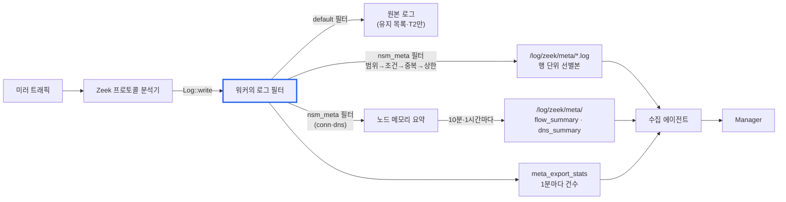

# 메타데이터 선별 전송 SRS (소프트웨어 요구사항 명세)

최종 수정: 2026-11-10 · 원본: 이 파일(`docs/SRS_METADATA_EXPORT.md`). 선별 전송 동작·설정을 바꾸는 PR에서 함께 고칩니다.

이 문서는 nsm_rules의 **메타데이터 선별 전송** 기능만 다룹니다. 탐지 룰·킬체인 상관·탐지 로그는 [탐지 SRS](SRS.md)에 있고, 설계 배경과 단계별 계획은 [개발 계획](METADATA_EXPORT_PLAN.md)에 있습니다. 기준은 main `b2c83fa`(PR #28·#29 반영)입니다.

## 1. 개요

### 1.1 목적

탐지가 나면 담당자는 "그 host가 앞뒤로 어디와 통신했는지, 어떤 계정으로 인증했는지"를 봐야 합니다. 탐지 룰이 없는 위협을 사후에 찾는 헌팅에도 프로토콜 메타데이터가 필요합니다. 그런데 Zeek가 만드는 로그를 전부 보내면 양이 너무 많습니다. 자산 식별 PoC가 운영 pcap으로 잰 값은 200초에 423.5MB, 하루로 치면 약 180GB 규모였습니다.

선별 전송은 **조사에 쓰는 메타데이터만 골라, 행과 필드를 줄여** 별도 경로에 남깁니다. 수집 에이전트가 그 경로를 Manager로 보냅니다.

### 1.2 범위

| 구분 | 포함 | 제외 |
| --- | --- | --- |
| 대상 로그 | Kerberos, NTLM, SMB 공유 연결, SMB 파일 변경, 주요 DCE-RPC, RDP, SSH, SSL, HTTP(행 단위) / conn, DNS(요약) / 센서 상태 | files, x509, weird 등 그 밖의 Zeek 로그 |
| 처리 | 범위 판정, 스트림별 조건, 필드 축소, 중복 억제, 분당 상한, 요약, 통계 | Manager로의 전송 자체(수집 에이전트 몫), Manager 저장·조회 |
| 탐지 로그 | 영향 없음(notice·nsm_detection·evidence는 탐지 SRS 범위) | |

### 1.3 대상 독자

- 센서 배포·운영 담당자: 3장(환경), 6장(설정), 9장(운영 절차)
- Manager·수집 에이전트 개발자: 5장(출력 명세)
- 룰·센서 개발자: 4장(기능), 7장(비기능), 8장(검증)

### 1.4 용어

| 용어 | 뜻 |
| --- | --- |
| T0 | 탐지 결과(notice, nsm_detection, evidence). 항상 기록되며 이 기능과 무관 |
| T1 선별 메타데이터 | 이 문서의 대상. 골라서 줄인 프로토콜 로그와 요약 로그 |
| T2 원본 | 줄이지 않은 Zeek 원본 로그. 선택 기능으로 센서 로컬에만 보관 |
| 스트림 | Zeek 로그 하나(예: `KRB::LOG` → kerberos) |
| 행 단위 전송 | 원본 행을 골라 필드만 줄여 그대로 쓰는 방식 |
| 요약 | 행을 쓰지 않고 노드 메모리에서 묶어 주기마다 한 행으로 쓰는 방식(conn, DNS) |
| 경계 연결 | 출발지와 목적지 중 하나만 내부망(`Site::local_nets`)인 연결 |
| 내부 관리 연결 | 내부 → 내부 연결 중 목적지 포트가 관리·인증 포트(`meta_admin_ports`)인 것 |
| 등록 도메인 | `www.a.example.co.kr` → `example.co.kr`처럼 공용 접미사 바로 위까지의 이름(`parent_domain`) |
| 노드 | Zeek 프로세스 하나. 단독 실행은 `zeek`, 클러스터는 worker-1 등 |

## 2. 시스템 구성



- Zeek 프로토콜 분석기는 탐지 룰 때문에 이미 돌고 있습니다. 선별 전송은 분석기가 로그를 쓸 때(`Log::write`) 필터를 하나 더 거치게 할 뿐, 새 분석을 하지 않습니다.
- 판정은 `Log::write`를 부른 노드에서 합니다. 클러스터에서는 워커입니다. 탈락한 행은 JSON 직렬화·로거 전송·디스크 쓰기를 하지 않습니다.

| 구성 요소 | 파일 | 역할 |
| --- | --- | --- |
| 선별 전송 모듈 | `nsm_rules/metadata/main.zeek` | 필터 설치, 판정, 요약, 통계 |
| 로그 필터 | `nsm_rules/rules/filter_log.zeek` | 유지 목록에 없는 스트림을 끔. 선별 대상은 `keep_enabled_streams`로 끄지 않음 |
| 로더 | `nsm_rules/__load__.zeek` | `metadata`를 설정 파일보다 먼저 로드(설정에서 `meta_*`를 바꿀 수 있도록) |
| 설정 | `nsm_config_fixed.zeek`(운영 공통), `nsm_config_custom.zeek`(고객별) | 6장 |
| 측정 도구 | `tests/measure_meta_export.sh` | 전송량·처리 시간 측정(8.2절) |

## 3. 운영 환경과 제약

| 항목 | 요구 | 비고 |
| --- | --- | --- |
| Zeek | 9.x(운영), 8.0.9에서도 동작 | CI가 두 버전에서 검사 |
| 내부망 설정 | `Site::local_nets` 필수 | 비어 있으면 경계·내부 판정이 틀어져 행이 과하게 빠지거나 남음 |
| 출력 경로 | `/log/zeek/meta/` 쓰기 가능, 수집 에이전트가 이 디렉터리를 읽음 | 기동 시 디렉터리 자동 생성(`create_log_dirs = T`) |
| 형식·회전 | JSON, 4시간 회전(Zeek 기본 회전 설정을 따름) | 에이전트와 맞춰 `Log::default_rotation_interval` 조정 |
| 내부 리졸버 | `NSM::dns_tunnel_resolvers`에 등록 권장 | 리졸버가 대신 묻는 질의를 DNS 요약에서 뺌 |
| 디스크(T2) | T2를 켜면 원본도 `/hdd_tmp/log/zeek/`에 씀 | 기본 끔 |
| 센서 위치 | 경계 로그(ssl·http·flow)는 인터넷 경계 구간, AD 로그는 DC·서버팜 구간이 미러에 있어야 함 | 미러에 없는 트래픽은 로그도 없음 |

## 4. 기능 요구사항

| ID | 요구사항 | 확인 |
| --- | --- | --- |
| FR-M1 | 선별 대상 스트림마다 `nsm_meta` 필터를 붙여 `meta_path_prefix + 이름`.log(JSON)로 쓴다 | `rules/meta-export` |
| FR-M2 | 필드는 스트림 설정의 `fields`에 있는 것만 쓴다 | `assert-fields` |
| FR-M3 | 행마다 ① 범위 ② 스트림별 조건 ③ (요약이면 묶고 끝) ④ 중복 억제 ⑤ 분당 상한 순으로 판정하고, 탈락하면 쓰지 않는다 | `rules/meta-export*` |
| FR-M4 | 범위는 연결 4-튜플로 판정한다: 전체 / 경계 / 내부 관리 / 경계 또는 내부 관리. 연결 정보가 없는 상태 로그는 범위와 무관하게 통과한다 | `rules/meta-export` |
| FR-M5 | 스트림별 조건: smb_files는 쓰기·이름 변경·삭제만, dce_rpc는 지정 인터페이스만, ssl·http는 예외 도메인(SNI·Host) 제외, dns는 빈 질의·역방향 조회·예외 도메인·내부 리졸버 출발지 제외 | `rules/meta-export`, `-summary` |
| FR-M6 | 중복 억제: 스트림별 키가 같은 행은 설정한 기간 동안 한 번만 쓴다. 노드별 상태다 | `rules/meta-export` |
| FR-M7 | 분당 상한: 노드·스트림별로 1분(로그를 쓰는 시각의 분 단위)에 쓸 최대 행 수를 넘으면 버린다 | `rules/meta-export-rate` |
| FR-M8 | conn은 `flow_summary`로, DNS는 `dns_summary`로 요약해 주기마다(10분·1시간) 쓴다. 종료 시에도 남은 요약을 쓴다 | `rules/meta-export-summary` |
| FR-M9 | DNS 요약은 등록 도메인 단위로 묶고, 출발지 하나가 주기마다 만드는 도메인 행이 상한을 넘으면 나머지를 `domain=(other)` 한 행에 더한다 | `rules/meta-export-summary` |
| FR-M10 | `meta_export_stats.log`에 노드·스트림별 보냄·탈락 사유별·요약 건수를 1분마다 쓴다. 경로는 선별 로그와 같은 `meta_path_prefix`를 따른다 | `rules/meta-export*` |
| FR-M11 | 유지 목록에 없는 선별 대상 스트림은 원본을 쓰지 않는다. T2를 켜면 원본을 `meta_raw_path_prefix + 이름`.log에 쓴다 | `rules/meta-export-off` |
| FR-M12 | `meta_export_enable = F`면 선별 로그·요약·통계를 쓰지 않고, 대상 스트림은 운영 필터대로 꺼진다 | `rules/meta-export-off` |
| FR-M13 | http는 URL 쿼리 문자열을 뺀 `uri_path`만 보낸다 | `rules/meta-export-summary`(쿼리 값이 선별 로그에 없음) |
| FR-M14 | 탐지 로그(notice·nsm_detection·evidence)는 이 기능의 켬·끔·상한과 무관하게 기록된다 | 전체 btest |
| FR-M15 | 클러스터에서 판정·요약은 워커에서 하고, 로거에는 통과한 행과 요약 행만 간다 | `cluster/meta-export-worker` |

### 4.1 스트림별 선별 규칙

| 출력 | 원본 | 범위 | 스트림별 조건 | 중복 억제 키 · 기간 |
| --- | --- | --- | --- | --- |
| kerberos | kerberos.log | 전체 | 없음 | 없음 |
| ntlm | ntlm.log | 전체 | 없음 | 없음 |
| smb_mapping | smb_mapping.log | 전체 | 없음 | (출발지, 목적지, 공유 경로) · 1시간 |
| smb_files | smb_files.log | 전체 | 동작이 쓰기·이름 변경·삭제 | (출발지, 목적지, 동작, 경로, 파일 이름) · 10분 |
| dce_rpc | dce_rpc.log | 전체 | 인터페이스가 `meta_dce_rpc_endpoints` | (출발지, 목적지, 인터페이스, 호출) · 10분 |
| rdp | rdp.log | 전체 | 없음 | 없음 |
| ssh | ssh.log | 전체 | 없음 | 없음 |
| ssl | ssl.log | 경계 | SNI가 예외 도메인이 아님 | (출발지, SNI, JA3) · 1시간 |
| http | http.log | 경계 | Host가 예외 도메인이 아님 | (출발지, Host, 메서드, 경로, 상태 코드) · 10분 |
| flow_summary | conn.log | 경계 또는 내부 관리 | 없음 | 요약(5.3절) |
| dns_summary | dns.log | 전체 | 빈 질의·역방향 조회(`.in-addr.arpa`, `.ip6.arpa`)·예외 도메인·내부 리졸버 출발지 제외 | 요약(5.4절) |
| capture_loss, stats, reporter | 같은 이름 | (연결 정보 없음) | 없음 | 없음 |

기본 인터페이스 목록(`meta_dce_rpc_endpoints`, Zeek `dce-rpc/consts.zeek`의 이름을 소문자로 비교):

| 인터페이스 | 보는 이유 |
| --- | --- |
| drsuapi | 디렉터리 복제(DCSync) |
| svcctl, atsvc, ITaskSchedulerService | 원격 서비스·예약 작업 생성(PsExec, schtasks) |
| winreg | 원격 레지스트리 |
| IRemoteSCMActivator | 원격 COM 객체 생성(DCOM, wmiexec 시작). ISystemActivator를 Zeek는 이 이름으로 기록 |
| IWbemLevel1Login, IWbemServices | 원격 WMI |
| samr, lsarpc | 계정·그룹 열거 |
| netlogon | Zerologon 등 |
| efsrpc | PetitPotam 강제 인증 |

## 5. 출력(로그) 명세

모든 출력은 JSON 한 줄에 한 행입니다. 시각(`ts`)은 epoch 초(소수점 포함)입니다. 값이 없는 필드는 쓰지 않습니다(JSON에 키가 없음). 경로는 `meta_path_prefix`(기본 `/log/zeek/meta/`) 뒤에 이름을 붙입니다.

| 파일 | 종류 | 기록 시점 |
| --- | --- | --- |
| kerberos, ntlm, smb_mapping, smb_files, dce_rpc, rdp, ssh, ssl, http | 행 단위 | 원본 로그가 쓰일 때 |
| flow_summary | 요약 | 10분마다, 키 상한 도달 시, 종료 시 |
| dns_summary | 요약 | 1시간마다, 키 상한 도달 시, 종료 시 |
| capture_loss, stats, reporter | 행 단위(센서 상태) | 원본과 같음 |
| meta_export_stats | 통계 | 1분마다, 종료 시 |

### 5.1 행 단위 로그 공통 필드

| 필드 | 형식 | 뜻 |
| --- | --- | --- |
| ts | 시각 | 원본 로그의 시각 |
| uid | 문자열 | 연결 ID. T2 원본이나 탐지 근거(evidence)와 조인 |
| id.orig_h, id.orig_p | 주소, 포트 | 출발지 |
| id.resp_h, id.resp_p | 주소, 포트 | 목적지 |

### 5.2 행 단위 로그별 필드

| 출력 | 필드(공통 필드 외) | 뜻 |
| --- | --- | --- |
| kerberos | request_type, client, service, success, error_msg, cipher | AS·TGS, 요청 계정, 서비스(SPN), 성공 여부, 오류 이름, 티켓 암호 |
| ntlm | username, domainname, hostname, success | 계정, 도메인, 단말 이름, 성공 여부 |
| smb_mapping | path, share_type | 공유 경로(`\\서버\공유`), 공유 종류 |
| smb_files | action, path, name, prev_name, size | 동작(`SMB::FILE_WRITE`·`FILE_RENAME`·`FILE_DELETE`), 공유 경로, 파일 이름, 이름 변경 전 이름, 크기 |
| dce_rpc | endpoint, operation | 인터페이스, 호출 이름 |
| rdp | cookie, security_protocol, result | 접속 계정 힌트(`mstshash`), 보안 프로토콜, 결과 |
| ssh | auth_success, auth_attempts, direction, client, server | 인증 성공, 시도 수, 방향, 클라이언트·서버 버전 문자열 |
| ssl | version, cipher, server_name, established, ja3 | TLS 버전, 암호, SNI, 핸드셰이크 완료, JA3 지문 |
| http | method, host, uri_path, status_code, user_agent, request_body_len, response_body_len | 메서드, Host, 쿼리를 뺀 경로, 상태 코드, User-Agent, 본문 길이 |

### 5.3 flow_summary

(출발지, 목적지, 목적지 포트)별로 10분 주기마다 한 행입니다.

| 필드 | 형식 | 뜻 |
| --- | --- | --- |
| ts, ts_end | 시각 | 주기 안 첫·마지막 연결의 시작 시각 |
| node | 문자열 | 기록한 노드 |
| orig_h, resp_h, resp_p, proto | 주소, 주소, 포트, 프로토콜 | 묶는 키 |
| service | 문자열 | 관측된 서비스(쉼표 구분, 예: `ssl`, `ntlm,gssapi,smb`) |
| conns | 수 | 연결 수 |
| orig_bytes, resp_bytes | 수 | 바이트 합(페이로드) |
| duration | 실수 | 연결 지속 시간 합(초) |
| states | 문자열 | 연결 상태별 건수(예: `SF:12,S0:3`) |
| sample_uid | 문자열 | 대표 연결 uid(첫 연결) |

### 5.4 dns_summary

(출발지, 등록 도메인, 질의 유형, 결과)별로 1시간 주기마다 한 행입니다.

| 필드 | 형식 | 뜻 |
| --- | --- | --- |
| ts, ts_end, node, orig_h | | flow_summary와 같음 |
| domain | 문자열 | 등록 도메인. 출발지 상한을 넘은 도메인은 `(other)` |
| qtype_name, rcode_name | 문자열 | 질의 유형(A, AAAA, TXT …), 결과(NOERROR, NXDOMAIN …) |
| queries | 수 | 질의 수 |
| unique_names | 수 | 고유 질의 이름 수(1000개까지 셈) |
| unique_names_capped | 참·거짓 | 1000개에 닿아 그 뒤는 세지 않았으면 참 |
| sample_names | 문자열 목록 | 처음 관측한 질의 이름(최대 5개) |
| answers | 문자열 목록 | 처음 관측한 응답(최대 5개) |
| sample_uid | 문자열 | 대표 uid |

### 5.5 meta_export_stats

노드·스트림별로 1분마다, 건수가 하나라도 있는 스트림만 씁니다. 다른 선별 로그와 같이 `meta_path_prefix`를 따르므로 기본 경로는 `/log/zeek/meta/meta_export_stats.log`이고, 접두어를 바꾸면 함께 옮겨 갑니다. `NSM::log_paths`에 `NSM::META_STATS_LOG` 경로를 직접 적으면 그 값이 우선합니다. 회전된 파일은 `meta_export_stats.<날짜-시각>.log`로 같은 디렉터리에 남습니다.

| 필드 | 뜻 |
| --- | --- |
| ts, node, stream | 시각, 노드, 스트림 출력 이름 |
| sent | 쓴 행 |
| dropped_scope | 범위 밖이라 뺀 행 |
| dropped_filter | 스트림별 조건(동작·인터페이스·예외 도메인 등)으로 뺀 행 |
| dropped_dedup | 중복 억제로 뺀 행 |
| dropped_rate | 분당 상한을 넘어 버린 행 |
| summarized | 요약으로 묶은 행 |

통계의 1분 구간은 기동 시점부터 잰 주기라 분당 상한의 분 경계(시각의 분 단위)와 맞지 않을 수 있습니다. 상한에 걸린 건수는 두 행에 나뉘어 보일 수 있습니다.

### 5.6 행 예시

```json
{"ts":1794182402.03,"uid":"Cq4cC54InF9kHckVU9","id.orig_h":"10.0.0.60","id.orig_p":62228,"id.resp_h":"10.0.0.10","id.resp_p":88,"request_type":"TGS","client":"user01/CORP.EXAMPLE","service":"MSSQLSvc/db01.corp.example:1433","success":true,"cipher":"rc4-hmac"}
{"ts":1794182421.003,"uid":"CZeZh24qKWTT7YYj8k","id.orig_h":"10.0.0.71","id.orig_p":47984,"id.resp_h":"93.184.215.131","id.resp_p":80,"method":"GET","host":"files.example-cdn.net","user_agent":"Mozilla/5.0","request_body_len":0,"response_body_len":2,"status_code":200,"uri_path":"/download/file.zip"}
{"ts":1794182429.495996,"ts_end":1794182431.607996,"node":"zeek","orig_h":"10.0.0.73","resp_h":"93.184.215.133","resp_p":443,"proto":"tcp","conns":3,"orig_bytes":0,"resp_bytes":0,"duration":0.162,"states":"SF:3","sample_uid":"CulwkK1OBoRoJvREY8"}
{"ts":1794182401.0,"ts_end":1794182405.0,"node":"zeek","orig_h":"10.0.0.70","domain":"example-news.com","qtype_name":"A","rcode_name":"NOERROR","queries":5,"unique_names":1,"unique_names_capped":false,"sample_names":["www.example-news.com"],"answers":["93.184.215.130"],"sample_uid":"CLJ78X3tH5SbVlPFH7"}
{"ts":1794182700.0,"node":"zeek","stream":"http","sent":1,"dropped_scope":1,"dropped_filter":1,"dropped_dedup":1,"dropped_rate":0,"summarized":0}
```

## 6. 설정 요구사항

### 6.1 설정 위치

모든 파라미터는 `NSM::` 접두어가 붙은 `&redef` 상수입니다. 기본값은 `metadata/main.zeek`에 있고, 운영 공통으로 바꿀 값은 `nsm_config_fixed.zeek`, 고객별 값은 배포 때 작성하는 `nsm_config_custom.zeek`에 `redef`로 적습니다. 나중에 로드되는 custom 값이 이깁니다.

### 6.2 파라미터

| 파라미터 | 기본값 | 의미 | 조정 가이드 |
| --- | --- | --- | --- |
| `meta_export_enable` | T | 기능 전체 토글 | 수집 에이전트가 없는 센서는 F |
| `meta_path_prefix` | `/log/zeek/meta/` | 출력 경로 앞부분(선별 로그·요약 로그·`meta_export_stats` 모두) | 에이전트가 읽는 디렉터리에 맞춤. 끝에 `/` 포함 |
| `meta_export_streams` | 4.1절 | 스트림별 설정 표(6.3절) | 스트림 추가·제거·상한 지정 |
| `meta_admin_ports` | 22, 88(tcp·udp), 135, 139, 389(tcp·udp), 445, 636, 3268, 3269, 3389, 5985, 5986 | 내부 관리 연결로 보는 목적지 포트 | 사내 관리 포트 `+=` |
| `meta_smb_file_actions` | 쓰기·이름 변경·삭제 | smb_files에서 남길 동작 | 읽기까지 남기면 양이 크게 늘어남 |
| `meta_dce_rpc_endpoints` | 4.1절 목록 | dce_rpc에서 남길 인터페이스(소문자) | `+=` |
| `meta_domain_allowlist` | 비어 있음 | ssl(SNI)·http(Host)·dns(질의)에서 뺄 도메인(접미사 일치, `example.com`이면 `a.example.com`도 포함) | OS·백신 업데이트, CDN, 텔레메트리 |
| `meta_dedup_max_entries` | 200000 | 중복 억제 테이블 항목 상한(노드당) | 넘으면 새 키는 억제하지 않고 보냄(누락보다 중복) |
| `meta_dedup_expire` | 1hr | 중복 억제 항목 보관 시간 | 가장 긴 `dedup`보다 길게 |
| `meta_flow_interval` | 10min | flow_summary 주기 | 짧으면 행이 늘고 지연이 줄어듦 |
| `meta_dns_interval` | 1hr | dns_summary 주기 | 위와 같음 |
| `meta_summary_max_keys` | 100000 | 요약 종류별 노드당 키 상한 | 넘으면 그 시점에 내보내고 새로 시작 |
| `meta_dns_max_domains_per_src` | 100 | 출발지별 주기당 DNS 도메인 행 상한 | 넘는 도메인은 `(other)` |
| `meta_dns_max_samples` / `meta_dns_max_answers` / `meta_dns_max_unique` | 5 / 5 / 1000 | 표본 이름 수, 응답 수, 고유 이름을 셀 최대 수 | |
| `meta_stats_interval` | 1min | 통계 주기 | |
| `meta_keep_raw_local` | F | T2: 선별 대상 원본도 로컬에 남김 | 디스크 여유가 있는 센서만 |
| `meta_raw_path_prefix` | `/hdd_tmp/log/zeek/` | T2 원본 경로 앞부분 | |
| `dns_tunnel_resolvers`(탐지 08과 공용) | 비어 있음 | 내부 재귀 리졸버. DNS 요약에서 출발지로 빼고 탐지 08에서도 뺌 | 배포 시 등록 권장 |

### 6.3 스트림 설정(`meta_export_streams`)

항목 하나는 다음 필드를 가집니다.

| 필드 | 기본값 | 뜻 |
| --- | --- | --- |
| `name` | (필수) | 출력 이름 |
| `fields` | 없음(전체 필드) | 남길 필드 이름 집합. 연결 4-튜플은 `id.orig_h`처럼 적음 |
| `scope` | `META_ALL` | `META_ALL`, `META_BOUNDARY`, `META_ADMIN_INTERNAL`, `META_BOUNDARY_OR_ADMIN` |
| `dedup` | 0secs(끔) | 중복 억제 기간. 키는 스트림마다 코드에 정해져 있음(4.1절) |
| `rate_limit` | 0(무제한) | 노드당 분당 최대 행 수 |
| `summary` | F | 요약 모드. conn·DNS만 지원 |

`+=`로 같은 키를 다시 넣으면 **항목 전체가 바뀝니다**. 적지 않은 필드는 기본값이 되므로, 기존 항목을 고칠 때는 코드의 항목을 그대로 옮겨 적고 필요한 값만 바꿉니다.

```zeek
# Kerberos 에 노드당 분당 5000행 상한 추가(fields 를 함께 적어야 필드 축소가 유지된다)
redef NSM::meta_export_streams += {
    [KRB::LOG] = [$name="kerberos", $rate_limit=5000,
                  $fields=set("ts", "uid", "id.orig_h", "id.orig_p", "id.resp_h", "id.resp_p",
                              "request_type", "client", "service", "success", "error_msg", "cipher")],
};

# RDP 를 선별 전송에서 빼기(값은 무시되지만 문법상 적어야 한다)
redef NSM::meta_export_streams -= { [RDP::LOG] = [$name="rdp"] };
```

새 스트림을 넣으려면 표에 항목을 추가하고, 범위·중복 억제·조건이 필요하면 `meta_extract` 함수에 그 로그 레코드 처리를 추가합니다. 추가하지 않으면 범위 판정 없이(전체) 필드 축소만 적용됩니다.

### 6.4 배포 설정 예시 (nsm_config_custom.zeek)

```zeek
# 내부망(필수)
redef Site::local_nets += { 10.0.0.0/8, 172.16.0.0/12, 192.168.0.0/16 };

# 내부 재귀 리졸버(DNS 요약에서 대신 묻는 질의 제외)
redef NSM::dns_tunnel_resolvers += { 10.0.0.53, 10.0.0.54 };

# 선별 전송에서 뺄 정상 도메인
redef NSM::meta_domain_allowlist += { "windowsupdate.com", "update.microsoft.com", "av-vendor.example" };

# 수집 에이전트가 다른 경로를 읽는 경우
# redef NSM::meta_path_prefix = "/data/zeek/meta/";

# 사내 관리 포트 추가(예: WSUS)
# redef NSM::meta_admin_ports += { 8530/tcp, 8531/tcp };
```

## 7. 비기능 요구사항

| ID | 구분 | 요구사항 | 확인 방법 |
| --- | --- | --- | --- |
| NFR-M1 | 전송량 | 운영 pcap 기준 선별 전송 합계가 Zeek 전체 로그 대비 5% 이하(목표) | `tests/measure_meta_export.sh`(8.2절). 운영 측정 대기 |
| NFR-M2 | 처리 부하 | 선별 전송 끔 대비 처리 시간 증가 5% 이하(목표) | 같은 스크립트 |
| NFR-M3 | 과부하 안전 | 분당 상한을 넘는 행은 버리고 건수를 남긴다. 버려도 탐지는 영향 없음 | `rules/meta-export-rate` |
| NFR-M4 | 메모리 상한 | 중복 억제 20만 항목, 요약 종류별 10만 키(노드당). 넘으면 억제를 멈추거나 즉시 내보내 메모리를 늘리지 않음 | 코드 |
| NFR-M5 | 패킷 단위 비용 없음 | 판정은 로그 행마다 한 번, 요약은 연결·질의 로그마다 한 번. 패킷 이벤트를 쓰지 않음 | 코드 |
| NFR-M6 | 클러스터 | 판정·중복 억제·상한·요약은 노드별. 같은 키가 워커 수만큼 중복될 수 있으며 Manager에서 합침 | `cluster/meta-export-worker` |
| NFR-M7 | 개인정보 | 계정 이름·URL 경로는 보냄. 인증 응답값, 비밀번호, URL 쿼리 문자열은 보내지 않음 | `rules/meta-export-summary` |
| NFR-M8 | 호환성 | Zeek 9.0.1·8.0.9에서 시작 시 새 경고·오류 없음 | CI 스모크 |
| NFR-M9 | 원본 스키마 | 원본 로그 레코드는 바꾸지 않는다. 예외: http.log에 `uri_path` 열 추가(원본을 남기는 환경에서만 보임) | 코드 |

## 8. 검증 요구사항

### 8.1 회귀 테스트

| 테스트 | pcap | 검증 내용 |
| --- | --- | --- |
| `rules/meta-export` | meta_export.pcap | 스트림별 출력, 허용 필드만 있는지(`assert-fields`), SMB 동작·RPC 인터페이스 조건, 중복 억제, conn 범위(테스트에서 행 단위로 바꿔 검사), 원본 미출력, 통계 |
| `rules/meta-export-rate` | meta_export.pcap | 분당 상한(32행 중 10행 기록, 22행 탈락 기록), 다른 스트림·원본은 영향 없음 |
| `rules/meta-export-off` | meta_export.pcap | 끔이면 선별 로그 없음·대상 스트림 꺼짐, T2를 켜면 원본이 전체 필드로 남음 |
| `rules/meta-export-summary` | meta_summary.pcap | ssl·http 경계·예외 도메인·중복 억제·`uri_path`, 쿼리 값 미포함, flow_summary 묶음·범위, dns_summary 묶음·제외 조건, 출발지별 도메인 상한(`(other)`) |
| `cluster/meta-export-worker` | (워커가 직접 행 기록) | 판정 위치가 워커(통계 node=worker-1), 로거에는 통과 행·요약만 |

CI는 Zeek 9.0.1과 8.0.9에서 위 테스트를 포함한 전체 btest를 돌립니다. 합성 pcap은 `tests/gen_pcaps.py`가 고정 시드로 만들고, CI가 재현성을 검사합니다.

### 8.2 전송량·부하 측정

```
tests/measure_meta_export.sh <pcap> [반복 횟수=3]
```

같은 pcap을 세 가지로 실행해 비교합니다.

| 실행 | 구성 |
| --- | --- |
| full | nsm_rules 없이 Zeek 기본 스크립트 + JSON 로그 전체 |
| off | nsm_rules, 선별 전송 끔 |
| on | nsm_rules, 선별 전송 켬 |

출력은 선별 로그별 바이트·행 수, Zeek 전체 로그 대비 비율, off 대비 on의 처리 시간 증가율(반복 중 최솟값 기준)입니다.

| 측정 | 결과 | 판단 |
| --- | --- | --- |
| 합성 pcap 25개 합본(9,806패킷) | 전체 로그 대비 20.15%, 처리 시간 7~11% 증가(절대값 약 0.1초) | 판단에 쓰지 않음. 공격 트래픽 비중이 커서 비율이 높고, pcap이 작아 고정 비용·오차가 큼 |
| 운영 미러 구간(1시간 이상, DC 구간 포함) | 대기 | NFR-M1·M2 판정 기준 |

## 9. 운영 절차

### 9.1 배포 체크리스트

1. `Site::local_nets`를 고객 내부망으로 설정합니다.
2. 내부 재귀 리졸버를 `dns_tunnel_resolvers`에 등록합니다.
3. 정상 대량 도메인(업데이트·백신·CDN)을 `meta_domain_allowlist`에 등록합니다.
4. 수집 에이전트가 `/log/zeek/meta/`(또는 바꾼 경로)를 읽도록 설정합니다.
5. 기동 후 `/log/zeek/meta/`에 로그 파일과 `meta_export_stats.log`가 생기는지 확인합니다.

### 9.2 모니터링

| 확인할 것 | 볼 곳 | 조치 |
| --- | --- | --- |
| 상한에 걸리는지 | `meta_export_stats.log`의 `dropped_rate > 0` | 상한을 올리거나 범위·예외 도메인을 조정 |
| 행이 너무 많이 빠지는지 | `dropped_scope`가 `sent`보다 훨씬 큼 | 정상(내부 트래픽이 많은 경우). 필요한 내부 트래픽이 빠지면 `meta_admin_ports` 추가 |
| DNS 요약이 큰지 | dns_summary의 `(other)` 행이 많은 출발지 | DGA 의심 또는 대량 조회 서버. 탐지 13(DGA) 결과와 함께 확인 |
| 센서 상태 | capture_loss, reporter | 캡처 손실·스크립트 오류 확인 |

### 9.3 문제 해결

| 증상 | 원인 | 확인·조치 |
| --- | --- | --- |
| `/log/zeek/meta`에 아무 로그가 없음 | 기능이 꺼짐, 디렉터리 권한, 대상 트래픽 없음 | `meta_export_enable`, 디렉터리 권한, `meta_export_stats.log`의 건수 |
| ssl·http·flow가 비어 있음 | `local_nets` 미설정 또는 센서가 경계 구간을 못 봄 | `dropped_scope` 건수, 미러 위치 |
| DNS 요약에 클라이언트가 아니라 리졸버만 보임(리졸버를 등록했다면 행이 거의 없음) | 센서가 리졸버 → 인터넷 구간만 봄 | 클라이언트 → 리졸버 구간 미러 추가 |
| 원본 conn.log·dns.log가 필요함 | 기본은 원본을 남기지 않음 | `meta_keep_raw_local = T`(T2) 또는 `keep_log_streams`에 추가 |
| http.log에 `uri_path` 열이 생김 | 선별 전송이 추가한 열 | 정상. 원본의 `uri`는 그대로 |

## 10. 알려진 한계와 향후 과제

| 한계 | 영향 | 대응·계획 |
| --- | --- | --- |
| 운영 전송량·CPU 미측정 | 예산(5%) 충족 여부 미확인 | 운영 pcap으로 8.2절 측정 후 주기·상한·예외 도메인 조정 |
| 중복 억제·상한·요약이 노드별 | 클러스터에서 워커 수만큼 중복 행 | Manager에서 합침(허용) |
| DGA처럼 도메인이 매번 바뀌는 출발지 | 출발지당 도메인 행 100개까지 나옴 | 상한 조정, `(other)` 행으로 확인 |
| flow_summary는 예외 도메인을 적용하지 못함 | conn에는 도메인 정보가 없어 업데이트 서버 흐름도 남음 | 필요하면 목적지 주소 예외 추가 검토 |
| 상태 로그 외에는 연결 정보가 있는 로그만 범위 판정 | 새 스트림은 `meta_extract`에 추가해야 범위·조건이 적용됨 | 6.3절 |
| 자산 식별 로그 미포함 | asset_signal이 선별 전송에 없음 | P4: 자산 식별 머지 후 추가 |
| OCSF 변환기 미연동 | 선별 로그를 SIEM 형식으로 보내지 못함 | P4: 변환기 입력 경로·매핑 추가 |
